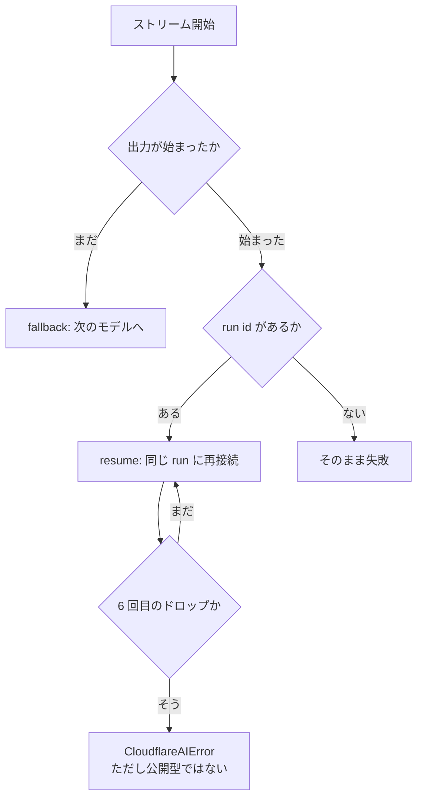

# Cloudflare AgentsのAI Providerが統合されたので検証してみる

> 落ちたら切り替わる、と思っていました。切り替わるのは、本文が 1 文字も出ていないうちだけでした。

## この記事の結論

Cloudflare Agents の `createAI` が持つ `fallback` を、偽の AI binding で 86 ケース、実機で 1 回測りました。**ストリームが壊れたときの守りは 3 層あり、一番外側の手当てだけが抜けていました。**

- **`fallback` は出力が始まるまで。** ツール名が届いた段階ならまだ切り替わり、本文が 1 文字出た時点で確定します
- **その先は `resume` が受け持つ。** ただしカタログモデルと dynamic route だけで、Workers AI には run id が無いので誰も守りません
- **`resume` が諦めたときのエラーは、ドキュメント通りに書くと拾えません。** 公開されている `CloudflareAIError` とは別のクラスが飛びます

| 壊れた場所 | 守る層 |
| --- | --- |
| 出力が始まる前 | `createAI` の `fallback` |
| ツール名だけ届いた | 同上。まだ間に合う |
| 本文が 1 文字出た後 | `fallback` は手を引く |
| 出力後・run id あり | AI Gateway の `resume` |
| 出力後・Workers AI | 誰も守らない |
| `resume` が尽きた | 誰も。しかもエラーが拾えない |

検証コードはこちらです: https://github.com/tanahiro2010/slides/tree/main/slides/slides/Cloudflare%20Agents%E3%81%AEAI%20Provider%E3%81%8C%E7%B5%B1%E5%90%88%E3%81%95%E3%82%8C%E3%81%9F/sandbox

そして、この記事で一番伝えたいことを先に書いておきます。

**`fallback` を 1 行書いた時点で、守られていると思ってはいけません。** 守備範囲は「モデルが口を開くまで」です。開いた後に壊れた場合は別の仕組みが引き継ぎ、その仕組みにも上限があり、上限に達したときのエラーは型が違っていて `catch` で拾えませんでした。最後の 1 件は Cloudflare に報告し、別の方が独立に再現して同じ修正に辿り着いています。

> この記事は LT「Cloudflare AgentsのAI Providerが統合されたので検証してみる」の内容に、発表で話しきれなかった計測と実装の読み解きを足したものです。対象は、Cloudflare Workers で LLM を呼んでいて `fallback` を書いている開発者です。

---

## 1. 何が統合されたのか

2026 年 10 月 21 日、Cloudflare が Agents SDK の AI Provider を `createAI` に一本化したと発表しました。旧 2 つは非推奨です。

これはレジストリから確認できます。

```sh
curl -s https://registry.npmjs.org/workers-ai-provider \
  | python3 -c "import json,sys; d=json.load(sys.stdin); lt=d['dist-tags']['latest']; \
print(lt, d['time'][lt][:10], repr(d['versions'][lt].get('deprecated')))"
```

```
4.0.1 2026-10-20 'Deprecated. Use createAI from agents/models/ai-sdk...'
```

`createAI` は 4 通りのモデル指定を受け付けます。`@cf/` で始まる Workers AI のモデル、`<author>/<model>` の形をした AI Gateway カタログのモデル、`dynamic/` で始まる dynamic route、ベンダー製パッケージが作るモデルオブジェクトです。

そして `fallback` が 1 行で書けるようになりました。

```ts
const result = await generateText({
  model: ai("@cf/zai-org/glm-4.7-flash", {
    fallback: ["anthropic/claude-opus-5.5"],
  }),
  prompt: "Hello",
});
```

便利です。ただ、ここで引っかかりました。**「落ちたら」って、どこからでしょうか。**

ストリーミングだと、途中まで文章が出てから切れます。そのとき切り替わるのか。切り替わらないのか。ドキュメントにはこうあります。

> A request that the vendor rejects falls back. So does a stream that fails before its first output part.

「first output part」がどこを指すのかは書いてありません。

### 脇道：「統合」には移植されなかった機能がある

本筋から外れますが、1 つだけ。Issue #2569 が移行チェックリストになっていて、2 項目に取り消し線が引かれています。サーバーサイドの `fallback` と `safePrompt` です。

前者の理由は「Universal Endpoint の機能だったから」でした。旧 `createAiGateway([a, b])` は 1 リクエストを投げて Gateway 側がモデルを選んでいましたが、`createAI` の `fallback` は Worker 内でモデルごとに 1 リクエストずつ投げます。投げる数が変わります。

脇道はここまでです。

## 2. 偽の binding で測る

境界を測るなら、狙った位置でストリームを切れないと話になりません。本物のモデルではできません。

そこで `createAI` が `binding` に何を要求しているのかを読みました。`models/core/transport.ts` を見ると、必要なのは 3 つだけです。`run(model, input, options)` が `Response` を返すこと、`fetch(url, init)` が `Response` を返すこと、`aiGatewayLogId` プロパティを持つこと。

つまり偽物を渡せば動きます。

```ts
const binding = {
  aiGatewayLogId: "01LOGID",
  async fetch() { return new Response("gone", { status: 404 }); },
  async run(model, input, options) {
    return new Response(sseBody, {
      headers: { "content-type": "text/event-stream" },
    });
  },
};
const ai = createAI({ binding: binding as never });
```

これで `fallback` の状態機械がローカルで動きます。アカウントも課金も要りません。

肝心なのは本文の作り方です。チャンクを 1 つずつ `pull` で出し、尽きたところでエラーにします。

```ts
function dropAfter(chunks: Chunk[]): ReadableStream<Uint8Array> {
  const enc = new TextEncoder();
  let i = 0;
  return new ReadableStream({
    pull(controller) {
      if (i < chunks.length) {
        controller.enqueue(enc.encode(`data: ${JSON.stringify(chunks[i++])}\n\n`));
        return;
      }
      controller.error(new Error("connection dropped"));
    },
  });
}
```

`chunks` に何を渡すかで、切れる位置が決まります。`{ choices: [{ delta: { content: "h" } }] }` を入れれば本文が 1 文字出てから切れ、`{ choices: [{ delta: { tool_calls: [{ function: { name: "x", arguments: "" } }] } }] }` を入れればツール名だけ出てから切れます。この差が、そのまま次の節の表になります。

実装を読むのに使った手も書いておきます。`agents` は `dist` に sourcemap を同梱していて、`sourcesContent` に元の TypeScript が丸ごと入っています。

```sh
curl -sL https://registry.npmjs.org/agents/-/agents-0.30.0.tgz -o agents.tgz
tar -xzf agents.tgz -C pkg
python3 -c "
import json
m = json.load(open('pkg/package/dist/ai-sdk-DRPh2rRa.js.map'))
for i, s in enumerate(m['sources']):
    open(s.split('/')[-1], 'w').write(m['sourcesContent'][i])
"
```

GitHub を読むより確実です。**実際に npm から配られている版**のソースが出てきます。

なお、この偽 binding という手口は後から Cloudflare の公式テストでも使われていると分かりました。`packages/agents/src/tests/models/ai-sdk/fallback-and-errors.test.ts` が同じことをしています。

## 3. fallback の境界

### 計測：切る位置だけを変える

primary を「指定位置まで流して接続断」、fallback を「正常に答える」に固定し、**切断する位置だけ**を動かしました。

| 切断した位置 | fallback |
| --- | --- |
| 何も出さずに切断 | する |
| `response-metadata` のみ | する |
| ツール名だけ（`tool-input-start`） | する |
| ツールの引数が出た | しない |
| `reasoning-delta` まで | しない |
| 本文 1 文字（`text-delta`） | しない |

ツール名までなら間に合い、本文が 1 文字出たら手遅れでした。

`fallback` が起きたとき、落ちたモデルのパートは利用者に 1 つも届きません。答えたモデルのプリアンブルに丸ごと差し替わります。途中まで出た文章が残って、その後ろに別のモデルの答えが続く、ということにはなりません。

この結果は 2 つの失敗モードで確かめました。接続が切れる場合と、SSE の中に `error` が載る場合です。実装上は別の分岐を通ります。モデル ID も本文も変えました。線は同じでした。

### 考察：なぜそこが境界なのか

実装に `PREAMBLE_PARTS` という集合があります。

```ts
const PREAMBLE_PARTS = new Set([
  "stream-start",
  "response-metadata",
  "text-start",
  "reasoning-start",
  "tool-input-start",
  "raw"
]);
```

「ここまでなら、まだ何も出力していない」という判定です。6 種類あります。

ところが chat-completions の wire を読むと、**6 種類のうち単独で出せるのは 3 つだけ**でした。

```ts
const content = text(delta.content);
if (content !== undefined && content !== "") {
  if (textId === undefined) {
    controller.enqueue({ id: textId, type: "text-start" });   // ← 続けて
  }
  controller.enqueue({ delta: content, id: textId, type: "text-delta" });
}
```

空文字が弾かれるので、`text-start` の直後には必ず `text-delta` が続きます。`reasoning-start` も `reasoning-delta` と対です。

一方、ツール呼び出しは引数のガードが別になっています。

```ts
if (input !== undefined && input !== "") {
  controller.enqueue({ delta: input, id: state.id, type: "tool-input-delta" });
}
```

名前だけ届いて引数が空なら、`tool-input-start` が単独で出ます。だからここが、切り替われる最後の地点になります。

並べるとこうなります。

| preamble パート | 単独で出せるか | 理由 |
| --- | --- | --- |
| `stream-start` | 出せる | 先頭に 1 つ出る |
| `response-metadata` | 出せる | 最初のチャンクの id と model から出る |
| `text-start` | **出せない** | `text-delta` と同じチャンクから続けて出る |
| `reasoning-start` | **出せない** | `reasoning-delta` と対で出る |
| `tool-input-start` | 出せる | 引数が空なら `tool-input-delta` が出ない |
| `raw` | 出せる | `includeRawChunks` を立てたときだけ |

6 つのうち 2 つは、この wire では到達できません。集合の定義を読むだけだと「`text-start` の後もまだ間に合う」と読めてしまいますが、実際には試せません。

`text-start` が集合に入っているのは、ベンダーのモデルオブジェクト向けと読めます。Anthropic の provider は `content_block_start` と `content_block_delta` を別のイベントで出すので、そちらなら単独で到達できるはずです。ただしベンダーモデルでは測っていないので、ここは実装の読みに留まります。

公式テストは「出力前」と「出力後」の 2 つしか試していません。ツール名だけの状態は扱われていません。

## 4. 出力が始まった後は resume が受け持つ

`fallback` が手を引いた後、何も無いわけではありません。

`AAA` まで流して切断し、再接続して `BBB` を受け取ると、利用者が手にするのは `AAABBB` です。取りこぼしも重複もありません。そしてこのとき **`fallback` は 1 度も呼ばれません**。

重複しない理由は、再接続の単位が SSE イベントだからです。実装のコメントにこうあります。

> The one subtlety is alignment. `from` counts complete SSE events, so the wrapper only ever passes complete events on and holds back a trailing partial one. After a drop the partial is discarded and the replay starts at the count of events already delivered: no byte is duplicated or lost.

完全なイベントだけを下流に渡し、途中まで届いたイベントは握っておく。切れたらその半端な分を捨てて、すでに渡した個数から再開する、という作りです。

実際に偽 binding で `fetch` の URL を記録すると、渡した個数がそのまま `from=` に乗っているのが見えます。イベントを 2 つ流して切れば `?from=2`、3 つなら `?from=3` でした。

役割が分かれています。`fallback` は「開けなかったとき」。`resume` は「開いた後に壊れたとき」です。

ただし `resume` は `cf-aig-run-id` ヘッダが無いと働きません。実機で確かめたところ、**Workers AI のストリームには run id が付きませんでした**。守備範囲はカタログモデルと dynamic route だけです。

実機の値も出しておきます。`wrangler dev --remote` で `@cf/meta/llama-3.2-1b-instruct` を 1 回叩いた結果です。

| 項目 | 値 |
| --- | --- |
| 最初のパートまで | 328 ms |
| パート数 | 32 |
| `providerMetadata.cloudflare` のキー | 8 個 |
| `runId` | 載らない |
| `provider` | 載らない |

載っていたキーは `cacheStatus` / `eventId` / `gateway` / `logId` / `model` / `requestId` / `step` / `traceId` です。1 回しか測っていないので、328 ms は分布ではなく 1 本ぶんの値として読んでください。

### ハマりポイント①：対照が通らない回の観測は捨てる

実機の 1 回目は、先頭 2 件が 500 で落ちました。`provider-error`、`isRetryable: true` です。後続のリクエストは通っていたので、立ち上がりの一時的な失敗だと思います。

このとき、後続の結果だけ拾いたくなります。やめました。先頭の正常系が通っていない回は、その後の観測が何に対する値なのか言えません。Worker を直して測り直し、先頭と末尾の両方で正常系が通った回の結果だけを採用しています。

## 5. resume の限界と、拾えないエラー

`resume` 側も毎回落とすようにして数えたところ、**5 回で諦めました**。

実装の定数は `resumableBody` の `options.maxReconnects ?? 5` です。ソースのコメントには「Reconnects allowed before giving up. Defaults to 5.」とあります。公開オプションには無いので、呼び出し側から変えることはできません。

諦めたときのメッセージはこうなります。

```
The stream dropped 6 times; giving up at event 7.
```

ドキュメントは「after five drops」と書いていますが、実際はドロップ 5 回を生き延びて 6 回目で落ちます。

そして、ここからが本題です。ドキュメントはこう約束しています。

> The provider throws `CloudflareAIError`, which extends the AI SDK's `APICallError`, for Workers AI failures, AI Gateway failures, **failed stream resumes**, and a fallback chain where every model failed.

同じ import、同じ `streamText` で、失敗のさせ方だけを変えて比べました。

| | 通常の失敗 | `resume` の失敗 |
| --- | --- | --- |
| `e.name` | `CloudflareAIError` | `CloudflareAIError` |
| `instanceof CloudflareAIError` | `true` | **`false`** |
| `APICallError.isInstance()` | `true` | **`false`** |
| `code` / `status` | 正しい | 正しい（`provider-error` / 404） |

名前が同じで、型だけが違います。**ログでは気づけません。**

原因は、同じ名前のクラスが 2 つあることでした。`models/core/errors.ts` の方は `extends Error` で、公開されていません。`models/ai-sdk/errors.ts` の方は `extends APICallError` で、こちらが公開されています。そして `core/resume.ts` は前者を import しています。

```ts
import { CloudflareAIError } from "./errors";
```

しかもそのエラーを投げるのは、`run()` が返った**後**、利用者がストリームを読んでいる最中です。`run()` の `catch` に置かれた変換は、その時点ではもう通り過ぎています。

```ts
async run(request) {
  try {
    return await inner.run(request);   // レスポンスが来た時点で解決する
  } catch (error) {
    throw toAISDKError(error);         // body 読み出し中の失敗は見えない
  }
},
```

この関数の doc コメントには「with every failure lifted into the AI SDK error type」と書かれています。その約束から、ストリームを読んでいる最中の失敗だけが漏れていました。

困るのは 2 つです。ドキュメントのサンプル通りに `instanceof` で分岐すると、`resume` の失敗だけ素通りします。`APICallError` でもないので、AI SDK の retry ループが `isRetryable` を読めません。

セキュリティの問題でも可用性の問題でもありません。エラーの分類が取れないだけです。

## 6. なぜ誰も気づかなかったか

公式テストが**内部クラスを import している**からです。

```ts
import { CloudflareAIError } from "../../../models/core/errors";
```

投げられているのはまさにそのクラスです。`toBeInstanceOf` は常に通ります。公開 API としての契約を見ているテストが、1 つもありません。

これは Cloudflare に限った話ではないはずです。**内部実装を import したテストは、公開 API の約束を守りません。** 自分のコードでも起こります。

ついでに書くと、設計 RFC（リポジトリ内の `design/rfc-workers-ai-gateway-merge.md`）と出荷版にも差がありました。RFC は `layer` / `transport` / `index` / `startedAt` を持つ attempt tree を設計していましたが、出荷されたのは `{ model, error }` の 2 フィールドだけです。「デバッグで一番聞かれるのはどの層が再試行したかだ」と書いて設計された構造が、2 フィールドの配列になって出ています。

## 7. streamRetries を足すと

AI SDK v7 に `streamRetries` があります。既定は 0 で、省略すると stream retry そのものが無効になります。「出力が始まった**後**のプロバイダーエラーを再試行する」オプションです。

`createAI` のドキュメントと AI SDK のドキュメントは、互いにこのオプションに触れていません。重なり方は測るしかありませんでした。

primary を「本文を出してから error」に固定して測りました。

| `streamRetries` | primary 呼び出し | 利用者が見たテキスト | `res.text` |
| --- | ---: | --- | --- |
| 省略 | 1 | `PARTIAL-` | `PARTIAL-` |
| `1` | 2 | `PARTIAL-PARTIAL-` | `PARTIAL-` |
| `2` | 3 | `PARTIAL-PARTIAL-PARTIAL-` | `PARTIAL-` |

部分出力が、別の id を持つ新しいテキストブロックとして流れます。

```
text-start id=03b4d183… → text-delta "PARTIAL-" → text-end
text-start id=a8c81696… → text-delta "PARTIAL-" → text-end
text-start id=101d4351… → text-delta "PARTIAL-" → text-end
```

`res.text` は 1 つ分しか返しません。つまり **`res.text` を読む実装と `fullStream` を UI に流す実装で、見えるものが違います。** UI に流していると、同じ文章が繰り返し画面に出ます。

なお再試行しても `fallback` には届きません。primary がストリームを開けてしまうので、毎回 primary に確定するからです。「出力後の答えは最終」というドキュメントの記述は、上のレイヤーを足しても破れませんでした。

## 8. 実運用で効く数値

Retry は `fallback` チェーンの**外側**にあります。

| 構成 | 総リクエスト数 |
| --- | ---: |
| 2 本チェーン / `maxRetries: 0` | 2 |
| 2 本チェーン / `maxRetries: 2`（既定） | 6 |
| 3 段の入れ子 / `maxRetries: 2` | 9 |

チェーンの長さ ×（1 + `maxRetries`）です。`maxRetries` の既定は 2 なので、何も指定しないと 3 倍になります。

入れ子の `fallback` は展開されます。ここは予想が外れました。最初は「leg の `fallback` は無視されるはず」と書いていたのですが、測ったら `P → F → F2` と 3 段とも試されていました。leg が自分で持つ `fallback` は保持され、呼び出し時に渡したものだけが剥がされます。

404 は `fallback` しますが retry はしません。判定の基準が別だからです。`fallback` は abort 以外のすべてで次に進み、retry は `isRetryable` だけを見ます。

その `isRetryable` の境目も測りました。

| ステータス | `isRetryable` |
| ---: | --- |
| 400 / 401 / 403 / 404 / 422 | `false` |
| 408 / 409 / 429 / 500 / 503 | `true` |

ステータスが付かない失敗（接続断など）も `true` です。実装では `status === undefined` を transport レベルの障害とみなしています。

**abort だけは別扱いです。** `AbortSignal` で中断すると、`fallback` は次のモデルに進まずそのまま throw します。利用者が画面を閉じたのに裏で別のモデルに課金される、という事故にはなりません。対照として、abort ではない例外を投げると `fallback` は普通に進みました。

もう 1 つ、設定の合流で踏みやすいところがあります。`fallback` をモデル側と呼び出し側の両方に書くと、**呼び出し側が置き換えます**。連結ではありません。

```ts
const model = ai(P, { fallback: [F] });           // モデル側は F
await generateText({
  model,
  providerOptions: { cloudflare: { fallback: [F2] } },  // 呼び出し側は F2
});
// 実際に試されたのは P → F2。F は 1 度も呼ばれない
```

空配列を渡した場合は未指定と同じ扱いで、`attempts` も入りませんでした。

`attempts` は `fallback` を設定していないと `undefined` です。ドキュメントのサンプルには条件なしで「lists every fallback model that failed」と書かれていますが、Cloudflare 自身のテストが `expect(error.attempts).toBeUndefined()` を期待しています。

実機では「存在しないモデル」の `code` が 2 つに割れました。

| 入力 | status | `code` |
| --- | ---: | --- |
| `@cf/nope/does-not-exist` | 400 | `bad-request` |
| `nope/not-a-real-model` | 404 | `not-found` |

`code === "not-found"` でモデル ID の打ち間違いを拾おうとすると、`@cf/` の打ち間違いだけがすり抜けます。

### ハマりポイント②：ドキュメントを疑って、外した

`peerDependencies` は `"ai": "^6.0.0 || ^7.0.0"` ですが、ドキュメントは「The provider needs `ai@^7`」と書いています。食い違っているので、最初はドキュメントが古いのだと思いました。

直す前に `ai@6` を入れて動かしました。

```
ai: 6.0.312 | @ai-sdk/provider: 4.0.31 | agents: 0.30.0
UnsupportedModelVersionError: Unsupported model version v4 for provider "cloudflare"
```

逆でした。`ai@6` は `@ai-sdk/provider@3` を直接依存で抱えているので、トップレベルに v4 を置いても関係ありません。ドキュメントが正しく、`package.json` の範囲が広すぎたということです。

入れても peer の警告は出ません。最初の `generateText` で落ちます。

## 9. 報告して、どうなったか

見つけたものは報告しました。

| | 内容 |
| --- | --- |
| [agents#2687](https://github.com/cloudflare/agents/issues/2687) | `resume` のエラー型 |
| [agents#2690](https://github.com/cloudflare/agents/issues/2690) | `ai` の peer range |
| [cloudflare-docs#34546](https://github.com/cloudflare/cloudflare-docs/pull/34546) | 再接続回数と `attempts` の記述 |

`agents` は pull request をコラボレーターに限定しています。Issue に修正ブランチのリンクを添える形にしました。

翌日、#2687 に別の方から再現報告が付きました。原因の特定も修正方針も、こちらが出したものと一致しています。`createTransport().run()` でレスポンスの body を包み、読み出し中のエラーを `toAISDKError` に通す、という形です。

> the AI SDK boundary only converts synchronous failures: `createTransport`'s try/catch in `models/ai-sdk/transport.ts` has already returned by the time the stream errors on a later read.

別経路で同じ場所に辿り着いているので、読み違いではなさそうです。

この方は core 側の設計意図も引いていました。`models/core/errors.ts` には「framework modules wrap it into their own error type at their boundary」と書かれています。つまり core が framework 中立のエラーを投げるのは設計通りで、抜けているのは境界側の変換だけ、という整理です。直す場所が core ではなく `models/ai-sdk/transport.ts` だという判断も、ここから出ています。

ついでに観測した話を 1 つ。このリポジトリには報告を確認して PR を出すボットがいます。別件で出した Issue では、確認コメントが付いた数時間後に修正 PR が立ちました。すべての報告がそうなるとは限りませんが、ファイルと行が特定できている報告は動きが早いようです。

## 10. まとめ

`fallback` を 1 行書いて安心していました。測ってみると、守備範囲は「モデルが口を開くまで」でした。




- ツール名が届いた段階なら、まだ別のモデルに切り替わります
- 本文が 1 文字出たら、もう切り替わりません
- その先は `resume` が引き継ぎますが、Workers AI では働きません
- `resume` は 5 回で諦めます。その回数は変えられません
- 諦めたときのエラーは、ドキュメント通りに `instanceof` で書くと拾えません

測れなかったものも書いておきます。429 と 401 は無料枠では起こせず、分類は偽 binding でしか確認していません。Gateway 側の `retries` が実際に何回投げたかは、RFC によると設計上クライアントからは観測できません。カタログモデルでの `metadata.model` と `response.modelId` のズレは、Unified Billing を使わなかったので未確認です。

偽の binding を 1 つ書くだけで、ここまで測れます。50 行ほどのオブジェクトです。自分が使っている SDK で同じことをすれば、ドキュメントに書いていない境界が出てくるはずです。

### 参考

- [Agents — Models](https://developers.cloudflare.com/agents/models/) — `createAI` が受け付ける 4 種類のモデル指定
- [Agents — AI SDK provider](https://developers.cloudflare.com/agents/models/ai-sdk/) — `fallback` / `resume` / エラー型の記述。この記事が突き合わせた相手
- [createAI replaces workers-ai-provider and ai-gateway-provider](https://developers.cloudflare.com/changelog/post/2026-10-21-createai/) — 移行表と非推奨の告知
- [cloudflare/agents#2569](https://github.com/cloudflare/agents/issues/2569) — 移行チェックリスト。移植しなかった機能に取り消し線が引いてある
- [cloudflare/agents#2576](https://github.com/cloudflare/agents/pull/2576) — Universal Endpoint をコアから削除した PR
- [AI Gateway — Fallbacks](https://developers.cloudflare.com/ai-gateway/configuration/fallbacks/) — Gateway 側の fallback。`createAI` からは使えない
