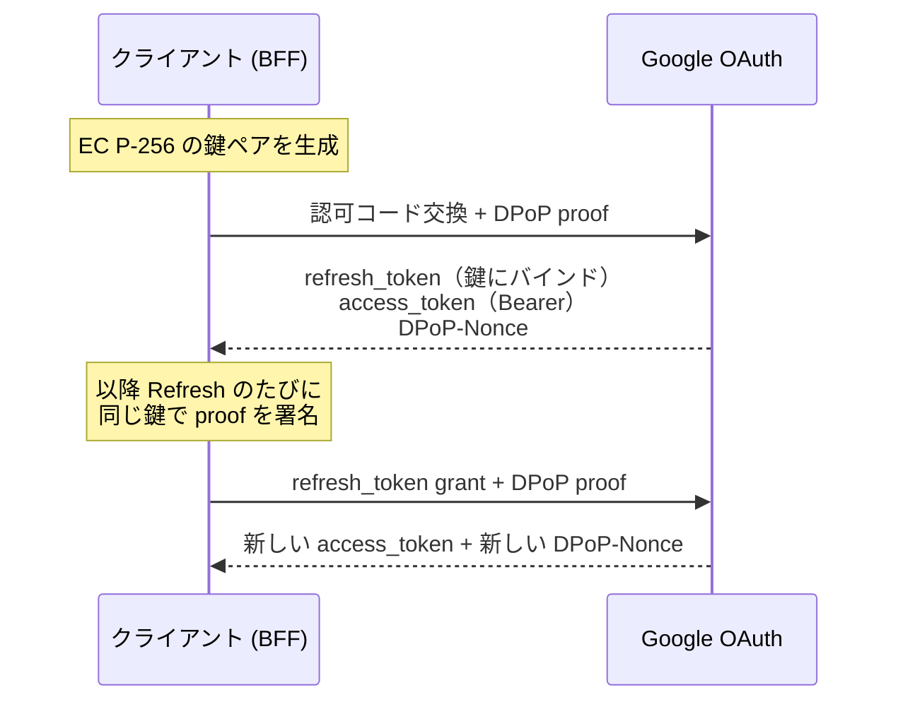
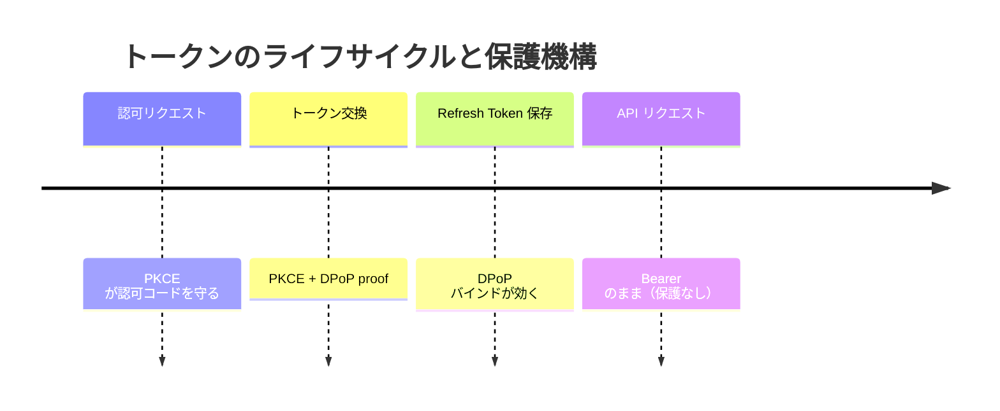

# Google OAuthがDPoPに対応したらしいので検証してみる

> DPoP に対応したらしい。……と聞いて調べ始めたら、話が思っていたのと違いました。

## この記事の結論

Google OAuth の Refresh Token を DPoP で鍵にバインドする仕組みを、公式ドキュメント・RFC 9449・自分の計測・実際のトークン交換の 4 方向から検証しました。**公式ブログの日付も、公式サンプルのコードも、公式ドキュメント同士も、そのまま信じると間違える場所がありました。**

- **「2026-10-15 に対応」は不正確。** ドキュメントの改版を追うと、実装は 5 月には動いていました
- **公式サンプルの proof は署名が壊れていた。** Refresh のサンプルは JWS が要求する形式になっていません
- **公式ドキュメント同士が矛盾していた。** Nonce の持ち越し可否が、新旧のドキュメントで逆のことを書いています
- **"used only once" と書かれた Nonce は、何度でも使えた。** 捕捉した proof は約 1 時間そのまま再利用できます。Google に報告しましたが、実害は限定的として Won't Fix でした

実測した環境です。

| 項目 | 値 |
| --- | --- |
| 検証日 | 2026-10-19 |
| Node.js | v24.22.0 |
| `jose` | 6.2.12 |
| `hono` | 4.13.13 |
| マシン | Apple M4 (arm64) |

実装はこちらです: https://github.com/tanahiro2010/slides/tree/main/slides/slides/Google%20OAuth%E3%81%8CDPoP%E3%81%AB%E5%AF%BE%E5%BF%9C%E3%81%97%E3%81%9F%E3%82%89%E3%81%97%E3%81%84%E3%81%AE%E3%81%A7%E6%A4%9C%E8%A8%BC%E3%81%97%E3%81%A6%E3%81%BF%E3%82%8B/sandbox

そして、この記事で一番伝えたいことを先に書いておきます。

**DPoP が守るのは「盗まれた Refresh Token 単体の再利用」だけで、それ以上でも以下でもありません。** Access Token は Bearer のまま、ブラウザの Cookie も対象外です。しかも後述するように、Node.js のサーバーでは秘密鍵を結局どこかに保存することになり、その時点で守備範囲はさらに狭くなります。「DPoP を入れた」と「安全になった」は別の話です。

> この記事は LT「Google OAuthがDPoPに対応したらしいので検証してみる」の内容に、発表で話しきれなかった計測と考察を足したものです。対象は、Google API 連携で Refresh Token をサーバーに保存している開発者です。

---

## 1. そもそも DPoP とは ―― 新しい技術ではない

DPoP（Demonstrating Proof-of-Possession）は RFC 9449 で標準化された OAuth 2.0 のセキュリティプロファイルです。2023 年 9 月に Proposed Standard になっていて、Okta や FusionAuth はずっと前から対応しています。新しいのは **Google が対応したこと**だけで、DPoP 自体は新登場ではありません。

通常の Bearer Token は、Google のブログの表現を借りると "finders-keepers model" です。拾った人が使えてしまう。ブログは想定脅威として Infostealer マルウェア（RedLine、NodeStealer）と Adversary-in-the-Middle（AiTM）攻撃を名指ししています。

DPoP はこれを「送信者拘束（sender-constraining）」で防ぎます。

- クライアントが鍵ペアを生成し、**秘密鍵を自分だけが持つ**
- トークンエンドポイントへのリクエストごとに、秘密鍵で署名した JWT（DPoP proof）を添える
- サーバーはトークンを**公開鍵に紐づけて**発行する



同じ送信者拘束でも、mTLS（RFC 8705）との違いはブログが明確に書いています。

> Unlike transport-layer token binding (e.g., mTLS/RFC 8705) which often breaks or terminates at modern cloud proxies and load balancers, DPoP operates at the HTTP header level.

トランスポート層の拘束はロードバランサやプロキシで切れてしまいますが、DPoP は HTTP ヘッダー層で動くので多段構成に強い、という主張です。

## 2. 「10 月に対応した」は不正確だった

Google Developers Blog で DPoP 対応が発表されたのは 2026-10-15 です。ですが、これを「対応日」と読むと間違えます。

Wayback Machine で公式ドキュメントの改版を追ってみました。

| 日付 | 出来事 |
| --- | --- |
| 2026-04-15 | Best Practices に DPoP の記述は**ゼロ** |
| **2026-05-20** | Best Practices に "Sender-constrain tokens with DPoP" が**登場** |
| 2026-07-31 | DPoP Adoption Guide の最終更新 |
| 2026-09-04 | `google/skills` に公式の DPoP SKILL.md が commit |
| **2026-10-15** | Developers Blog で発表 |
| 2026-10-16 | web-server doc が DPoP 対応で更新 |

ドキュメント上は、少なくとも 5 月には対応が入っていたことになります。発表はその約 5 ヶ月後です。「Google が隠していた」という話ではありません。**公式ブログの日付は、機能のリリース日とは限らない**という、ただそれだけの話です。新機能を追いかけるときに地味に効く教訓だと思います。

## 3. 何を防ぎ、何を防がないのか

ここを曖昧にすると記事全体が嘘になるので、丁寧に書きます。

**防げるもの:**

- Refresh Token **単体**が漏えいしたときの再利用。DB ダンプ、ログ流出、バックアップ流出、Infostealer がトークンだけ抜いていったケース

**防げないもの:**

- **Access Token の漏えい。** Google の Access Token は Bearer のままなので、有効期限内は使われます
- **秘密鍵と Refresh Token が両方漏れたケース。** 同じ DB に入れていれば一緒に漏れます
- **ブラウザのセッション Cookie の窃取。** ブログが明確に対象外と書いています
- **認可コードの横取り。** これは PKCE の仕事です

Cookie を守らないことは、ブログがはっきり書いています。

> DPoP does not protect standard web application session cookies, which remain a primary target for Infostealer malware.

その対策として Google と WICG は DBSC（Device Bound Session Credentials）を開発中とのことです。DPoP がアプリケーション層で API トークンを守り、DBSC がブラウザ層で Cookie を TPM に縛る。両方揃って初めて defense-in-depth になる、という構図です。

PKCE との役割分担も混同しがちですが、別物です。



PKCE はリダイレクト中の認可コードを守り、DPoP は発行後の Refresh Token を守ります。片方がもう片方を置き換えるわけではなく、**両方やる**のが正解です。

## 4. Google 固有の仕様 ―― RFC とズレている 3 箇所

DPoP は RFC 9449 で標準化されていますが、オプション部分の判断は各認可サーバーに委ねられています。Google の実装は RFC の一般仕様と何箇所かズレていて、ここを知らずに実装すると詰まります。

**ズレ①：Access Token は Bearer のまま。** RFC 9449 §5 は `token_type` に `DPoP` を MUST としていますが、web-server doc は「`token_type` は DPoP を使っても常に `Bearer`」と明言しています。ただしこれは RFC 違反ではなく、RFC 側に逃げ道があります。public client が Refresh Token も受け取る場合、「Refresh Token だけをバインドする」ことで、保護リソース側を DPoP 対応にしなくてもセキュリティを上げられる、と RFC 自身が許容しています。Google の理由はブログによると性能で、高 QPS の API で毎回非対称署名を検証するコストを避けたい、とのことです（この主張は §8 で実測します）。

**ズレ②：認可コード交換の `jti` が乱数ではない。** RFC 9449 §4.2 は `jti` に「96 bit 以上の擬似乱数か UUIDv4」を要求します。ところが Google は、認可コード交換のときだけ**決定的な値**を使います。

> the value of `jti` is the Base-64 and Url-encoded SHA256 hash of the authorization code, such as `jti = BASE64URL(SHA-256(authorization_code))`

公式サンプルに載っている認可コードと `jti` で、実際に計算してみました。

```python
import hashlib, base64
code = "4/0AXEQxIDNpLD-qpSIvjHb2Hl10uS_2sk2GBRpO8UJQ78YZF3hZ9LB9kTA1xYLD4xisi4C5w"
print(base64.urlsafe_b64encode(hashlib.sha256(code.encode()).digest()).rstrip(b"=").decode())
# -> o29CN8LIY0l_N8iy5-ilon1guad9NFQHFOdXTzrBNck （サンプルの jti と一致）
```

一致しました。サンプルの数値は作り物ではなく、規則の記述は信用してよいということです。Refresh のときは逆に普通のランダム値（192 bit）を使います。

なぜこうなっているのか。RFC が定める「認可コードを鍵に縛る」方法は §10 の `dpop_jkt` という認可リクエストパラメータですが、**Google の認可リクエストに `dpop_jkt` はありません**。代わりに既存の `jti` クレームを流用して同じ目的を果たしています。認可コードは一度しか使えないので、決定的な値でも実質的に一意になり、リプレイ対策としては成立します。RFC の OPTIONAL な機能を実装する代わりに、手持ちのクレームで代替した、という読み方ができます。

**ズレ③：Confidential Client なのにバインドしている。** RFC 9449 §5 はこう書いています。

> Refresh tokens issued to confidential clients ... are **not** bound to the DPoP proof public key because they are already sender-constrained with a different existing mechanism.

ところが Google の Adoption Guide のサンプルは `client_secret` を送る Confidential Client です。一方で Best Practices が DPoP を強く勧めるのは SPA やインストール型アプリといった public client で、その SPA には「BFF（= Confidential Client）を立てろ」と言います。**public client を守りたいのに、実装は Confidential Client になる**というねじれがあります。RFC は「鍵に縛るより client 認証の方が柔軟（鍵を変えても Refresh Token を失効させずに済む）」とまで書いていて、その注意点を Google の構成はあえて踏みにいっています。この代償は §12 の鍵ローテーションの話で効いてきます。

おまけでもう 1 つ。RFC 9449 §5.1 は対応表明の方法として `dpop_signing_alg_values_supported` という authorization server metadata を定義していますが、`accounts.google.com/.well-known/openid-configuration` を引いても `dpop` を含むキーは 1 つもありません。discovery ベースで feature detection する標準準拠のクライアントは、Google の DPoP 対応を**検出できません**。対応アルゴリズムも機械可読な形では公開されておらず、実装ではハードコードするしかありません。

## 5. 実装の前提を決める

検証に使った構成です。

- 実行環境：Node.js 上の TypeScript サーバー（Google OAuth の Confidential Client）
- JWT ライブラリ：`jose` 6.2.12。**依存ゼロ**で、ES256 署名・JWK エクスポート・thumbprint 計算が揃っています
- HTTP：標準の `fetch`、`application/x-www-form-urlencoded` で POST
- 鍵：EC P-256（ES256）。Adoption Guide は RSA も可としますが「計算コストが高いので非推奨」で、しかも具体的な alg 名（RS256 か PS256 か）は書かれていません

既存フローの `state` 検証と PKCE はそのまま残します。DPoP はこれらを置き換えません。

## 6. 鍵をどう持つか ―― 公式ガードレールが Node で破綻する

ここが実装者の一番の悩みどころでした。Google 公式の SKILL.md は、秘密鍵の扱いを「CRITICAL SECURITY GUARDRAIL」としてこう要求します。

> The private key MUST be configured as **non-extractable** (`extractable: false`).

ところが Node.js でこれを字義通り守ると、鍵を永続化できなくなります。

```text
exportKey('jwk')   -> InvalidAccessError: key is not extractable
exportKey('pkcs8') -> InvalidAccessError: key is not extractable
```

非 extractable な鍵はプロセスの外に出せません。つまりサーバーが再起動した瞬間、その鍵にバインドされた**全ユーザーの Refresh Token が使用不能**になります。復旧手段は `prompt=consent` での再同意しかありません。

さらに言うと、Node.js の WebCrypto には TPM も Secure Enclave もありません。非 extractable 鍵はただのプロセスメモリ上の鍵で、SKILL.md が言う「hardware cryptographic boundary」は Node には存在しません。この文言はブラウザやモバイル向けで、Adoption Guide 自身が前提にしている Node の Confidential Client には当てはまらないのです。

現実的な選択肢は、鍵を `extractable: true` で生成し、書き出した JWK を暗号化や KMS で保護して保存することになります。動きますが、その瞬間に秘密鍵成分が DB に乗ります。**「秘密鍵は外に出ない」という DPoP の前提が一段弱くなる**ということです。これが §3 で書いた「DPoP を入れた＝安全、ではない」の具体的な中身です。

なお、公開鍵は `extractable: false` を指定しても常に取り出せます（WebCrypto の仕様）。JWK に秘密鍵成分を絶対に含めないのは、この性質のおかげで簡単に担保できます。

## 7. 公式サンプルを検証したら、署名が壊れていた

Adoption Guide には proof のサンプルが 2 つ載っています。コピーして動かす前に、一応署名を検証してみました。

| サンプル | 署名長 | 検証結果 |
| --- | ---: | --- |
| 認可コード交換 | 64 B | SIGNATURE VALID |
| Token Refresh | **70 B** | **SIGNATURE FAILED** |

70 バイトの中身を ASN.1 としてパースすると、きれいに通りました。

```text
hex head: 30 44 02 20 ...
ASN.1 DER SEQUENCE? True | declared len: 68
  r: tag=0x02 (INTEGER) len=32
  s: tag=0x02 (INTEGER) len=32
```

JWS が要求するのは raw な `R || S`（P-256 なら 64 バイト、IEEE P1363 形式）ですが、サンプルは **ASN.1 DER のまま貼られています**。これは Google 自身が web-server doc で「やるな」と書いていることそのものです。

> Note that JWS requires the signature to be in a raw `R | S` concatenated format (64 bytes for P-256). If using OpenSSL directly, you must convert the default ASN.1 DER-encoded signature to this raw format.

もう 1 つ。web-server doc のサンプル proof をデコードすると、**RFC 9449 の例文の丸写し**でした。`htu` が `https://server.example.com/token`（Google のエンドポイントではない）、`iat` は 1562262616（2019-07-04）で、`jti` も同じページの 3 段落上に書いてある自分のルール（認可コード交換は `sha256(code)`）を破っています。そのままコピーすると `htu` 不一致で弾かれます。

煽りたいわけではありません。言いたいのは**公式サンプルも検証対象だ**ということです。この記事全体の「公式を信じずに自分で確かめる」という姿勢は、この一件で正当化されたと思っています。

## 8. ES256 は本当に重いのか

§4 で出てきた「高 QPS の API で毎回 DPoP を検証すると重い」という Google の主張を、数字で確かめます。

> If every API call to high-throughput Google resource servers ... required verifying a DPoP proof, the compute overhead at the API Gateway layer would be massive ...

Node v24.22.0 / Apple M4 で、20,000 回のループを測りました。

| 操作 | µs/op | ops/s |
| --- | ---: | ---: |
| ES256 sign | 26.2 | 38,227 |
| ES256 verify | 50.5 | 19,787 |

検証は署名の約 2 倍のコストで、1 コアあたり毎秒 2 万回程度です。**自分のアプリの規模では誤差ですが、Gmail や Drive の規模では効きます。** どちらも正しい、というのが公平な評価だと思います。もちろんこれはインプロセスのマイクロベンチで、API Gateway の実コストをこれだけで語れるわけではありません。

ついでに、§7 の伏線がここで回収されます。同じ ES256 署名でも、API によって出力形式が違いました。

```text
crypto.subtle.sign     -> 64 bytes, first byte 0xed   (raw P1363)
node:crypto createSign -> 71 bytes, first byte 0x30   (ASN.1 DER)
```

`node:crypto` 側は DER で、しかも **71 バイト**です。§7 のサンプルは 70 バイトでした。DER の長さは leading zero 次第で 69〜72 バイトに揺れるので、`length === 70` のような長さチェックで DER を判定してはいけません。

## 9. 実際にトークン交換を通す

ここからは専用のテストクライアントとテストアカウントで、実際に Google のトークンエンドポイントを叩いた結果です。本番ユーザーの grant には触れていません。

**grant は proof より先に検証される。** 存在しない Refresh Token を送りつつ proof の方だけを 8 通りに壊してみると、全部 `invalid_grant` で、`DPoP-Nonce` は一度も返りませんでした。ここから実装上の教訓が出ます。**デバッグ中に proof のバグが `invalid_grant` に隠れる**のです。Refresh Token が期限切れだと、proof がどれだけ壊れていても `invalid_grant` しか返りません。「proof を直したのに直らない」の原因がここにあることがあります。実装の順序としては「まず DPoP なしで Refresh が通ることを確認してから DPoP を足す」が正解になります。

**Nonce の持ち越しは、公式ドキュメント同士が矛盾していた。** 認可コード交換で受け取った `DPoP-Nonce` を、初回の Refresh にそのまま使えるか。ここで新旧 2 つのドキュメントが逆のことを書いています。

- Adoption Guide（2026-07-31）：workflow をまたぐと「無条件に 400 で拒否する」
- web-server doc（2026-10-16）：この nonce を使えば「余分な往復を避けられる」

実際に投げたら `HTTP 400 use_dpop_nonce` でした。**古い Adoption Guide の方が正しく、新しい web-server doc が間違っています。** つまり初回 Refresh は必ず 400 → リトライで 2 往復になります。`use_dpop_nonce` のリトライループは最適化ではなく**必須**で、省くと認可直後の 1 回目が必ず失敗します。

**失敗ケースのエラーコードも、ドキュメントと違った。** web-server doc は「`htm`/`htu` 不一致、`iat` 期限切れ、再利用、署名不正はすべて `invalid_dpop_proof`」と書いていますが、実測は違いました。

| doc の主張 | 実測 | |
| --- | --- | --- |
| `htu` 不一致 → `invalid_dpop_proof` | `invalid_request` | ❌ |
| `htm` 不一致 → `invalid_dpop_proof` | `invalid_request` | ❌ |
| `iat` 期限切れ → `invalid_dpop_proof` | `invalid_dpop_proof` | ✅ |
| 署名不正 → `invalid_dpop_proof` | `invalid_dpop_proof` | ✅ |

実際の切り分けはこうなっていて、こちらの方がドキュメントの記述より一貫しています。

| 状況 | error |
| --- | --- |
| proof が無い / `htm`・`htu` が噛み合わない | `invalid_request` |
| 署名が不正 / `iat` が範囲外 | `invalid_dpop_proof` |
| nonce が無い・期限切れ・workflow 跨ぎ | `use_dpop_nonce` |
| grant 自体が不正 | `invalid_grant` |

**`iat` の許容範囲は非公開だったので実測した。** 二分探索で 1 秒まで詰めた結果（独立した 2 回の実行で一致）です。

| 方向 | 通る最遠 | 弾かれる最近 | 値 |
| --- | ---: | ---: | --- |
| 過去 | -3599 s | -3600 s | ちょうど 3600 秒 |
| 未来 | +10 s | +11 s | ちょうど 10 秒 |

過去は 3600 秒、未来は 10 秒。360 倍の非対称です。過去側が緩いのは proof が届くまでの遅延を見込むため、未来側が厳しいのは未来の `iat` が「proof の作り置き」を意味するからで、RFC 9449 §11.2 "DPoP Proof Pre-generation" が警戒しているのがこれです。実装側の教訓としては、**サーバーの時計が未来に 11 秒ずれているだけで全 proof が弾かれます**。NTP が効いていない環境で「なぜか `invalid_dpop_proof`」が出るときは、ここを疑う価値があります。

ここまでは「ドキュメントと実装が食い違う」話でした。次は、検証を続けていて見つけた、もう一段踏み込んだ挙動です。

## 10. proof はそのまま再利用できる

RFC 9449 §11.1 は DPoP proof のリプレイ（盗聴した proof をそのまま投げ直す攻撃）を想定していて、サーバー側の対策を 2 つ挙げています。`jti` を記録して重複を弾くことと、`DPoP-Nonce` を使うこと。そして、こう書いています。

> Unlike cryptographic nonces, it is acceptable for clients to use the same nonce multiple times ... **As long as the `jti` value is tracked and duplicates are rejected for the lifetime of the nonce**, there is no additional risk of token replay.

nonce の使い回しを許していいのは、**`jti` を追跡している場合に限る**。この条件を手がかりに、Google の実装を順に確かめました。

**`jti` は記録されていない。** 公式ドキュメントは「再利用された `jti` は `invalid_dpop_proof` で弾く」と書いていますが、同じ `jti` を持つ proof を 2 回投げても、両方 200 でした。

**`DPoP-Nonce` は検証されるが、使い捨てではない。** まず対照を取りました。でたらめな nonce や 1 文字変えた nonce は `400 use_dpop_nonce` で弾かれます。つまり nonce は確かに検証されています。そのうえで、**同じ nonce を 6 回続けて使っても、すべて 200** でした。Adoption Guide の "a nonce value is used only once" は、実際の挙動と違います。

**その結果、proof をバイト単位でそのまま再利用できる。** `jti`・`nonce`・`iat`・署名まで完全に同一の proof を投げ直すと、繰り返し 200 が返り、そのたびに新しい Access Token が発行されました（送った proof の SHA-256 と、返ってきたトークンのハッシュを記録して確認しています。同じ proof から毎回違うトークンが出る＝キャッシュではなく本当に再発行されている、ということです）。

では、いつまで再利用できるのか。1 本の proof を作って、現実に盗まれた proof と同じ条件（`iat` も `nonce` も一緒に古くなる）で、時間をおいて投げ直しました。

| 経過（proof 作成から） | HTTP | 結果 |
| --- | ---: | --- |
| 0 〜 2700 秒（0〜45 分） | 200 | 再利用成立 |
| 3300 秒（55 分） | 200 | 再利用成立 |
| 3540 秒（59 分） | 200 | 再利用成立 |
| **3660 秒（61 分）** | **400** | **`invalid_dpop_proof`** |

59 分では通り、61 分で `invalid_dpop_proof`（`use_dpop_nonce` ではない）で落ちました。nonce は 59 分時点でもまだ有効だったので、先に来たのは `iat` の窓です。**捕捉した proof は、発行からおよそ 3600 秒（1 時間）、何度でも再利用できる**ということになります。この 3600 秒は、§9 で別経路（`iat` スキューの二分探索）から出した値とぴたり一致しました。

### これが意味すること、しないこと

誤解を避けるために、影響範囲をはっきりさせておきます。**DPoP の主目的は損なわれていません。**

- proof を手に入れるには、**生のリクエストを観測できる立場**（AiTM、TLS 終端プロキシ、ログ）が要ります
- その立場なら、同じリクエストボディに入っている `refresh_token` と `client_secret` も一緒に取れます
- しかも §9 の通り、proof **単体**では `invalid_grant` で弾かれます。再利用には有効な `refresh_token` が必須です

つまり「DB ダンプで Refresh Token だけ漏れた」ケースには、DPoP は従来どおり有効です。弱くなっているのは「proof そのものが単体で漏れる」経路に対する耐性で、これは DPoP の副次的な防御層です。RFC が「`jti` を追跡していれば nonce を使い回してよい」と条件付きで認めた、その**条件を満たさないまま許可だけ取っている**状態、と言うのが正確です。

## 11. Google に報告した ―― 結果は Won't Fix

挙動がドキュメントと食い違い、RFC の hardening 条件も満たしていなかったので、Google の Bug Hunters に報告しました。再現用の生ログ（秘密は不可逆なハッシュに置き換えたもの）を添えています。

結果は **Won't Fix（Infeasible）** でした。要旨はこうです。

- アカウント乗っ取り・権限昇格・認証バイパスが示されていない
- 報告者自身が「実用上の影響は限定的」と認めている
- 「他ユーザーの機微データの機密性・完全性を実質的に損なう」という VRP の基準を越えていない

この判断には納得しています。§10 で書いたとおり、proof を観測できる時点で攻撃者は `refresh_token` も持っていて、再利用の窓は攻撃能力を増やしていません。セキュリティバグというより、**ドキュメントと実装の食い違い**と、RFC が示す理想からの **hardening ギャップ**です。

それでも記事にする価値はあると考えています。"a nonce value is used only once" や「再利用された `jti` は弾く」は、**読んで実装すると現実と違う**ので、その通りに作ると要らない排他制御を書いたり、効いていない前提に寄りかかったりします。報告して「追跡しない」と返ってきた、という結末も含めて、公式の記述を鵜呑みにしない材料になるはずです。

## 12. 運用で効いてくる話

実装よりも、運用の判断で効いてくる話がいくつかあります（この節の内容は §4・§6 で触れた仕様の帰結です）。

**既存ユーザーの移行コストが重い。** web-server doc によると、すでに Refresh Token を持っているユーザーを DPoP バインドに切り替えるには、ユーザーが既存の grant を revoke するか、`prompt=consent` を付けて再発行させるしかありません。稼働中のサービスでは、**全ユーザーに再同意を踏ませる**ことになります。

**鍵ローテーションが「鍵の差し替え」で済まない。** 新しい鍵にバインドされた Refresh Token を得るには、やはり再認可が必要です。§4 のズレ③で引用した「鍵に縛るより client 認証の方が柔軟」という RFC の警告が、ここで現実に効いてきます。§6 の鍵消失問題と合わせると、**鍵のバックアップ戦略が Refresh Token のバックアップ戦略そのもの**になります。

**SPA は BFF を立てるしかない。** secretless な SPA は `client_secret` 要件と `DPoP-Nonce` ヘッダーの CORS 制約で DPoP を直接使えません。Backend-for-Frontend を Confidential Client として立て、そこで Refresh Token をサーバー側でバインドする、というのが Google の推奨です。

## 13. まとめ ―― 入れるべきか

DPoP バインドが効くのは、**Refresh Token を長期保存していて、その保存先が漏れるリスクを下げたい**ケースです。DB ダンプやログ流出で Refresh Token だけが漏れても、鍵がなければ再利用されない。これは確かな価値です。

一方で、次を正直に見積もる必要があります。

- Access Token は Bearer のまま、Cookie も守らない（§3）
- Node では秘密鍵を結局保存することになり、守備範囲が狭まる（§6）
- 既存ユーザーの移行と鍵ローテーションに再同意が要る（§12）
- 捕捉した proof は約 1 時間そのまま再利用できる。ただし proof を取れる立場なら Refresh Token も取れるので、実害は限定的（§10）

そして今回いちばんの収穫は、技術そのものより姿勢の方でした。公式ブログの日付は実態とずれていて（§2）、公式サンプルはそのままでは動かず（§7）、公式ドキュメントは互いに矛盾し（§9）、"used only once" と書かれた nonce は何度でも使えました（§10）。最後の 1 つは Google に報告しましたが、Won't Fix で返ってきました（§11）。報告の結末まで含めて、**公式の記述を鵜呑みにせず自分で検証する価値があった**、という一点に尽きます。

### 参考

- [DPoP Adoption Guide](https://developers.google.com/identity/protocols/oauth2/resources/dpop-adoption) — Google の DPoP 実装ガイド。proof の構成と Nonce の扱い
- [Using OAuth 2.0 for Web Server Applications](https://developers.google.com/identity/protocols/oauth2/web-server) — トークンエンドポイントのパラメータとエラー、`prompt=consent` の注記
- [OAuth 2.0 Best Practices](https://developers.google.com/identity/protocols/oauth2/resources/best-practices) — sender-constraining の推奨対象
- [Announcing DPoP Support for Google OAuth](https://developers.googleblog.com/announcing-dpop-support-for-google-oauth-securing-refresh-tokens/) — 発表ブログ。性能トレードオフと脅威モデル
- [RFC 9449](https://www.rfc-editor.org/rfc/rfc9449.html) — DPoP の仕様。§5 token_type、§10 dpop_jkt、§11 セキュリティ考慮
- [google/skills — dpop-adoption](https://github.com/google/skills/blob/main/skills/identity/dpop-adoption/SKILL.md) — 公式の実装スキル。非 extractable 鍵と署名形式
