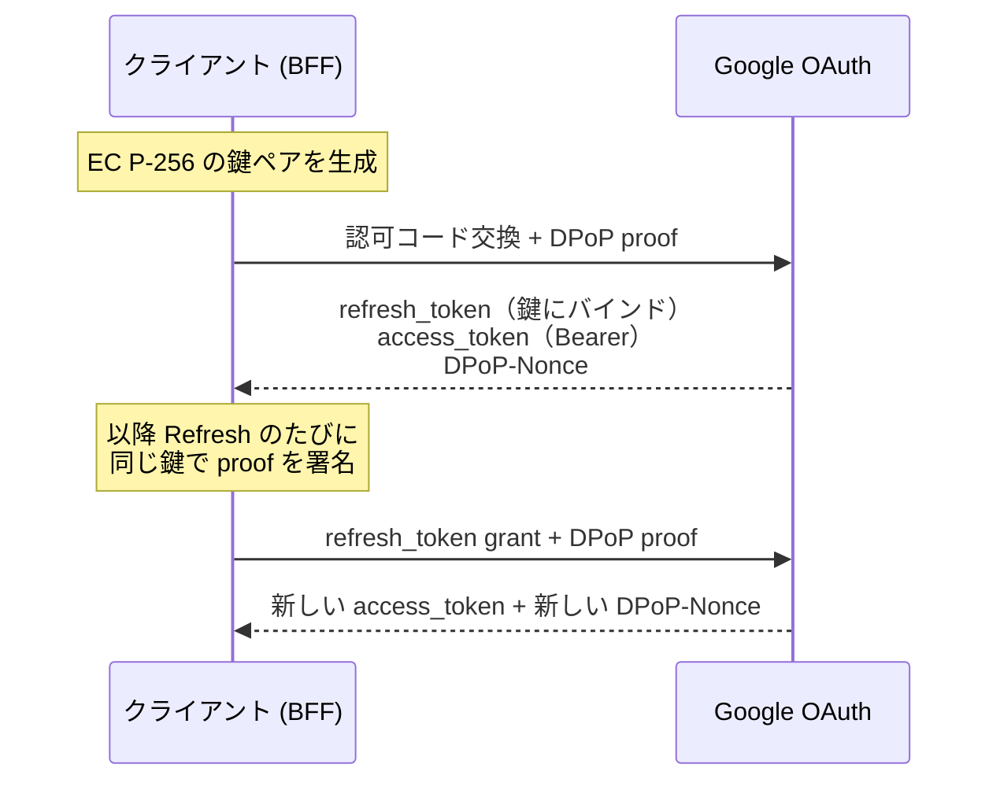

# Google OAuthがDPoPに対応したらしいので検証してみる

> 実装は、ちゃんと動きました。壊れていたのはドキュメントの方です。

## この記事の結論

Google OAuth の Refresh Token を DPoP で鍵にバインドする仕組みを、公式ドキュメント・RFC 9449・自分の計測・実際のトークン交換の 4 方向から検証しました。**実装はまともに動きます。詰まったところは、1 つ残らず「ドキュメントとの差分」でした。**

差分は 3 種類に分かれます。

- **RFC と違う** — Access Token は Bearer のまま、`jti` が乱数ではない。設計判断で、ドキュメントには書いてあります
- **書いてあることと、実際が違う** — 公式サンプルの署名が壊れている、ドキュメント同士が矛盾している、"a nonce value is used only once" が嘘
- **そもそも書いていない** — `iat` の許容範囲、grant と proof の検証順。実測するしかありませんでした

実測した環境です。

| 項目 | 値 |
| --- | --- |
| 検証日 | 2026-10-19 |
| Node.js | v24.22.0 |
| `jose` | 6.2.12 |
| `hono` | 4.13.13 |
| マシン | Apple M4 (arm64) |

実装はこちらです: https://github.com/tanahiro2010/slides/tree/main/slides/slides/Google%20OAuth%E3%81%8CDPoP%E3%81%AB%E5%AF%BE%E5%BF%9C%E3%81%97%E3%81%9F%E3%82%89%E3%81%97%E3%81%84%E3%81%AE%E3%81%A7%E6%A4%9C%E8%A8%BC%E3%81%97%E3%81%A6%E3%81%BF%E3%82%8B/sandbox

そして、この記事で一番伝えたいことを先に書いておきます。

**Google の DPoP 実装そのものは、おかしくありません。** 設計判断にはちゃんと理由があり、性能を理由にした主張も測ってみれば妥当でした。それでも実装者が詰まるのは、書いてあることが実際と違ったり、肝心なことが書いていなかったりするからです。最後に見つけた "used only once" の件は Google に報告しましたが、**Won't Fix** で返ってきました。つまりそれも、仕様の問題ではなく記述の問題だったということです。

> この記事は LT「Google OAuthがDPoPに対応したらしいので検証してみる」の内容に、発表で話しきれなかった計測と考察を足したものです。対象は、Google API 連携で Refresh Token をサーバーに保存している開発者です。

---

## 1. DPoP とは何か

DPoP（Demonstrating Proof-of-Possession）は RFC 9449 で標準化された OAuth 2.0 のセキュリティプロファイルです。2023 年 9 月に Proposed Standard になっていて、Okta や FusionAuth はずっと前から対応しています。**新しいのは Google が対応したことだけ**で、DPoP 自体は新登場ではありません。

通常の Bearer Token は、Google のブログの表現を借りると "finders-keepers model" です。拾った人が使えてしまう。DPoP はこれを送信者拘束（sender-constraining）で防ぎます。

- クライアントが鍵ペアを生成し、**秘密鍵を自分だけが持つ**
- トークンエンドポイントへのリクエストごとに、秘密鍵で署名した JWT（DPoP proof）を添える
- サーバーはトークンを**公開鍵に紐づけて**発行する



検証は Node.js + TypeScript のサーバー（Google OAuth の Confidential Client）で行いました。JWT ライブラリは `jose` 6.2.12 で、依存ゼロで ES256 署名と JWK エクスポートが揃います。専用のテストクライアントとテストアカウントを使い、本番ユーザーの grant には触れていません。

## 2. まず「いつ対応したのか」が違った

発表は 2026-10-15 の Google Developers Blog です。ところが Wayback Machine で公式ドキュメントの改版を追うと、話が合いません。

| 日付 | 出来事 |
| --- | --- |
| 2026-04-15 | Best Practices に DPoP の記述は**ゼロ** |
| **2026-05-20** | Best Practices に "Sender-constrain tokens with DPoP" が**登場** |
| 2026-07-31 | DPoP Adoption Guide の最終更新 |
| 2026-09-04 | `google/skills` に公式の DPoP SKILL.md が commit |
| **2026-10-15** | Developers Blog で発表 |
| 2026-10-16 | web-server doc が DPoP 対応で更新 |

ドキュメント上は、少なくとも 5 月には対応が入っていたことになります。発表はその約 5 ヶ月後です。隠していたという話ではなく、**公式ブログの日付は機能のリリース日とは限らない**、というだけの話です。

そしてこれは序の口でした。確かめれば確かめるほど差分が出てきて、しかもきれいに 3 種類に分かれます。順に見ていきます。

## 3. 差分①：RFC と違う（仕様。ちゃんと書いてある）

RFC 9449 はオプションの判断を各認可サーバーに委ねています。Google の選択は RFC の一般仕様とズレますが、**これは「書いてある」類の差分**です。RFC だけ読んで実装すると詰まる、という意味で先に潰しておく必要があります。

### Access Token は Bearer のまま

RFC 9449 §5 は `token_type` に `DPoP` を MUST としていますが、web-server doc は「`token_type` は DPoP を使っても常に `Bearer`」と明言しています。バインドされるのは Refresh Token だけです。

ただしこれは RFC 違反ではありません。RFC 側に逃げ道があって、public client が Refresh Token も受け取る場合に「Refresh Token だけをバインドする」ことを明示的に許容しています。

理由はブログによると性能で、高 QPS の API で毎回非対称署名を検証するコストを避けたい、とのことです。これは測ってみました。Node v24.22.0 / Apple M4 で 20,000 回のループです。

| 操作 | µs/op | ops/s |
| --- | ---: | ---: |
| ES256 sign | 26.2 | 38,227 |
| ES256 verify | 50.5 | 19,787 |

検証は署名の約 2 倍、1 コアあたり毎秒 2 万回程度でした。**自分のアプリの規模なら誤差ですが、Gmail や Drive の規模なら効きます。** Google の言い分は妥当だと思います。

### 認可コード交換の `jti` が乱数ではない

RFC 9449 §4.2 は `jti` に「96 bit 以上の擬似乱数か UUIDv4」を要求します。ところが Google は、認可コード交換のときだけ**決定的な値**を使います。

> the value of `jti` is the Base-64 and Url-encoded SHA256 hash of the authorization code, such as `jti = BASE64URL(SHA-256(authorization_code))`

公式サンプルに載っている認可コードと `jti` で、実際に計算して確かめました。

```python
import hashlib, base64
code = "4/0AXEQxIDNpLD-qpSIvjHb2Hl10uS_2sk2GBRpO8UJQ78YZF3hZ9LB9kTA1xYLD4xisi4C5w"
print(base64.urlsafe_b64encode(hashlib.sha256(code.encode()).digest()).rstrip(b"=").decode())
# -> o29CN8LIY0l_N8iy5-ilon1guad9NFQHFOdXTzrBNck （サンプルの jti と一致）
```

一致しました。Refresh のときは逆に普通のランダム値（192 bit）を使います。**同じ `jti` クレームが、フローによって別のルールで決まる**ので、片方だけ実装すると必ず詰まります。

なぜこうなっているのか。RFC が定める「認可コードを鍵に縛る」方法は §10 の `dpop_jkt` という認可リクエストパラメータですが、**Google の認可リクエストに `dpop_jkt` はありません**。代わりに既存の `jti` クレームを流用しています。認可コードは一度しか使えないので、決定的な値でも実質的に一意になり、目的は達成できます。RFC の OPTIONAL な機能を実装する代わりに、手持ちのクレームで代替した、と読めます。

### Confidential Client なのにバインドする

RFC 9449 §5 はこう書いています。

> Refresh tokens issued to confidential clients ... are **not** bound to the DPoP proof public key because they are already sender-constrained with a different existing mechanism.

ところが Google の Adoption Guide のサンプルは `client_secret` を送る Confidential Client です。一方で Best Practices が DPoP を強く勧めるのは SPA やインストール型アプリといった public client で、その SPA には「BFF（= Confidential Client）を立てろ」と言います。**public client を守りたいのに、実装は Confidential Client になる**というねじれです。

RFC は「鍵に縛るより client 認証の方が柔軟（鍵を変えても Refresh Token を失効させずに済む）」とまで書いていて、Google の構成はその注意点をあえて踏みにいっています。

## 4. 差分②：書いてあることと、実際が違う

ここからが本題です。

### 公式サンプルの proof は、署名が壊れている

Adoption Guide には proof のサンプルが 2 つ載っています。コピーして動かす前に、一応署名を検証してみました。

| サンプル | 署名長 | 検証結果 |
| --- | ---: | --- |
| 認可コード交換 | 64 B | SIGNATURE VALID |
| Token Refresh | **70 B** | **SIGNATURE FAILED** |

70 バイトの中身を ASN.1 としてパースすると、きれいに通りました。

```text
hex head: 30 44 02 20 ...
ASN.1 DER SEQUENCE? True | declared len: 68
  r: tag=0x02 (INTEGER) len=32
  s: tag=0x02 (INTEGER) len=32
```

JWS が要求するのは raw な `R || S`（P-256 なら 64 バイト、IEEE P1363 形式）ですが、サンプルは **ASN.1 DER のまま貼られています**。これは Google 自身が web-server doc で「やるな」と書いていることそのものです。

> Note that JWS requires the signature to be in a raw `R | S` concatenated format (64 bytes for P-256). If using OpenSSL directly, you must convert the default ASN.1 DER-encoded signature to this raw format.

この罠は Node の中でも再現できます。同じ ES256 署名でも、API によって出力形式が違います。

```text
crypto.subtle.sign     -> 64 bytes, first byte 0xed   (raw P1363)
node:crypto createSign -> 71 bytes, first byte 0x30   (ASN.1 DER)
```

`node:crypto` 側は DER で、しかも **71 バイト**です。サンプルは 70 バイトでした。DER の長さは leading zero 次第で 69〜72 バイトに揺れるので、`length === 70` のような長さチェックで DER を判定してはいけません。

もう 1 つ。web-server doc のサンプル proof をデコードすると、**RFC 9449 の例文の丸写し**でした。`htu` が `https://server.example.com/token`（Google のエンドポイントではない）、`iat` は 1562262616（2019-07-04）で、`jti` も同じページの 3 段落上に書いてある自分のルールを破っています。そのままコピーすると `htu` 不一致で弾かれます。

### Nonce の持ち越し可否で、ドキュメント同士が矛盾している

認可コード交換で受け取った `DPoP-Nonce` を、初回の Refresh にそのまま使えるか。ここで新旧 2 つのドキュメントが逆のことを書いています。

- Adoption Guide（2026-07-31）：workflow をまたぐと「無条件に 400 で拒否する」
- web-server doc（2026-10-16）：この nonce を使えば「余分な往復を避けられる」

実際に投げたら `HTTP 400 use_dpop_nonce` でした。**古い Adoption Guide の方が正しく、新しい web-server doc が間違っています。** つまり初回 Refresh は必ず 400 → リトライで 2 往復になります。`use_dpop_nonce` のリトライループは最適化ではなく**必須**で、省くと認可直後の 1 回目が必ず失敗します。

### エラーコードの説明が違う

web-server doc は「`htm`/`htu` 不一致、`iat` 期限切れ、再利用、署名不正はすべて `invalid_dpop_proof`」と書いていますが、実測は違いました。

| doc の主張 | 実測 | |
| --- | --- | --- |
| `htu` 不一致 → `invalid_dpop_proof` | `invalid_request` | ❌ |
| `htm` 不一致 → `invalid_dpop_proof` | `invalid_request` | ❌ |
| `iat` 期限切れ → `invalid_dpop_proof` | `invalid_dpop_proof` | ✅ |
| 署名不正 → `invalid_dpop_proof` | `invalid_dpop_proof` | ✅ |

実際の切り分けはこうなっていて、こちらの方がドキュメントの記述より一貫しています。

| 状況 | error |
| --- | --- |
| proof が無い / `htm`・`htu` が噛み合わない | `invalid_request` |
| 署名が不正 / `iat` が範囲外 | `invalid_dpop_proof` |
| nonce が無い・期限切れ・workflow 跨ぎ | `use_dpop_nonce` |
| grant 自体が不正 | `invalid_grant` |

### `extractable: false` は、Node には当てはまらない

Google 公式の SKILL.md は、秘密鍵の扱いを「CRITICAL SECURITY GUARDRAIL」としてこう要求します。

> The private key MUST be configured as **non-extractable** (`extractable: false`).

ところが Node.js でこれを字義通り守ると、鍵を永続化できなくなります。

```text
exportKey('jwk')   -> InvalidAccessError: key is not extractable
exportKey('pkcs8') -> InvalidAccessError: key is not extractable
```

非 extractable な鍵はプロセスの外に出せません。サーバーが再起動した瞬間、その鍵にバインドされた**全ユーザーの Refresh Token が使用不能**になり、復旧手段は再同意しかありません。

さらに、Node.js の WebCrypto には TPM も Secure Enclave もありません。非 extractable 鍵はただのプロセスメモリ上の鍵で、SKILL.md が言う「hardware cryptographic boundary」は Node には存在しません。**この文言はブラウザやモバイル向け**で、Adoption Guide 自身が前提にしている Node の Confidential Client には当てはまらないのです。

現実的には `extractable: true` で生成し、書き出した JWK を暗号化や KMS で保護して保存することになります。動きますが、その瞬間に秘密鍵成分が DB に乗ります。

### "a nonce value is used only once" が、嘘だった

Adoption Guide はこう書いています。

> Note that **a nonce value is used only once** and a missing, invalid, expired, or **reused** nonce value is rejected with an HTTP 400 response.

まず「そもそも nonce は検証されているのか」の対照を取りました。でたらめな nonce と 1 文字変えた nonce は、どちらも `400 use_dpop_nonce` で弾かれます。**検証はされています。**

そのうえで、同じ nonce を続けて使いました。

```text
1 回目（同じ nonce）   200
2 回目（同じ nonce）   200
3 回目（同じ nonce）   200
4 回目（同じ nonce）   200
5 回目（同じ nonce）   200
30 秒後（同じ nonce）  200
```

**6 回とも通りました。** 検証はされるが、消費はされません。

同じことが `jti` でも起きます。web-server doc は「再利用された `jti` は `invalid_dpop_proof`」と書いていますが、同じ `jti` を持つ proof を 2 回投げても両方 200 でした。**`jti` は記録されていません。**

この 2 つが重なると、**proof をバイト単位でそのまま再利用できます。** `jti`・`nonce`・`iat`・署名まで完全に同一の proof を投げ直すと、繰り返し 200 が返り、そのたびに新しい Access Token が発行されました（送った proof の SHA-256 と、返ってきたトークンのハッシュを記録しています。同じ proof から毎回違うトークンが出る＝キャッシュではなく本当に再発行されている、ということです）。

いつまで再利用できるのか。1 本の proof を作って、現実に盗まれた proof と同じ条件（`iat` も `nonce` も一緒に古くなる）で、時間をおいて投げ直しました。

| 経過（proof 作成から） | HTTP | 結果 |
| --- | ---: | --- |
| 0 〜 2700 秒（0〜45 分） | 200 | 再利用成立 |
| 3300 秒（55 分） | 200 | 再利用成立 |
| 3540 秒（59 分） | 200 | 再利用成立 |
| **3660 秒（61 分）** | **400** | **`invalid_dpop_proof`** |

59 分では通り、61 分で `invalid_dpop_proof`（`use_dpop_nonce` ではない）で落ちました。nonce は 59 分時点でもまだ有効だったので、先に来たのは `iat` の窓です。**捕捉した proof は、発行からおよそ 1 時間、何度でも再利用できます。**

ここで RFC 9449 §11.1 を読み直すと、まさにこの条件が書いてあります。

> Unlike cryptographic nonces, it is acceptable for clients to use the same nonce multiple times ... **As long as the `jti` value is tracked and duplicates are rejected for the lifetime of the nonce**, there is no additional risk of token replay.

nonce の使い回しを許していいのは、**`jti` を追跡している場合に限る**。Google は `jti` を追跡しないまま、nonce 再利用だけを許しています。RFC が条件付きで認めた許可の、**条件の方を満たしていない**状態です。

## 5. 差分③：そもそも書いていない

実装していて必要になったのに、どこにも書かれていなかったものです。実測するしかありませんでした。

### grant は proof より先に検証される

存在しない Refresh Token を送りつつ、proof の方だけを 8 通りに壊してみました。DER 署名の proof でも、`typ` を壊しても、`not-a-jwt` を送っても、**全部 `invalid_grant`** で、`DPoP-Nonce` は一度も返りませんでした。

ここから実装上の教訓が出ます。**デバッグ中に proof のバグが `invalid_grant` に隠れる**のです。Refresh Token が期限切れだと、proof がどれだけ壊れていても `invalid_grant` しか返りません。「proof を直したのに直らない」の原因がここにあることがあります。

実装の順序としては「**まず DPoP なしで Refresh が通ることを確認してから DPoP を足す**」が正解になります。どちらが壊れているのか切り分けられるからです。

### `iat` の許容範囲

Google は「期限切れの `iat` は弾く」としか書いておらず、秒数を公開していません。RFC 9449 §4.3 も実装依存としています。二分探索で 1 秒まで詰めました（独立した 2 回の実行で一致）。

| 方向 | 通る最遠 | 弾かれる最近 | 値 |
| --- | ---: | ---: | --- |
| 過去 | -3599 s | -3600 s | ちょうど 3600 秒 |
| 未来 | +10 s | +11 s | ちょうど 10 秒 |

**過去は 3600 秒、未来は 10 秒。360 倍の非対称です。** 過去側が緩いのは proof が届くまでの遅延を見込むため、未来側が厳しいのは未来の `iat` が「proof の作り置き」を意味するからで、RFC 9449 §11.2 "DPoP Proof Pre-generation" が警戒しているのがこれです。なお §4 で見た「proof を約 1 時間再利用できる」の窓を決めていたのは、この過去側の 3600 秒でした。別々に測った 2 つの数字が同じ値を指したことになります。

実装側の教訓としては、**サーバーの時計が未来に 11 秒ずれているだけで全 proof が弾かれます**。NTP が効いていない環境で「なぜか `invalid_dpop_proof`」が出るときは、ここを疑う価値があります。

### その他、書かれていなかったもの

- **成功レスポンスの `challenge` フィールド。** Adoption Guide のサンプルには出てきますが、本文に説明がありません。値は `DPoP-Nonce` ヘッダーと同一でした
- **discovery に DPoP の宣言がない。** RFC 9449 §5.1 は `dpop_signing_alg_values_supported` という authorization server metadata を定義していますが、`accounts.google.com/.well-known/openid-configuration` を引いても `dpop` を含むキーは 1 つもありません。discovery ベースで feature detection する標準準拠のクライアントは、Google の DPoP 対応を**検出できません**
- **RSA を使う場合の alg 名。** Adoption Guide は RSA も可としますが「計算コストが高いので非推奨」とだけ書かれていて、RS256 なのか PS256 なのかは書かれていません。discovery にも無いので、投げて試すしかありません

## 6. 報告したら Won't Fix だった

§4 の最後の件（`jti` 未追跡 + nonce 再利用 + proof の再利用）は、ドキュメントとの食い違いであると同時に RFC の hardening 条件も満たしていないので、Google の Bug Hunters に報告しました。再現用の生ログ（秘密は不可逆なハッシュに置き換えたもの）を添えています。

結果は **Won't Fix（Infeasible）** でした。要旨はこうです。

- アカウント乗っ取り・権限昇格・認証バイパスが示されていない
- 報告者自身が「実用上の影響は限定的」と認めている
- 「他ユーザーの機微データの機密性・完全性を実質的に損なう」という VRP の基準を越えていない

この判断には納得しています。proof を観測できる立場（AiTM、TLS 終端プロキシ、ログ）なら、同じリクエストボディに入っている `refresh_token` と `client_secret` も一緒に取れます。しかも §5 のとおり proof **単体**では `invalid_grant` で弾かれるので、再利用には有効な `refresh_token` が必須です。**再利用できる窓があっても、攻撃者の能力を増やしていません。**

逆に言うと、この回答で finding の性質が確定しました。**セキュリティバグではなく、ドキュメントと実装の食い違いである**、と Google 自身が位置づけたということです。この記事の主張そのものです。

それでも書く価値はあると思っています。"a nonce value is used only once" や「再利用された `jti` は弾く」は、**読んで実装すると現実と違う**ので、その通りに作れば要らない排他制御を書いたり、効いていない前提に寄りかかったりします。報告して「追跡しない」と返ってきた結末まで含めて、公式の記述を鵜呑みにしない材料になるはずです。

## 7. で、入れるべきなのか

DPoP バインドが効くのは、**Refresh Token を長期保存していて、その保存先が漏れるリスクを下げたい**ケースです。DB ダンプやログ流出で Refresh Token だけが漏れても、鍵がなければ再利用されません。これは確かな価値です。

ただし守備範囲は見かけより狭いです。Access Token は Bearer のままなので有効期限内は使われますし、ブラウザのセッション Cookie は対象外だとブログが明言しています（その領域は DBSC が担当する、という整理です）。そして §4 のとおり Node では秘密鍵を結局どこかに保存することになるので、「鍵は外に出ない」という前提も一段弱くなります。

導入コストで一番重いのは移行です。すでに Refresh Token を持っているユーザーを DPoP バインドに切り替えるには、既存の grant を revoke するか `prompt=consent` で再発行させるしかありません。稼働中のサービスでは**全ユーザーに再同意を踏ませる**ことになります。鍵をローテーションしたい場合も同じで、新しい鍵にバインドされた Refresh Token を得るには再認可が必要です。つまり**鍵のバックアップ戦略が、そのまま Refresh Token のバックアップ戦略**になります。

## 8. まとめ

Google の DPoP 実装は、動きます。仕様の選択にも理由があり、Bearer のままにした性能上の判断は測ってみれば妥当でした。

詰まったのは全部、ドキュメントとの差分でした。RFC と違うところ（§3）、書いてあることと実際が違うところ（§4）、そもそも書いていないところ（§5）。一番派手だった "used only once" は報告しましたが、Won't Fix で返ってきて、**やはり記述の問題だった**ことがはっきりしました（§6）。

これから実装する人向けに、ドキュメントを読むだけでは得られなかった点をまとめておきます。

- 認可コード交換の `jti` は `BASE64URL(SHA-256(code))`、Refresh は乱数。**フローで別ルール**
- 初回 Refresh は必ず `use_dpop_nonce` で 1 回落ちる。**リトライループは必須**
- `htm`/`htu` の不一致は `invalid_dpop_proof` ではなく `invalid_request`
- `iat` は過去 3600 秒・未来 10 秒。**時計が未来にずれると全滅する**
- Node では `extractable: false` にできない。鍵の保存方法を先に決める
- まず DPoP なしで Refresh を通してから DPoP を足す。でないと `invalid_grant` に隠れる

### 参考

- [DPoP Adoption Guide](https://developers.google.com/identity/protocols/oauth2/resources/dpop-adoption) — Google の DPoP 実装ガイド。proof の構成と Nonce の扱い
- [Using OAuth 2.0 for Web Server Applications](https://developers.google.com/identity/protocols/oauth2/web-server) — トークンエンドポイントのパラメータとエラー、`prompt=consent` の注記
- [OAuth 2.0 Best Practices](https://developers.google.com/identity/protocols/oauth2/resources/best-practices) — sender-constraining の推奨対象
- [Announcing DPoP Support for Google OAuth](https://developers.googleblog.com/announcing-dpop-support-for-google-oauth-securing-refresh-tokens/) — 発表ブログ。性能トレードオフと脅威モデル
- [RFC 9449](https://www.rfc-editor.org/rfc/rfc9449.html) — DPoP の仕様。§5 token_type、§10 dpop_jkt、§11 セキュリティ考慮
- [google/skills — dpop-adoption](https://github.com/google/skills/blob/main/skills/identity/dpop-adoption/SKILL.md) — 公式の実装スキル。非 extractable 鍵と署名形式
