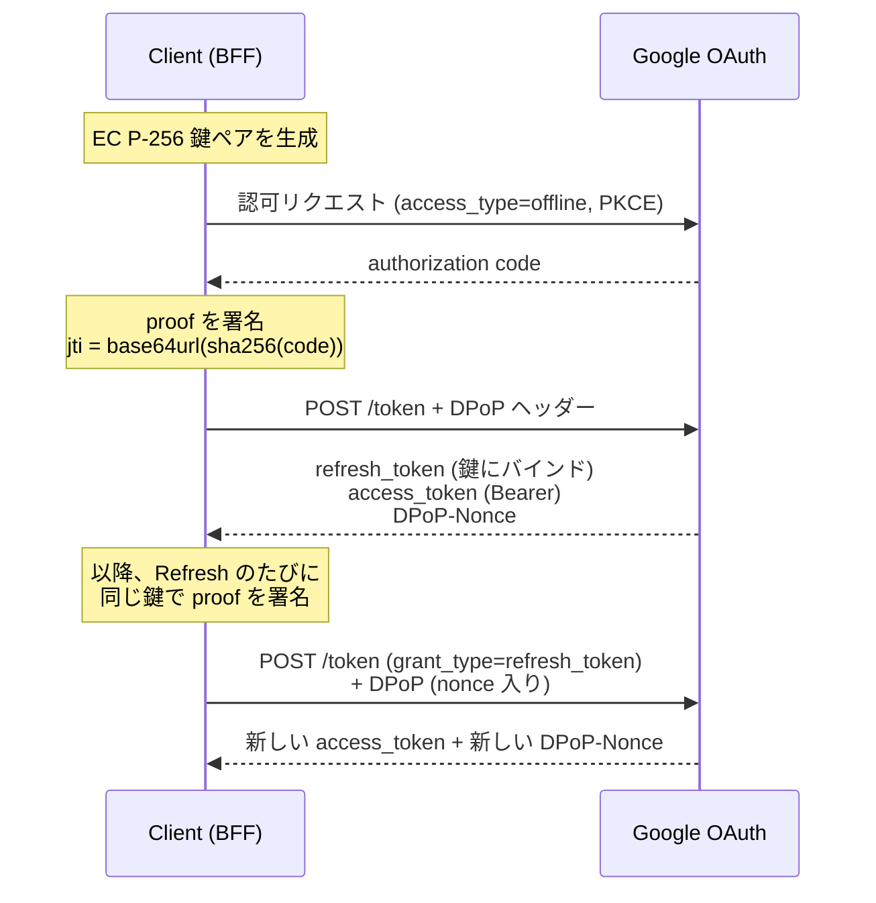
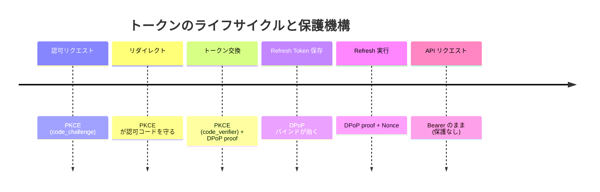

# Google OAuthがDPoPに対応したらしいので検証してみる

**重要：このネタは「実際に検証してみた」記事です。** 下の「検証前チェックリスト」を実際に潰して、
レスポンスをそのまま貼れる状態にしてから書き始めてください。実測していない挙動は断定しないでください。

**調査済みの内容は `references.md` に全部あります。先にそっちを読んでください。**
一次ソース・判定・自分で取った計測値・未確認の項目が整理されています。
計測スクリプトは `sandbox/` にあります。

### 一次ソース

- Google Developers Blog（2026-10-15）: https://developers.googleblog.com/announcing-dpop-support-for-google-oauth-securing-refresh-tokens/
- DPoP Adoption Guide（Last updated 2026-07-31）: https://developers.google.com/identity/protocols/oauth2/resources/dpop-adoption
- OAuth 2.0 for Web Server Applications（Last updated 2026-10-16）: https://developers.google.com/identity/protocols/oauth2/web-server
- OAuth 2.0 Best Practices（Last updated 2026-05-20）: https://developers.google.com/identity/protocols/oauth2/resources/best-practices
- Google公式 SKILL.md（commit 2026-09-04）: https://github.com/google/skills/blob/main/skills/identity/dpop-adoption/SKILL.md
- RFC 9449（DPoP, 2023-09）: https://www.rfc-editor.org/rfc/rfc9449.html
- RFC 9700（OAuth 2.0 Security BCP）: https://datatracker.ietf.org/doc/html/rfc9700
- RFC 9449 日本語訳（tex2e）: https://tex2e.github.io/rfc-translater/html/rfc9449.html

## 概要
これはタイトル通りの記事を書くためのドラフトです。
あくまで記事を書くための情報をまとめただけのものです。
これを読み込んだあなたは、ZennやQiitaに投稿するために作者目線となって記事を作成してください。
記事は`article-generator`スキルを使って同フォルダのarticle.mdに、スライドは`yusukebe-slide-creater`スキルを使って同フォルダのslide.mdに作成してください。
また、作成する順番としてはslide -> articleでお願いします。
イメージとしては、articleはLTの内容を拡張して書く記事って感じです。
それぞれのセクションごとの文章量を増やし、もしそのネタが技術的側面を持っているのならLT以上に技術要素を追加したり（そのためにセクションを追加したりもする）して欲しいです。

## LTスライドを作るに当たって
`yusukebe-slide-creater`スキルを使って、slide.mdを作成してください。
適度に画像を挿入したり、コードを挿入したりして、見やすいスライドを作ってください。
基本的にslide-createrをベースにしつつもデザインはアイテムの中心寄せ・フォントサイズの変更（真ん中にポンと小さいアイテムがあるのを避ける）などを行ってください。
また、他のプロジェクトから画像を持ってくるのもOKです。
https://qiita.com/shimagaji/items/8acd9b94dfe56fefc0dc
この記事の内容を参考にし、対策してください。

## 記事を書くに当たって
`article-generator`スキルを読んでから書いてください。骨格（エピグラフ → この記事の結論 → 採番した本文）と
frontmatterの決まり、一次ソースの当たり方がそこにまとまっています。
記事はスライドの各セクションごとを増量し、そして技術的側面を追加して書くことを意識してください。
また、記事の中では画像を使うことはできません。
marmaidなどで図を作ることはできます。
https://zenn.dev/meijin/articles/tech-article-output-recommend
これを参考に記事書いてください。

### 表現のルール（必ず守る）

- ❌「DPoPが新登場した」→ ⭕「DPoPはRFC 9449で2023年に標準化済み。Googleが対応した」
- ❌「DPoPならトークン漏えいを防げる」→ ⭕「盗まれたRefresh Token単体の再利用を困難にする」
- 「Refresh Tokenを暗号化する」と「Refresh Tokenを鍵にバインドする」は**別物**として書き分ける
- Google固有仕様とRFC一般仕様を必ず区別する（`jti`・Nonceのルールは特にGoogle固有）
- 概念コードと、実際に動作確認したコードを混同しない
- ログ・記事・リポジトリに Refresh Token / client secret / 秘密鍵 / 完全なproof を出さない

## 記事・スライド共通ドラフト

- タイトル
  - 題名：Google OAuthがDPoPに対応したらしいので検証してみる
  - 副題：Refresh Tokenを鍵に縛る。公式ドキュメントを信じずに、全部自分で確かめる
  - 発表者：田中博悠 / Hirohisa Tanaka / tanahiro2010
  - 💭 感想：（ここに書く）

- 自己紹介
  - 名前：田中博悠（tanahiro2010）
  - 所属：三田学園高等学校 / GDG Greater Kwansai
  - 個人開発でGoogle OAuthを使っている（Refresh TokenをDBに保存している側の人間）
  - 💭 ここで「だからRefresh Tokenが漏れる話は他人事じゃない」に繋げる

- つかみ
  - 2026/10/15、Google Developers Blog に「DPoP対応しました」という記事が出た
  - 「Refresh Tokenを鍵にバインドできる」── 便利そう、やってみよう
  - ……と思って調べ始めたら、**話が思ってたのと違った**
    - 実は半年前から出ていた
    - 公式サンプルの署名が壊れていた
    - 公式ドキュメント同士が矛盾していた
  - 問いかけ：「あなたのDBにあるRefresh Token、今漏れたらどうなりますか？」
  - 💭 感想：（ここに書く）

- この発表のスタンス
  - 公式ドキュメントの翻訳記事にはしない
  - RFC 9449とGoogleの実装を**並べて差分を見る**
  - 「ドキュメントにこう書いてある」ではなく「**実際にこうなった**」を出す
  - 📌 検証できなかったものは「できなかった」と書く。推測で埋めない
  - 🔥 このスタンス自体が、§7（公式サンプルが壊れていた）で正当化される構成にする

### 1. そもそもDPoPとは ―― 新機能ではない

- 優先度：高（前提を揃えるパート）
- DPoP = Demonstrating Proof-of-Possession
  - **RFC 9449**、Proposed Standard、**2023年9月**に標準化済み
  - ⚠️ 「新しい技術」として書かない。新しいのは**Googleが対応したこと**だけ
  - Okta も FusionAuth も以前から対応している
- Bearer Token の何が問題か
  - blog の表現が分かりやすい：**"finders-keepers" model**
    - 拾った人が使える。それだけ
  - 想定脅威として blog が名指ししているもの
    - Infostealer マルウェア（RedLine、NodeStealer）
    - Adversary-in-the-Middle（AiTM）攻撃
- DPoP が何をするか
  - クライアントが鍵ペアを生成して、**秘密鍵を自分だけが持つ**
  - リクエストごとに秘密鍵で署名した JWT（= DPoP proof）を付ける
  - サーバーはトークンを**公開鍵に紐づけて**発行する
  - → トークンだけ盗まれても、秘密鍵がなければ使えない
  - 📋 概念図（Mermaid）は「メモ①」参照
- 用語の整理をここでやっておく
  - **sender-constraining**（送信者拘束）：トークンを「誰が使えるか」で縛ること
  - DPoP は sender-constraining の**アプリケーション層での実装**
  - 📋 他の手法との比較表は「メモ②」参照
- mTLS（RFC 8705）との違いは blog が明確に書いている
  > Unlike transport-layer token binding (e.g., mTLS/RFC 8705) which often breaks or terminates at modern cloud proxies and load balancers, DPoP operates at the HTTP header level.
  - トランスポート層の拘束はロードバランサやプロキシで切れる
  - DPoP は HTTP ヘッダー層なので多段構成に強い
  - 💭 ここ、MCP / エージェント文脈に繋がる話でもある（§10で回収）

### 2. 「10月に対応した」は不正確 ―― 時系列を調べたら半年ズレていた

- 優先度：高（**つかみの種明かし。LTで一番ウケるパート**）
- 🔥 Wayback Machine で公式ドキュメントの改版を追ったら、話が変わった
  - 📋 調査コマンドは「メモ③」参照
  - 📋 時系列表は「メモ④」参照
- 結論
  - **2026-04-15** 時点の Best Practices に DPoP の記述は**ゼロ**
  - **2026-05-20** の改版で "Sender-constrain tokens with DPoP" が**登場**
  - **2026-09-04** に `google/skills` へ公式 SKILL.md が commit
  - **2026-10-15** に Developers Blog で発表 ← **ここが5ヶ月遅れ**
  - 2026-10-16 に web-server doc が追従更新
- つまり「**静かに出して、5ヶ月後に発表した**」
- 💭 なぜこの順番だったのか：（推測になるので断定しない。事実だけ並べて読者に委ねる）
- 📌 これは references.md の実測（Waybackスナップショットのdpop出現数）がそのまま根拠になる
- 記事での扱い
  - 煽らない。「Googleが隠していた」みたいな書き方はしない
  - 「**公式ブログの日付＝機能のリリース日、ではない**」という一般論に着地させる
  - 💭 感想：（ここに書く）

### 3. 脅威モデル ―― 何を防ぎ、何を防がないか

- 優先度：**最高**（記事の誠実さがここで決まる）
- ⚠️ ここを曖昧に書くと記事全体が嘘になる。慎重に
- 📋 整理表は「メモ⑤」参照
- **防げるもの**
  - Refresh Token **単体**が漏えいしたときの再利用
    - DBダンプ、ログ流出、バックアップ流出
    - Infostealer がトークンだけ抜いていったケース
- **防げないもの**
  - **Access Token の漏えい** ← Google では Bearer のまま。有効期限内は使われる
  - **秘密鍵とRefresh Tokenが両方盗まれたケース** ← 同じDBに入れてたら一緒に漏れる
  - **ブラウザのセッションCookie窃取** ← blog が明確に「対象外」と書いている
  - 認可コードの横取り ← これはPKCEの仕事
- blog が「Cookieは守らない」とはっきり書いているのが良い
  > DPoP does not protect standard web application session cookies, which remain a primary target for Infostealer malware.
  - その対策として **DBSC（Device Bound Session Credentials）** を Google と WICG で開発中、という話が出てくる
    - DPoP = アプリケーション層でAPIトークンを守る
    - DBSC = ブラウザ/ネットワーク層でCookieをTPMに縛る
    - 💭 「両方揃って初めてdefense-in-depth」という blog の構図は記事で使える
- PKCE との役割分担（Best Practices より）
  - PKCE = **認可コード**をリダイレクト中に守る
  - DPoP = **発行後のRefresh Token**を守る
  - ⚠️ 置き換えではない。**両方やる**
  - 📋 時間軸で並べた図（Mermaid）は「メモ⑥」参照
- 🔥 記事で一番言いたいこと
  - §6 で「秘密鍵をDBに置く」という選択をした瞬間、守備範囲が一段狭まる
  - **「DPoPを入れた」と「安全になった」はイコールではない**
  - 💭 感想：（ここに書く）

### 4. Google固有の仕様 ―― RFCと3箇所ズレている

- 優先度：**最高**（記事の技術的な山場その1）
- 📋 RFC vs Google の対照表は「メモ⑦」参照
- **ズレ①：Access Token は Bearer のまま**
  - RFC 9449 §5：`token_type` に `DPoP` が **MUST**
  - Google：web-server doc が明言
    > `token_type` | The type of token returned. This value is always `Bearer`, even when DPoP is used.
  - 📌 ただしこれは**RFC違反ではない**。RFCに逃げ道がある
    > An authorization server MAY elect to issue access tokens that are not DPoP bound, which is signaled to the client with a value of `Bearer` ... For a public client that is also issued a refresh token, this has the effect of DPoP-binding the refresh token alone, which can improve the security posture even when protected resources are not updated to support DPoP.
  - Google の理由（blog）は性能
    > ensuring that high-QPS resource APIs do not incur the per-request asymmetric cryptographic verification overhead of DPoP
  - 💭 この主張は §8 で実測値をぶつけて検証する。頭ごなしに否定も肯定もしない
- **ズレ②：認可コード交換の `jti` が乱数ではない**
  - 🔥 ここが一番面白い
  - RFC 9449 §4.2：`jti` は96bit以上の擬似乱数かUUIDv4
    > The value MUST be assigned such that there is a negligible probability that the same value will be assigned to any other DPoP proof
  - Google：認可コード交換のときだけ**決定的な値**
    > the value of `jti` is the Base-64 and Url-encoded SHA256 hash of the authorization code, such as `jti = BASE64URL(SHA-256(authorization_code))`
  - Refresh のときは普通にランダム（`crypto.getRandomValues(new Uint8Array(24))` = 192bit）
  - **公式サンプルの code と jti で実際に計算したら一致した**（references.md 計測A）
    - 📋 再現コードは「メモ⑧」参照
    - → サンプルの数値は作り物ではない。規則の記述は信用してよい
  - なぜこうなっているのか（事実から読める範囲で）
    - RFC が定める「認可コードを鍵に縛る」方法は §10 の **`dpop_jkt` 認可リクエストパラメータ**
    - **Googleの認可リクエストに `dpop_jkt` は無い**
    - 代わりに既存の `jti` クレームを流用して同じ目的を達成している
    - 認可コードは1回しか使えないので、決定的でも実質一意。リプレイ対策としては成立する
  - 💭 「RFCを読んで実装したら動かない」が起きる場所。ここが記事の技術的な価値
- **ズレ③：Confidential Client なのにバインドしている**
  - RFC 9449 §5 はこう書いている
    > Refresh tokens issued to confidential clients ... are **not** bound to the DPoP proof public key because they are already sender-constrained with a different existing mechanism.
    > This existing sender-constraining mechanism is more flexible (e.g., it allows credential rotation for the client without invalidating refresh tokens) than binding directly to a particular public key.
  - ところが Google の Adoption Guide のサンプルは `client_secret` を送っている = **Confidential Client**
  - さらに Best Practices の推奨対象は逆に public client 寄り
    > Adopting DPoP is strongly recommended if your application: Operates as a public client (such as a single-page application or installed app)
  - そして SPA には「**BFF（= Confidential Client）を立てろ**」と言う
  - → **public clientを守りたいのに、実装はconfidential client**というねじれ
  - 🔥 RFCが「鍵に縛るより client 認証の方が柔軟」と**事前に警告していたデメリット**を踏みにいっている
    - その代償が §9 の「鍵ローテーションができない」問題にそのまま出る
  - 💭 感想：（ここに書く）
- **おまけのズレ：discovery doc で何も宣言していない**
  - RFC 9449 §5.1 は対応表明の方法として `dpop_signing_alg_values_supported` を定義している
  - `accounts.google.com/.well-known/openid-configuration` を引いたら **`dpop` を含むキーがゼロ**
    - 📋 コマンドは「メモ⑨」参照
  - → discovery ベースで feature detection する標準準拠クライアントは**Googleの対応を検出できない**
  - → 対応アルゴリズム（ES256以外に何が通るか）も機械可読な形では公開されていない
  - → 実装では**ハードコードするしかない**
  - 💭 「公式blogは出たのに、プロトコル上は何も言っていない」。§2の時系列と地続きの話

### 5. 実装の前提を決める

- 優先度：高
- 実行環境
  - Node.js 上の TypeScript サーバーアプリ（Google OAuth の **Confidential Client**）
  - 検証時の正確なバージョンを記事に貼る（`node -v` / `npm ls jose typescript`）
- JWT ライブラリは `jose` を使う
  - 📋 レジストリから引いた数字は「メモ⑩」参照
  - `jose@6.2.12`（2026-09-05公開）、**依存ゼロ**、unpackedSize 210KB / 80ファイル
  - ES256署名・JWKエクスポート・thumbprint計算が全部できる
  - Node v24.22.0 で動作確認済み
  - ⚠️ `openid-client` は discovery 前提なので、**ズレ④（discoveryにDPoPが無い）と噛み合わない可能性**がある。未検証
- HTTP は標準の `fetch`、`application/x-www-form-urlencoded` で POST
- 鍵形式は **EC P-256（ES256）**
  - Adoption Guide：
    > A RSA keypair is also possible but not recommended due to higher computational costs.
    - ⚠️ ただし**具体的なalg名（RS256なのかPS256なのか）が書かれていない**。discoveryにも無い（§4）
- ⚠️ 既存フローとして `state` 検証と PKCE は**そのまま残す**
  - DPoP はこれらを置き換えない（§3）
- 検証は専用のGoogle OAuthクライアント＋テストアカウントで行う
  - 📌 本番ユーザーの grant を失効させない（§9の `prompt=consent` 問題）

### 6. 鍵をどう持つか ―― 公式ガードレールがNodeで破綻する

- 優先度：**最高**（記事の技術的な山場その2。実装者が一番困るところ）
- Google公式 SKILL.md は「**CRITICAL SECURITY GUARDRAIL**」としてこう書いている
  > The private key MUST be configured as **non-extractable** (`extractable: false`). This guarantees the private key can never leave the hardware cryptographic boundary (Secure Enclave, Android KeyStore, or JS sandbox memory), thwarting XSS and dependency token theft attacks.
- web-server doc も同じ方向
  > The security of DPoP relies on the private key being restricted to a single device; we recommend storing it in a way that it cannot be copied off-device, for example by using TPMs, Secure Enclaves, or other hardware-backed keystores.
- 🔥 **Node.js で字義通りに守ると壊れる**（references.md 計測C）
  - 📋 実測コードと出力は「メモ⑪」参照
  ```
  exportKey('jwk')   -> InvalidAccessError: key is not extractable
  exportKey('pkcs8') -> InvalidAccessError: key is not extractable
  ```
  - → **秘密鍵をプロセス外に出せない**
  - → プロセスが再起動した瞬間、その鍵にバインドされた**全ユーザーのRefresh Tokenが使用不能**
  - → 復旧手段は **`prompt=consent` での再同意しかない**（§9）
- さらに：**Node の WebCrypto に TPM も Secure Enclave も無い**
  - 非extractable鍵は単なるプロセスメモリ上の鍵
  - 「hardware cryptographic boundary」は Node には**存在しない**
  - SKILL.md のこの文言は**ブラウザ/モバイル向け**で、Adoption Guide 自身が前提にしている
    Node の Confidential Client（`client_secret`を送る）には当てはまらない
  - 💭 公式スキルをそのまま読んで実装すると気づけない。**ここに気づけたのが今回の収穫**
- 📌 公開鍵は `extractable: false` を指定しても常に取り出せる（WebCrypto仕様）
  - 実測済み：`privateKey.extractable = false` / `publicKey.extractable = true`
  - JWK に `d`（秘密鍵成分）を**絶対に入れない**のはこの性質のおかげで簡単にできる
- **選択肢は実質3つ**。記事ではこれを整理する
  - 📋 比較表は「メモ⑫」参照
  - **A. `extractable: false` + 鍵をプロセスに閉じる**
    - 公式ガードレール通り。再起動で全ユーザー再同意 → **実用不可**
  - **B. `extractable: true` + JWK を暗号化/KMSで保存**
    - 現実解。実測でラウンドトリップは動く（計測D）
    - ⚠️ ただし `d` がDBに乗る。RFCの脅威モデルからは一段落ちる
    - PRD §9：**Refresh Token と同じDBに平文で置かない**
  - **C. KMS側に鍵を置いて署名だけ委譲**
    - 「鍵が外に出ない」を本当に満たせる唯一の方法
    - 実装コストは高い。⬜ 今回は未検証
  - 🔥 **Bを選んだ時点で「鍵は盗まれない」前提が消える** → §3 の整理がそのまま正しくなる
  - 💭 感想：（ここに書く）

### 7. 実験①：公式サンプルを検証したら壊れていた

- 優先度：**最高**（🔥 LTのクライマックス。**ここが一番おいしい**）
- きっかけ：サンプルのproofをコピーして動かそうとして、一応署名を確かめてみた
- 📋 検証コードは「メモ⑬」参照
- **結果**（references.md 計測B）

  | サンプル | 署名長 | 検証結果 |
  | --- | ---: | --- |
  | 認可コード交換 | 64 B | **SIGNATURE VALID** |
  | Token Refresh | **70 B** | **SIGNATURE FAILED** |

- 70バイトの中身をASN.1としてパースしたら、きれいに通った
  ```
  hex head: 3044022039b4f405
  ASN.1 DER SEQUENCE? True | declared len: 68
    r: tag=0x02 (INTEGER) len=32
    s: tag=0x02 (INTEGER) len=32
  ```
  - → JWSが要求する raw `R||S`（P-256で64バイト、IEEE P1363）ではなく、**ASN.1 DERのまま貼られている**
- 🔥 **これはGoogle自身が別の場所で「やるな」と書いていることそのもの**
  - web-server doc：
    > Note that JWS requires the signature to be in a raw `R | S` concatenated format (64 bytes for P-256). If using OpenSSL directly, you must convert the default ASN.1 DER-encoded signature to this raw format.
  - 公式SKILL.md §1-D は丸ごとこのトピック（"IEEE P1363 vs. ASN.1 DER Signature Disambiguation"）
- **もう1つ**：web-server doc のサンプルproofをデコードしたら、**RFC 9449の例文の丸写しだった**
  - 📋 デコード結果は「メモ⑭」参照
  - `htu` が `https://server.example.com/token` ← **Googleのエンドポイントではない**
  - `jti` が `-BwC3ESc6acc2lTc` という短いランダム文字列
    - 同じページの3段落上に「認可コード交換の `jti` は `BASE64URL(SHA256(code))`」と書いてあるのに、
      **直後のサンプルが自分のルールを破っている**
  - `iat` は 1562262616 = **2019-07-04**（RFCの例文の日付）
  - → そのままコピーすると `invalid_dpop_proof`（htu不一致）を2重に踏む
- ⚠️ 書き方の注意
  - **煽らない。** 「Googleのドキュメントは間違いだらけ」みたいな書き方はしない
  - 「**公式サンプルも検証対象**」という一般論に着地させる
  - これが §「この発表のスタンス」の正当化になる構成
- ⚠️ **references.md 限りの話を記事に持ち込まない**
  - DER→P1363に変換してもう一度検証したが、それでも通らなかった（＝署名自体が対応していない）
  - これは「プレースホルダなのか生成ミスなのか判別できない」ので、**記事には書かない**
  - 記事に書くのは「**70バイトのDERだった**」という検証できた事実だけ
- 💭 感想：（ここに書く）

### 8. 実験②：ES256は本当に重いのか

- 優先度：中（blogの主張の裏取り）
- blog の主張：
  > If every API call to high-throughput Google resource servers (like Gmail, Calendar, or Drive APIs) required verifying a DPoP proof, the compute overhead at the API Gateway layer would be massive, introducing measurable latency and scaling costs.
- これを**数字で評価する**。頭ごなしに否定も肯定もしない
- 📋 ベンチコードは「メモ⑮」参照
- 測定結果（Node v24.22.0 / Apple M4、N=20,000）

  | | µs/op | ops/s |
  | --- | ---: | ---: |
  | ES256 sign | 26.2 | 38,227 |
  | ES256 verify | 50.5 | 19,787 |

- 読み方
  - 検証は署名の**約2倍**のコスト
  - 1コアあたり毎秒2万回程度
  - **自分のアプリでは誤差。Gmail / Drive の規模では効く**
  - 🔥 **どちらも正しい**という書き方ができる。これが公平な評価
- ⚠️ 測定条件を明記する
  - インプロセスのマイクロベンチであること
  - マシン・Node版・ラウンド数
  - これだけでAPI Gatewayの実コストを語れるわけではない、というbut
- ついでに取れた副産物：**署名フォーマットの違いがNode内で再現できる**
  ```
  crypto.subtle.sign      -> 64 bytes, first byte 0xed   (raw P1363)
  node:crypto createSign  -> 71 bytes, first byte 0x30   (ASN.1 DER)
  ```
  - 📌 **71バイト**であることに注目。§7のサンプルは70バイトだった
  - DER長は leading zero 次第で **69〜72 に揺れる**
  - → `length === 70` のようなチェックを書いてはいけない
  - 💭 §7の話がここで技術的に回収される。構成として気持ちいい

### 9. 実験③：実際にトークン交換を通す

- 優先度：**最高**（**記事の本体。2026-10-19 に実施済み**）
- 📋 生の結果は「メモ⑲」参照（`sandbox/data/results-2026-10-19T12-36-26-691Z.md`）
- 🔥 **4つ出た。うち3つは「公式ドキュメントに書いてあることが実際と違う」**
- 📋 検証手順とcurlは「メモ⑯」参照
- **9-0. 🔥 まず分かったこと：Googleは proof より先に grant を検証する**（済）
  - 認可なしでも分かる唯一の実挙動。**存在しないRefresh Tokenを送って、proofの方だけを8通りに壊した**
  - 📋 結果表は「メモ⑱」参照
  - **8通り全部 `invalid_grant`。`DPoP-Nonce` は一度も返らなかった**
    - DER署名のproofでも、`typ` を壊しても、`not-a-jwt` を送っても同じ
    - 認可コード交換側でも同じ
  - → **grantが不正な時点で打ち切られ、proofは一切見られていない**
  - 🔥 ここから出る実装上の教訓が3つある
    1. **有効なRefresh Tokenが無いと、DPoPの挙動は何も調べられない**（回避路なし）
    2. **デバッグ時にproofのバグが `invalid_grant` に隠れる。**
       Refresh Tokenが期限切れ・revoke済みだと、proofがどれだけ壊れていても `invalid_grant` しか返らない。
       「proofを直したのに直らない」の原因がここにある可能性がある
    3. **不正なリクエストでNonceだけ先に貰うことはできない**
  - 📌 だから実装の順序は「**まずDPoPなしでRefreshが通ることを確認してから、DPoPを足す**」が正解
    - 根拠つきで言える。いきなりDPoP付きで書き始めると、どちらが壊れているか切り分けられない
  - 📌 RFC 9449はこの検証順序を規定していない。**どちらを先に見るかは実装依存**で、Googleはgrant優先
  - ⚠️ PRD §6.4 の「`invalid_grant` をDPoPエラーと混同しない」は、実際には**逆向きに**効く。
    混同するのではなく、**DPoPエラーが `invalid_grant` に覆い隠される**
  - 💭 感想：（ここに書く）
- **9-1. 認可コード交換にDPoPを付ける**
  - 認可リクエスト：`access_type=offline` + `prompt=consent` + PKCE + `state`
  - proof payload：`htm=POST` / `htu=https://oauth2.googleapis.com/token` / `iat` / `jti=base64url(sha256(code))`
  - ⚠️ proof は **`DPoP` HTTPヘッダー**に置く。**フォーム項目として送らない**
  - レスポンスの `DPoP-Nonce` ヘッダーを保存する
  - 確認すること
    - [ ] 200が返り、`refresh_token` と `DPoP-Nonce` が得られる
    - [ ] `token_type` が `Bearer` であること（§4のズレ①を実物で確認）
    - [ ] 📌 成功レスポンスに `"challenge"` という**ドキュメントに説明の無いフィールド**が出るか
      - Adoption Guideのサンプルには載っているが本文に一切説明が無い。値は `DPoP-Nonce` と同じに見える
- **9-2. 🔥 Nonceの持ち越し問題 ―― 公式ドキュメント同士が矛盾している**
  - ここが**今回一番おいしい未解決問題**。やれば一次情報になる
  - **A. Adoption Guide（2026-07-31）：持ち越しは効かない**
    > when transitioning between different OAuth workflows (such as moving from the initial Authorization Code Exchange to a Token Refresh request) Google's server enforces workflow isolation. This means the server **unconditionally rejects** the nonce with an HTTP 400 `use_dpop_nonce` challenge
  - **B. web-server doc（2026-10-16）：持ち越しは効く**
    > **By using this early-issued nonce, you can avoid an extra round-trip failure (`use_dpop_nonce`) on your next request.**
  - Aなら初回Refreshは**必ず400 → リトライで2往復**。Bなら**1往復**
  - 実装への影響がデカい：リトライループを必須にするか、最適化扱いにするか
  - **実測結果（2026-10-19）：`HTTP 400 use_dpop_nonce`**
  - 🔥 **A が正しい。より新しい web-server doc の方が間違っていた**
  - つまり **初回Refreshは必ず400 → リトライで2往復**。避けられない
  - → `use_dpop_nonce` のリトライループは**最適化ではなく必須**。
    省くと認可直後の1回目が必ず失敗する
  - 💭 感想：（ここに書く）
- **9-3. Refresh を実装する**
  - 同じ秘密鍵で**毎回新しいproofを署名する**
  - `jti` はリクエストごとのランダム値（192bit）
  - `iat` を都度更新
  - 保存済みの有効なNonceを `nonce` クレームに入れる
  - レスポンスに新しい `DPoP-Nonce` があれば次回用に更新
  - ⚠️ **並行Refreshの競合**：同一ユーザーで同時にRefreshが走るとNonceが食い合う
    - 実装例では直列化するか、Nonce更新とRefresh処理を排他制御する
    - 💭 ⬜ Nonceの有効期限と再利用判定の粒度は未確認。実測したい
- **9-4. 🔥 失敗ケースを全部踏んだら、ドキュメントが2箇所間違っていた**
  - 📋 結果表は「メモ⑲」、整理した対応表は「メモ⑰」参照
  - web-server doc のこの一文のうち、`htm` / `htu` / `iat` / 署名の4つを試した
    > If the DPoP proof has mismatching `htm` or `htu` claims, an expired `iat`,
    > a re-used `jti`, or an invalid signature, Google returns an `invalid_dpop_proof` error code.

    | doc の主張 | 実測 | |
    | --- | --- | --- |
    | `htu` 不一致 → `invalid_dpop_proof` | `invalid_request` | ❌ |
    | `htm` 不一致 → `invalid_dpop_proof` | `invalid_request` | ❌ |
    | `iat` 期限切れ → `invalid_dpop_proof` | `invalid_dpop_proof` | ✅ |
    | 署名不正 → `invalid_dpop_proof` | `invalid_dpop_proof` | ✅ |
  - **4つのうち2つが実際と違う**
  - エラーコードの実際の切り分け（📋「メモ⑰」に整理した）
    - `invalid_request` … proofが無い / `htm`・`htu`が噛み合わない
    - `invalid_dpop_proof` … 署名不正 / `iat`範囲外
    - `use_dpop_nonce` … nonceが無い・期限切れ・workflow跨ぎ
    - `invalid_grant` … grant自体が不正（§9-0。proofより先に判定される）
  - 💭 doc の記述より、この切り分けの方が一貫している。**公式のどこにも無い表**が作れる
  - ⚠️ リトライは**無制限にしない**。SKILL.md は「**exactly once**」と言っている
    > Replay the failed token request **exactly once**. If the retried request fails, terminate immediately with an error to prevent infinite recursion.
- **9-5. `iat` の許容スキュー（実測）**
  - 📋 結果は「メモ⑲」参照

    | ずれ | 結果 |
    | --- | --- |
    | -30 / -60 / -120 / -300 / **-600s** | **200 通る** |
    | **-3600s** | 400 `invalid_dpop_proof` |
    | **+60s（未来）** | 400 `invalid_dpop_proof` |
    | +300s（未来） | 400 `invalid_dpop_proof` |

  - 二分探索で1秒まで詰めた結果（独立した2回の実行で一致）

    | 方向 | 通る最遠 | 弾かれる最近 | 値 |
    | --- | ---: | ---: | --- |
    | 過去 | **-3599s** | **-3600s** | **ちょうど3600秒（1時間）** |
    | 未来 | **+10s** | **+11s** | **ちょうど10秒** |

  - 🔥 **過去は3600秒、未来は10秒。360倍の非対称**
  - この非対称性には理屈がある
    - 過去側：proofを作ってから届くまでの遅延は当然あるので緩める必要がある
    - 未来側：未来の `iat` は**proofの作り置き**を意味する。
      RFC 9449 §11.2 "DPoP Proof Pre-generation" が警戒しているのがこれ
  - 📌 **サーバーの時計が未来に11秒ずれているだけで全proofが弾かれる。** 過去方向は1時間耐える
    - NTPが効いていない環境で「なぜか `invalid_dpop_proof`」の原因になりうる

- **9-6. まだ埋まっていないもの**
  - [ ] RSA（RS256 / PS256）が本当に通るか（§5。alg名が公開されていない）
  - [ ] `ath` クレームを送ったらどうなるか
  - [ ] DPoPなしの通常フローとの比較

### 10. 運用で効いてくる話

- 優先度：高（導入判断に直結）
- **10-1. 既存ユーザーの移行コストが重い**
  - web-server doc：
    > If your application already has a refresh token for the user and you want to obtain a new DPoP-bound refresh token, **the user must revoke the existing grant or you must use the `prompt=consent` parameter**
  - → **既存ユーザー全員に再同意を踏ませないと移行できない**
  - → 稼働中のサービスでは、これが導入の最大の障壁
  - ⚠️ PRD §9：本番ユーザーの grant を不用意に失効させない。テストアカウントでやる
- **10-2. 鍵ローテーションが「鍵の差し替え」で済まない**
  - 新しい鍵にバインドされたRefresh Tokenを得るには、**再認可が必要**
  - つまり 10-1 と**同じ代償**
  - 🔥 §4のズレ③で引用したRFCの警告がここで刺さる
    > This existing sender-constraining mechanism is more flexible (e.g., it allows credential rotation for the client without invalidating refresh tokens) than binding directly to a particular public key.
  - RFCが「client認証の方が柔軟」と言った理由が、運用で実際に効いてくる
  - 💭 感想：（ここに書く）
- **10-3. 鍵を失うこと = Refresh Tokenを失うこと**
  - §6 の `extractable: false` 問題がここに直結
  - 鍵のバックアップ戦略 = Refresh Tokenのバックアップ戦略
  - ⚠️ ただしバックアップを増やすほど漏えい面も増える。トレードオフとして書く
- **10-4. SPA は BFF を立てるしかない**
  - Adoption Guide：
    > Pure, secretless client-side SPAs cannot use DPoP directly due to the `client_secret` requirement and CORS limitations on the `DPoP-Nonce` header.
  - 理由は2つ：`client_secret` が要ること、`DPoP-Nonce` ヘッダーのCORS制約
  - 対策は BFF（Backend-for-Frontend）を Confidential Client として立てる
  - 関連する設計論
    - RFC 9700（OAuth 2.0 Security BCP）が sender-constrained refresh token を論じている
    - OAuth 2.0 for Browser-Based Applications draft が3モデルを定義
      - BFF / Token-Mediating Backend / Browser-based OAuth Client
- **10-5. エージェント・MCP文脈での限界**（余力があれば）
  - blog が珍しく踏み込んで書いているパート
  - マルチエージェントの委譲で詰む
    > In a multi-agent chain, Agent B cannot sign a DPoP proof on behalf of Agent A without access to Agent A's private key—and sharing private keys violates the core security principles of DPoP.
  - かつ **`oauth2.googleapis.com` は RFC 8693（Token Exchange）に対応していない**
  - → Google Cloud Secure Token Service (STS) を経由しろ、という誘導
  - 💭 MCPサーバーを書いてる人には刺さる話。LTでは時間次第で落とす

### 11. まとめ ―― 入れるべきか

- 💭 結論：（検証後に書く）
- 書くときの観点
  - 新規プロジェクトなら？
  - 稼働中のサービスなら？（10-1の再同意コストが効く）
  - Refresh Token を長期保存しているなら？
  - SPAなら？（BFFを立てる覚悟があるか）
- 誠実に書くための着地点
  - DPoP は **Refresh Token 単体の窃取・再利用**に効く。それ以上でも以下でもない
  - Access Token は Bearer のまま。Cookie も守らない
  - 秘密鍵をDBに置いた時点で、守備範囲はさらに狭まる
  - **それでも「DBダンプだけで永続的になりすませる」状態からは抜けられる**
  - 💭 ここの着地が記事の価値になる
- 📌 「対応したらしい → 調べたら色々違った」という記事全体の流れを、最後にもう一度回収する
  - 公式blogの日付 ≠ リリース日（§2）
  - 公式サンプル ≠ 動くコード（§7）
  - 公式ドキュメント同士が矛盾することもある（§9-2）
  - **だから自分で検証する**
- Thanks for listening

---

## 検証前チェックリスト

### 環境
- [ ] 専用のGoogle OAuthクライアントとテストアカウントを用意した
- [ ] `node -v` / `npm ls jose typescript` の出力を記録した
- [ ] ログに Refresh Token / client secret / 秘密鍵 / 完全なproof を出していないことを確認した

### 鍵
- [ ] `extractable: false` で `exportKey` が落ちることを確認した（済・計測C）
- [ ] `extractable: true` での永続化ラウンドトリップを確認した（済・計測D）
- [ ] 公開鍵JWKに `d` が含まれていないことを確認した

### 公式サンプルの検証
- [ ] 認可コード交換サンプルの署名が検証を通ることを確認した（済・計測B）
- [ ] Refreshサンプルの署名が70バイトのDERであることを確認した（済・計測B）
- [ ] web-server docのサンプルがRFC 9449の例文と同一であることを確認した（済）

### トークン交換
- [x] grant と proof の検証順を確認した（済・`npm run probe`。grant が先）
- [ ] DPoPなしの通常フローと、DPoP付きフローの差を確認した
- [ ] DPoP付き認可コード交換が成功し、`refresh_token` と `DPoP-Nonce` が返った
- [ ] `token_type` が `Bearer` であることを実物で確認した
- [ ] 謎の `"challenge"` フィールドが返るか確認した
- [ ] **認可コード交換のNonceを初回Refreshに持ち越せるか確認した（§9-2の矛盾の決着）**
- [ ] 正しい鍵・Nonceでの Refresh が成功した
- [ ] DPoP proof を省略した Refresh が拒否された
- [ ] 別の鍵で署名した proof が拒否された
- [ ] `htm` / `htu` / `jti` / `iat` を壊したときのエラーを記録した
- [ ] **`iat` の許容スキューを実測した**
- [ ] 使用済みNonceで `use_dpop_nonce` が返り、新Nonceでリトライが成功した
- [ ] `invalid_grant` と DPoP系エラーを区別できた

### 余力があれば
- [ ] RSA（RS256 / PS256）が通るか確認した
- [ ] `ath` クレームを送ったときの挙動を確認した
- [ ] 並行Refresh時のNonce競合を再現した
- [ ] `openid-client` / `oauth4webapi` がGoogle + DPoPで使えるか確認した

### 記事
- [ ] 実験コードを sandbox/ に置いた
- [ ] 公式ドキュメントへのリンクを張った
- [ ] 検証できなかった項目を「確認できていません」と明記した
- [ ] references.md 限りの内容（DER変換しても通らなかった件など）を持ち込んでいない

---

## メモ（サンプルコード・資料）

> 本文の 📋 から参照されるコード置き場。
> **「済」と書いていないものはまだ実行していない。** 走らせて結果を本文に反映すること。
> 実測済みのものは `references.md` の「計測」セクションと `sandbox/` に対応する。

### メモ① DPoPの概念図（Mermaid）



### メモ② sender-constraining の手法比較

| 手法 | 層 | 縛るもの | 弱点 |
| --- | --- | --- | --- |
| Bearer（なし） | — | 何も縛らない | 拾った人が使える |
| mTLS（RFC 8705） | トランスポート層 | クライアント証明書 | LB/プロキシで切れる |
| **DPoP（RFC 9449）** | **アプリケーション層** | **クライアント生成の鍵ペア** | **鍵の保管が自己責任** |
| DBSC（WICG、開発中） | ブラウザ/ネットワーク層 | デバイスのTPM | ブラウザCookie専用 |

### メモ③ ドキュメント改版の追跡コマンド（済）

```sh
# スナップショット一覧
curl -s "http://web.archive.org/cdx/search/cdx?url=developers.google.com/identity/protocols/oauth2/resources/best-practices&fl=timestamp,statuscode&collapse=timestamp:6&limit=30"

# 各スナップショットの DPoP 出現数（⚠️ gzip されているので注意）
curl -s --compressed "https://web.archive.org/web/${ts}id_/https://developers.google.com/identity/protocols/oauth2/resources/best-practices"
```

結果：

| snapshot | Last updated | `dpop` 出現数 |
| --- | --- | ---: |
| 20260510064412 | 2026-04-15 | **0** |
| 20260619045816 | 2026-05-20 | 14 |
| 20260710111344 | 2026-05-20 | 14 |
| 20260803231334 | 2026-05-20 | 16 |
| 20260915101121 | 2026-05-20 | 16 |

SKILL.md の commit：

```sh
curl -s "https://api.github.com/repos/google/skills/commits?path=skills/identity/dpop-adoption/SKILL.md"
# 2026-09-04 a83a895 Add official DPoP Adoption Skill (RFC 9449) under skills/identity/dpop-adoption/
```

### メモ④ 時系列表

| 日付 | 出来事 | 根拠 |
| --- | --- | --- |
| 2023-09 | RFC 9449 が Proposed Standard に | RFC |
| 2026-04-15 | Best Practices に DPoP の記述**なし** | Wayback |
| **2026-05-20** | Best Practices に DPoP セクションが**登場** | Wayback |
| 2026-07-31 | DPoP Adoption Guide の Last updated | ページ末尾 |
| **2026-09-04** | `google/skills` に公式 SKILL.md が commit | GitHub API |
| **2026-10-15** | Developers Blog で**発表** | blog |
| 2026-10-16 | web-server doc が DPoP 対応で更新 | ページ末尾 |

### メモ⑤ 脅威モデル整理表

| 脅威 | DPoPで防げるか | 備考 |
| --- | --- | --- |
| Refresh Token 単体の漏えい・再利用 | ✅ | **これがDPoPの目的** |
| Access Token の漏えい | ❌ | GoogleではBearerのまま。有効期限内は使われる |
| 秘密鍵 + Refresh Token の同時漏えい | ❌ | 同じDBに置いたら一緒に漏れる |
| ブラウザのセッションCookie窃取 | ❌ | blogが明示。DBSCの領域 |
| 認可コードの横取り | ❌ | PKCEの仕事 |
| client_secret の漏えい | ❌ | 別の管理が必要 |

### メモ⑥ PKCE と DPoP の守備範囲（Mermaid）



### メモ⑦ RFC 9449 vs Google 対照表

| 項目 | RFC 9449 | Google |
| --- | --- | --- |
| Access Token | `token_type: DPoP` が **MUST** | **`Bearer` 固定** |
| Refresh Token のバインド | public client のみ（confidentialは対象外） | **confidential でもバインド** |
| 認可コードと鍵の紐付け | `dpop_jkt` 認可リクエストパラメータ（OPTIONAL） | **`jti = base64url(sha256(code))`** |
| `jti` の性質 | 96bit以上の擬似乱数 / UUIDv4 | 認可コード交換時は**決定的な値**、Refresh時はランダム |
| 対応の表明 | `dpop_signing_alg_values_supported`（AS metadata） | **discovery doc に記載なし** |
| 認可コード交換での `nonce` | — | optional |
| Refresh での `nonce` | AS の裁量 | **必須** |
| `ath` クレーム | リソースリクエストで使う | GoogleのATはBearerなので用途なし（⬜未検証） |

### メモ⑧ 公式サンプルの `jti` 再現（済・references.md 計測A）

```python
import hashlib, base64
code = "4/0AXEQxIDNpLD-qpSIvjHb2Hl10uS_2sk2GBRpO8UJQ78YZF3hZ9LB9kTA1xYLD4xisi4C5w"
print(base64.urlsafe_b64encode(hashlib.sha256(code.encode()).digest()).rstrip(b'=').decode())
```

```
doc jti : o29CN8LIY0l_N8iy5-ilon1guad9NFQHFOdXTzrBNck
calc jti: o29CN8LIY0l_N8iy5-ilon1guad9NFQHFOdXTzrBNck
match   : True
```

→ サンプルの数値は作り物ではない。規則の記述は信用してよい。
（スクリプト：`sandbox/measurements/check_jti.py`）

### メモ⑨ discovery doc に DPoP が無いこと（済）

```sh
curl -s https://accounts.google.com/.well-known/openid-configuration | python3 -m json.tool | grep -i dpop
# （何も出ない）
```

`grant_types_supported` や `code_challenge_methods_supported` は普通にあるのに、
**`dpop` を含むキーは1つも無い**。

### メモ⑩ ライブラリのレジストリ情報（済）

```sh
curl -s https://registry.npmjs.org/jose | python3 -c "
import json,sys
d=json.load(sys.stdin); lt=d['dist-tags']['latest']; v=d['versions'][lt]
print('latest:', lt, 'published:', d['time'][lt][:10])
print('deps:', v.get('dependencies') or 'なし')
print('unpackedSize:', v['dist'].get('unpackedSize'), 'files:', v['dist'].get('fileCount'))"
```

| | version | published | dependencies | unpackedSize | files |
| --- | --- | --- | --- | ---: | ---: |
| `jose` | **6.2.12** | 2026-09-05 | **なし** | 210,660 | 80 |
| `openid-client` | 6.8.8 | 2026-09-05 | `jose` `oauth4webapi` | 221,768 | 9 |

### メモ⑪ 非extractable鍵の実測（済・references.md 計測C）

```js
const kp = await crypto.subtle.generateKey(
  { name: 'ECDSA', namedCurve: 'P-256' },
  false,                    // ← extractable: false（公式SKILL.mdのガードレール）
  ['sign', 'verify']
)

console.log(kp.privateKey.extractable)  // false
console.log(kp.publicKey.extractable)   // true ← 公開鍵は常に取り出せる

await crypto.subtle.exportKey('jwk', kp.privateKey)
// InvalidAccessError: key is not extractable
await crypto.subtle.exportKey('pkcs8', kp.privateKey)
// InvalidAccessError: key is not extractable
```

永続化する場合（`extractable: true`）：

```
[persist] private JWK keys: kty,x,y,crv,d | has d: true
[persist] sign with reloaded key -> verify OK
```

→ 動く。ただし秘密鍵成分 `d` がDBに乗る。
（スクリプト：`sandbox/measurements/measure-node.mjs` / `sandbox/measurements/measure-perf.mjs`）

### メモ⑫ 鍵の持ち方 3つの選択肢

| | 方式 | 再起動耐性 | 鍵が外に出ないか | 実装コスト | 判定 |
| --- | --- | --- | --- | --- | --- |
| A | `extractable: false` のままプロセスに閉じる | ❌ 全ユーザー再同意 | ✅ | 低 | **実用不可** |
| B | `extractable: true` + JWKを暗号化/KMSで保存 | ✅ | ❌ `d` がDBに乗る | 中 | **現実解** |
| C | KMSに鍵を置いて署名だけ委譲 | ✅ | ✅ | 高 | ⬜ 未検証 |

⚠️ Bを選んだ時点で「鍵は盗まれない」という前提は消える。記事ではこれを正直に書く。

### メモ⑬ 公式サンプルproofの署名検証（済・references.md 計測B）

```js
import { jwtVerify, importJWK, decodeProtectedHeader } from 'jose'

const hdr = decodeProtectedHeader(jwt)
const sigLen = Buffer.from(jwt.split('.')[2], 'base64url').length
const key = await importJWK(hdr.jwk, 'ES256')
await jwtVerify(jwt, key, { clockTolerance: Number.MAX_SAFE_INTEGER })
```

```
[auth-code exchange] sig=64B  SIGNATURE VALID
[token refresh]      sig=70B  SIGNATURE FAILED: ERR_JWS_SIGNATURE_VERIFICATION_FAILED
```

70バイトをASN.1としてパース：

```
hex head: 3044022039b4f405
ASN.1 DER SEQUENCE? True | declared len: 68 | actual rest: 68
  r: tag=0x02 (INTEGER) len=32
  s: tag=0x02 (INTEGER) len=32
```

（スクリプト：`sandbox/measurements/verify-doc-sample.mjs`）

### メモ⑭ web-server doc サンプルのデコード結果（済）

```json
{"typ":"dpop+jwt","alg":"ES256","jwk":{"kty":"EC","x":"l8tFrhx-34tV3hRICRDY9zCkDlpBhF42UQUfWVAWBFs","y":"9VE4jf_Ok_o64zbTTlcuNJajHmt6v9TDVrU0CdvGRDA","crv":"P-256"}}
{"jti":"-BwC3ESc6acc2lTc","htm":"POST","htu":"https://server.example.com/token","iat":1562262616}
```

RFC 9449 の 459〜467 行と**完全に同一**（同じ鍵、同じ `jti`、同じ `htu`）。
`iat` 1562262616 = **2019-07-04**。

### メモ⑮ ES256 ベンチマーク（済・references.md 計測D）

```js
const N = 20000
const data = new TextEncoder().encode('.'.repeat(200))

let t = performance.now()
for (let i = 0; i < N; i++)
  await crypto.subtle.sign({ name: 'ECDSA', hash: 'SHA-256' }, kp.privateKey, data)
const signMs = performance.now() - t
// verify も同様に計測
```

Node v24.22.0 / Apple M4 (arm64) / 2026-10-19：

| | µs/op | ops/s | N |
| --- | ---: | ---: | ---: |
| ES256 sign | 26.2 | 38,227 | 20,000 |
| ES256 verify | 50.5 | 19,787 | 20,000 |

署名フォーマットの差：

```
crypto.subtle.sign      -> 64 bytes, first byte 0xed   (raw P1363)
node:crypto createSign  -> 71 bytes, first byte 0x30   (ASN.1 DER)
```

（スクリプト：`sandbox/measurements/measure-perf.mjs`）

### メモ⑯ トークン交換の検証手順（未実施）

認可リクエスト：

```sh
curl -G "https://accounts.google.com/o/oauth2/v2/auth" \
  --data-urlencode "client_id=YOUR_CLIENT_ID.apps.googleusercontent.com" \
  --data-urlencode "redirect_uri=http://127.0.0.1:8080" \
  --data-urlencode "response_type=code" \
  --data-urlencode "scope=https://www.googleapis.com/auth/calendar.readonly" \
  --data-urlencode "state=RANDOM_STATE" \
  --data-urlencode "code_challenge=YOUR_CODE_CHALLENGE" \
  --data-urlencode "code_challenge_method=S256" \
  --data-urlencode "access_type=offline" \
  --data-urlencode "prompt=consent"
```

認可コード交換：

```sh
curl -i -X POST https://oauth2.googleapis.com/token \
  -H "Content-Type: application/x-www-form-urlencoded" \
  -H "DPoP: ${PROOF}" \
  --data-urlencode "grant_type=authorization_code" \
  --data-urlencode "code=${CODE}" \
  --data-urlencode "redirect_uri=http://127.0.0.1:8080" \
  --data-urlencode "client_id=${CLIENT_ID}" \
  --data-urlencode "client_secret=${CLIENT_SECRET}" \
  --data-urlencode "code_verifier=${CODE_VERIFIER}"
```

⚠️ `-i` を付けて **`DPoP-Nonce` レスポンスヘッダーを必ず記録する**。

Refresh：

```sh
curl -i -X POST https://oauth2.googleapis.com/token \
  -H "Content-Type: application/x-www-form-urlencoded" \
  -H "DPoP: ${REFRESH_PROOF}" \
  --data-urlencode "grant_type=refresh_token" \
  --data-urlencode "refresh_token=${REFRESH_TOKEN}" \
  --data-urlencode "client_id=${CLIENT_ID}" \
  --data-urlencode "client_secret=${CLIENT_SECRET}"
```

proof 生成（`jose`）：

```ts
import { SignJWT, exportJWK } from 'jose'

const jwk = await exportJWK(publicKey)
const header = {
  typ: 'dpop+jwt',
  alg: 'ES256',
  jwk: { kty: jwk.kty, crv: jwk.crv, x: jwk.x, y: jwk.y },  // ⚠️ d を入れない
}

// 認可コード交換：jti は決定的
const sha = await crypto.subtle.digest('SHA-256', new TextEncoder().encode(authCode))
const jti = Buffer.from(sha).toString('base64url')

// Refresh：jti はランダム + nonce 入り
const jti = Buffer.from(crypto.getRandomValues(new Uint8Array(24))).toString('base64url')

const proof = await new SignJWT({
  htm: 'POST',
  htu: 'https://oauth2.googleapis.com/token',
  jti,
  ...(nonce ? { nonce } : {}),
})
  .setProtectedHeader(header)
  .setIssuedAt()
  .sign(privateKey)
```

### メモ⑰ エラー一覧

| error | 原因（web-server doc より） | 対応 |
| --- | --- | --- |
| `invalid_dpop_proof` | `htm` / `htu` 不一致、`iat` 期限切れ、`jti` 再利用、署名不正 | proof を作り直す。**リトライしない**（バグなので） |
| `use_dpop_nonce` | `nonce` が無い / 期限切れ / 使用済み / 不正 | 新 `DPoP-Nonce` を取り、新 `jti`・`iat` で**1回だけ**リトライ |
| `invalid_grant` | 通常のOAuthエラー（Refresh Token失効など） | DPoP系と**混同しない**。再認可へ |

リトライのルール（SKILL.md より）：

- `use_dpop_nonce` **だけ**をリトライ対象にする
- **exactly once**。失敗したら即エラーで終了（無限再帰を防ぐ）
- proof はリクエストごとに**必ず作り直す**（使い回さない）

### メモ⑱ grant と proof の検証順（済）

```sh
cd sandbox && npm run probe
```

存在しない Refresh Token を送りつつ、proof の方だけを壊して投げ分けた結果。

| 検証項目 | HTTP | error | `DPoP-Nonce` |
| --- | ---: | --- | --- |
| proof なし | 400 | `invalid_grant` | 返らない |
| 正しい proof（nonce なし） | 400 | `invalid_grant` | 返らない |
| **DER 署名の proof**（公式サンプルと同じ壊れ方） | 400 | `invalid_grant` | 返らない |
| `htu` が別 URL | 400 | `invalid_grant` | 返らない |
| `iat` が 1 時間前 | 400 | `invalid_grant` | 返らない |
| `typ` が `dpop+jwt` でない | 400 | `invalid_grant` | 返らない |
| `jwk` を付けない | 400 | `invalid_grant` | 返らない |
| proof が JWT ですらない | 400 | `invalid_grant` | 返らない |

認可コード交換（`grant_type=authorization_code`）でも同じ：

| 検証項目 | HTTP | error |
| --- | ---: | --- |
| proof なし | 400 | `invalid_grant` |
| 正しい proof | 400 | `invalid_grant` |
| `jti` が乱数（Google 規則違反） | 400 | `invalid_grant` |

`error_description` はすべて `"Bad Request"` のみ。詳細は出ない。

実行日時 2026-10-19T12:17:41Z / Node.js v24.22.0

### メモ⑲ 実機でのトークン交換（2026-10-19T12:36:24Z）

```sh
cd sandbox
npm start           # ブラウザで「1. 認可する」のみ。Refresh は押さない
npm run experiments
```

生の出力: `sandbox/data/results-2026-10-19T12-36-26-691Z.md`

**Nonce の持ち越し**

```
HTTP 400  use_dpop_nonce
→ DPoP Adoption Guide の「workflow isolation」が正しい
```

**失敗ケース**

| 検証項目 | HTTP | error | |
| --- | ---: | --- | --- |
| 正常系 | 200 | — | ✅ |
| proof を付けない | 400 | `invalid_request` | ✅ |
| 別の鍵で署名 | 400 | `invalid_dpop_proof` | ✅ |
| `htu` を別の URL にする | 400 | `invalid_request` | ⚠️ doc は `invalid_dpop_proof` |
| `htm` を GET にする | 400 | `invalid_request` | ⚠️ doc は `invalid_dpop_proof` |
| `nonce` クレームを入れない | 400 | `use_dpop_nonce` | ✅ |
| 正常系（最後にもう一度） | 200 | — | ✅ |

**`iat` スキュー**

| ずれ | HTTP | error |
| --- | ---: | --- |
| -30s | 200 | — |
| -60s | 200 | — |
| -120s | 200 | — |
| -300s | 200 | — |
| -600s | 200 | — |
| -3600s | 400 | `invalid_dpop_proof` |
| +60s（未来） | 400 | `invalid_dpop_proof` |
| +300s（未来） | 400 | `invalid_dpop_proof` |

環境: Node.js v24.22.0 / jose 6.2.12 / hono 4.13.13
