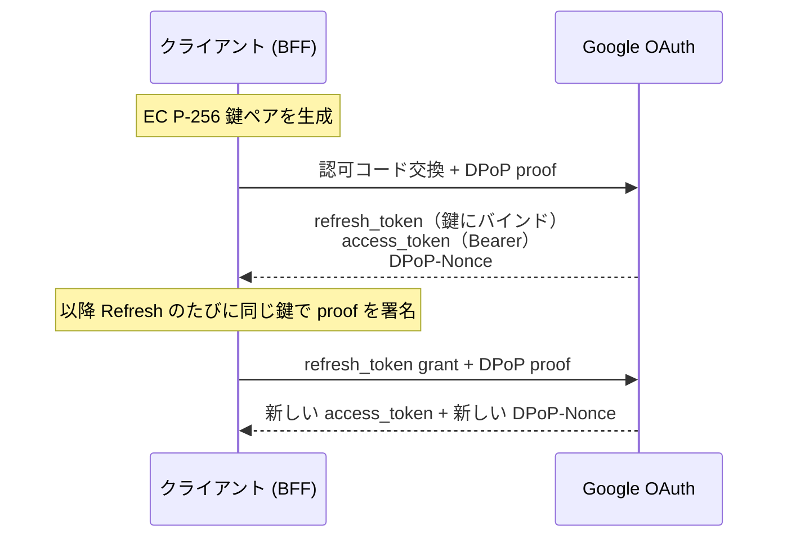
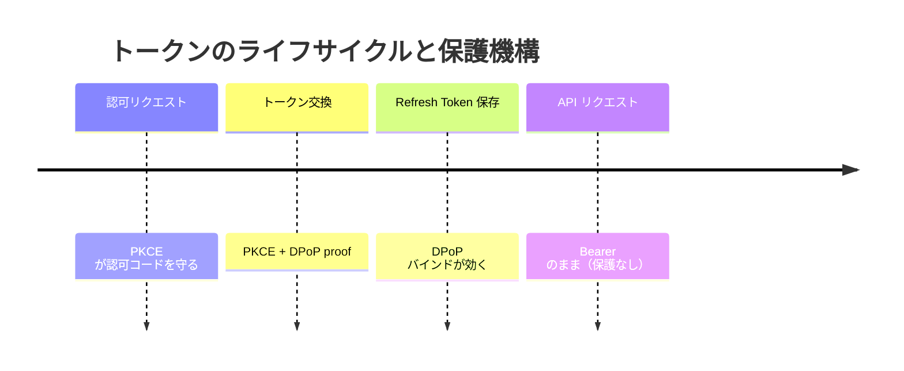

# Google OAuthがDPoPに対応したらしいので検証してみる

**このドラフトは検証がすべて完了した後の確定版です。** article.md は書き上げ済み（公開は `published: false` のまま保留）。
slide.md はこのドラフトをベースに作る。数値・結論はすべて実測で確定済み。

**経緯メモ:** proof リプレイの件は Google Bug Hunters に報告済み → **Won't Fix (Infeasible)**。
責任ある開示は完了しているので、全知見を公開してよい。

## 一次ソース

- Google Developers Blog（2026-10-15）: https://developers.googleblog.com/announcing-dpop-support-for-google-oauth-securing-refresh-tokens/
- DPoP Adoption Guide（更新 2026-07-31）: https://developers.google.com/identity/protocols/oauth2/resources/dpop-adoption
- OAuth 2.0 for Web Server Applications（更新 2026-10-16）: https://developers.google.com/identity/protocols/oauth2/web-server
- OAuth 2.0 Best Practices（更新 2026-05-20）: https://developers.google.com/identity/protocols/oauth2/resources/best-practices
- Google公式 SKILL.md（commit 2026-09-04）: https://github.com/google/skills/blob/main/skills/identity/dpop-adoption/SKILL.md
- RFC 9449（DPoP, 2023-09）: https://www.rfc-editor.org/rfc/rfc9449.html
- RFC 9700（OAuth 2.0 Security BCP）: https://datatracker.ietf.org/doc/html/rfc9700
- RFC 9449 日本語訳（tex2e）: https://tex2e.github.io/rfc-translater/html/rfc9449.html

## 表現のルール（slide でも守る）

- ❌「DPoPが新登場」→ ⭕「RFC 9449で2023年に標準化済み。Googleが対応した」
- ❌「DPoPならトークン漏えいを防げる」→ ⭕「盗まれたRefresh Token単体の再利用を困難にする」
- 「暗号化」と「鍵にバインド」を書き分ける
- Google固有仕様とRFC一般仕様を区別する（`jti`・Nonceのルールは特にGoogle固有）
- リプレイの件は**煽らない**。影響は限定的（Googleも Won't Fix）。
  「ドキュメントと実装の食い違い」として扱う
- ログ・記事・リポジトリに Refresh Token / client secret / 秘密鍵 / 完全なproof を出さない

## タイトルまわり

- 題名：Google OAuthがDPoPに対応したらしいので検証してみる
- 副題：Refresh Tokenを鍵に縛る。存在を初めて知ったので勉強してみる
- 発表者：田中博悠 / Hirohisa Tanaka / tanahiro2010
- 自己紹介：三田学園高等学校 / GDG Greater Kwansai
  - 個人開発でGoogle OAuthを使っている（Refresh TokenをDBに保存している側）

## つかみ

- 2026/10/15、Google Developers Blog に「DPoP対応しました」の記事
- 「Refresh Tokenを鍵にバインドできる」── 便利そう、やってみよう
- ……と調べ始めたら、話が思ってたのと違った
  - 実は半年前から動いていた
    - 実際に話題になっていた[ページ](https://developers.google.com/identity/protocols/oauth2/resources/dpop-adoption?hl=ja)は 2026/08/01 が最終更新
      - この時点でちょこっと違和感を抱く
  - 公式サンプルの署名が壊れていた
  - 公式ドキュメント同士が矛盾していた
  - "used only once" の Nonce が何度でも使えた
    - もしかして、脆弱性？！ と思いテンションを上げる
      - （→ 報告 → Won't Fix）
- 問いかけ：「あなたのDBにあるRefresh Token、今漏れたらどうなりますか？」

## この発表のスタンス

- 公式ドキュメントの翻訳記事にはしない
- RFC 9449とGoogleの実装を**並べて差分を見る**
- 「ドキュメントにこう書いてある」ではなく「**実際にこうなった**」を出す
- 検証できなかったものは「できなかった」と書く
- 🔥 このスタンスは §7（公式サンプルが壊れていた）と §10-11（報告→Won't Fix）で正当化される

---

## 1. そもそもDPoPとは ―― 新機能ではない

- DPoP = Demonstrating Proof-of-Possession。**RFC 9449、2023年9月に標準化済み**
  - 新しいのは**Googleが対応したこと**だけ。Okta / FusionAuth は以前から対応
- Bearer Token の問題：blog いわく "finders-keepers model"（拾った人が使える）
  - 想定脅威（blog が名指し）：Infostealer（RedLine, NodeStealer）、AiTM 攻撃
- DPoP の仕組み
  - クライアントが鍵ペアを生成、**秘密鍵を自分だけが持つ**
  - リクエストごとに秘密鍵で署名した JWT（proof）を添える
  - サーバーはトークンを**公開鍵に紐づけて**発行
  - → トークンだけ盗まれても鍵がなければ使えない
  - 📋 概念図（Mermaid・sequence）→ メモ①
- 用語：sender-constraining（送信者拘束）。DPoP はそのアプリケーション層実装
  - 📋 他手法との比較 → メモ②
- mTLS（RFC 8705）との違い（blog）
  > Unlike transport-layer token binding ... which often breaks or terminates at modern cloud proxies and load balancers, DPoP operates at the HTTP header level.
  - トランスポート層の拘束はLB/プロキシで切れる。DPoPはHTTPヘッダー層で多段に強い

## 2. 「10月に対応した」は不正確 ―― 半年ズレていた

- 🔥 Wayback Machine でドキュメント改版を追った（📋 時系列 → メモ④）
  - 2026-04-15：Best Practices に DPoP 記述**ゼロ**
  - **2026-05-20：Best Practices に DPoP セクション登場**
  - 2026-07-31：Adoption Guide 更新
  - 2026-09-04：`google/skills` に公式 SKILL.md commit
  - **2026-10-15：Developers Blog で発表（5ヶ月遅れ）**
  - 2026-10-16：web-server doc 追従
- 着地：「Googleが隠した」ではなく「**公式ブログの日付＝リリース日ではない**」

## 3. 脅威モデル ―― 何を防ぎ、何を防がないか

- 📋 整理表 → メモ⑤
- **防げる**：Refresh Token **単体**の漏えい時の再利用（DBダンプ／ログ／バックアップ／Infostealer）
- **防げない**
  - Access Token の漏えい（Google では Bearer のまま、有効期限内は使われる）
  - 秘密鍵とRefresh Tokenの同時漏えい（同じDBなら一緒に漏れる）
  - ブラウザのセッションCookie窃取（blog が明確に対象外）
  - 認可コードの横取り（PKCEの仕事）
- blog は Cookie を守らないと明言 → 対策は DBSC（Google + WICG 開発中、TPMにCookieを縛る）
  - DPoP = アプリ層でAPIトークン、DBSC = ブラウザ層でCookie。両方で defense-in-depth
- PKCE との役割分担（📋 時間軸図 → メモ⑥）
  - PKCE = 認可コードをリダイレクト中に守る / DPoP = 発行後のRefresh Tokenを守る。**両方やる**
- 🔥 §6 で秘密鍵をDBに置いた瞬間、守備範囲が一段狭まる。**「DPoP入れた」≠「安全になった」**

## 4. Google固有の仕様 ―― RFCとズレている3箇所

- 📋 RFC vs Google 対照表 → メモ⑦
- **ズレ①：Access Token は Bearer のまま**
  - RFC §5：`token_type` に `DPoP` が MUST。Google：web-server doc が「常に `Bearer`」
  - ただし RFC 違反ではない（public client で RT だけバインドする逃げ道あり）
  - Google の理由（blog）は性能（高QPS APIで毎回署名検証したくない）→ §8 で実測
- **ズレ②：認可コード交換の `jti` が乱数ではない**（🔥 一番面白い）
  - RFC §4.2：96bit以上の擬似乱数 or UUIDv4
  - Google：認可コード交換時は `jti = BASE64URL(SHA-256(authorization_code))` ＝決定的
  - ✅ 公式サンプルの code と jti で再現 → 一致（📋 メモ⑧）
  - Refresh 時は普通のランダム（192bit）
  - なぜ：RFC の `dpop_jkt`（§10）を Google は使わず、既存の `jti` で代替。認可コードは1回限りなので実質一意
- **ズレ③：Confidential Client なのにバインドしている**
  - RFC §5：confidential client の RT は鍵にバインドしない（client認証で既に拘束済み、その方が柔軟）
  - Google サンプルは `client_secret` 付き＝confidential。なのに推奨対象は public client。SPAには BFF を立てろ
  - → **public を守りたいのに実装は confidential** のねじれ。代償は §12 の鍵ローテーションに出る
- **おまけ：discovery doc で何も宣言していない**
  - RFC §5.1 の `dpop_signing_alg_values_supported` が無い（✅ 実測、📋 メモ⑨）
  - discovery ベースの標準準拠クライアントは対応を検出できない。実装はハードコードするしかない

（注意：ここはできるならテーブルで表示する）

## 5. 実装の前提

- 実行環境：Node.js + TypeScript サーバー（Google OAuth の Confidential Client）
- ライブラリ：`jose` 6.2.12。**依存ゼロ**、210KB/80ファイル（📋 メモ⑩）。ES256署名・JWK・thumbprint が揃う
- HTTP：標準 `fetch`、`application/x-www-form-urlencoded` で POST
- 鍵：EC P-256（ES256）。RSA も可だが非推奨、しかも alg 名（RS256/PS256）は非公開
- `state` 検証と PKCE は既存フローとして残す（DPoP は置き換えない）

## 6. 鍵をどう持つか ―― 公式ガードレールがNodeで破綻する（🔥 山場その2）

- 公式 SKILL.md：秘密鍵は「CRITICAL」として `extractable: false` MUST
- ✅ Node で字義通り守ると永続化できない（📋 メモ⑪）
  ```
  exportKey('jwk')   -> InvalidAccessError: key is not extractable
  exportKey('pkcs8') -> InvalidAccessError: key is not extractable
  ```
  - → プロセス再起動で**全ユーザーのRefresh Tokenが使用不能**。復旧は再同意のみ
- さらに：Node の WebCrypto に TPM も Secure Enclave も無い。「hardware boundary」は存在しない
  - SKILL.md のこの文言はブラウザ/モバイル向け。Node の confidential client には当てはまらない
- 現実解：`extractable: true` で生成 → JWK を暗号化/KMS で保存
  - 動くが秘密鍵成分が DB に乗る。**「鍵は外に出ない」前提が一段弱くなる**（§3 の具体化）
- 公開鍵は `extractable: false` でも常に取り出せる（WebCrypto仕様）。JWK に `d` を入れないのは簡単

## 7. 公式サンプルを検証したら壊れていた（🔥 山場その1）

- proof サンプルの署名を検証（📋 メモ⑬）

  | サンプル | 署名長 | 結果 |
  | --- | ---: | --- |
  | 認可コード交換 | 64 B | VALID |
  | Token Refresh | **70 B** | **FAILED** |

- 70B を ASN.1 でパース → DER SEQUENCE（r,s 各32B）。JWS が要求する raw `R||S`（64B, IEEE P1363）ではない
  - 🔥 Google 自身が web-server doc / SKILL.md で「DER を変換しろ」と書いている罠を、公式サンプルが踏んでいる
- もう1つ：web-server doc のサンプルは **RFC 9449 の例文の丸写し**（📋 メモ⑭）
  - `htu` が `server.example.com`、`iat` 1562262616（2019-07-04）、`jti` も自分のルール違反
  - そのままコピーすると `htu` 不一致で弾かれる
- 着地：**公式サンプルも検証対象**。煽らない

## 8. ES256は本当に重いのか

- blog の主張：高QPS APIで毎回DPoP検証すると API Gateway のコストが massive
- ✅ 実測（Node v24.22.0 / Apple M4 / N=20,000、📋 メモ⑮）

  | | µs/op | ops/s |
  | --- | ---: | ---: |
  | sign | 26.2 | 38,227 |
  | verify | 50.5 | 19,787 |

  - 検証は署名の約2倍、1コア毎秒2万回。**自分のアプリでは誤差、Gmail/Drive規模では効く**。どちらも正しい
- 副産物：署名フォーマットの差を Node 内で再現
  ```
  crypto.subtle.sign     -> 64 bytes, 0xed  (raw P1363)
  node:crypto createSign -> 71 bytes, 0x30  (ASN.1 DER)
  ```
  - 📌 71B。§7 のサンプルは70B。DER長は 69〜72 で揺れる → `length === 70` チェックはダメ

## 9. 実際にトークン交換を通す（実機・2026-10-19、📋 メモ⑯〜⑲）

- **9-0. grant は proof より先に検証される**（✅ 認可なしで判明）
  - 存在しないRefresh Token + proof を8通りに壊す → **全部 `invalid_grant`、`DPoP-Nonce` は返らない**
  - 教訓：**デバッグ時に proof のバグが `invalid_grant` に隠れる**（RTが期限切れだと特に）
  - → 実装順序は「まずDPoPなしでRefreshを通す → DPoPを足す」
  - 検証順序はRFC規定外、Google は grant 優先
- **9-1. 認可コード交換に DPoP を付ける**
  - 認可リクエスト：`access_type=offline` + `prompt=consent` + PKCE + `state`
  - proof payload：`htm=POST` / `htu=…/token` / `iat` / `jti=sha256(code)`
  - proof は `DPoP` ヘッダーに置く（フォーム項目にしない）。レスポンスの `DPoP-Nonce` を保存
  - ✅ `token_type` は `Bearer`（ズレ①を実物確認）
  - 📌 成功レスポンスに `challenge` フィールド。値は `DPoP-Nonce` と同じ（ドキュメント未説明）
- **9-2. Nonce の持ち越しは効かない**（公式ドキュメント同士が矛盾）
  - Adoption Guide：workflow 跨ぎは無条件 400 / web-server doc：持ち越せる
  - ✅ 実測 `HTTP 400 use_dpop_nonce`。**古いAdoption Guideが正しく、新しいweb-server docが誤り**
  - → 初回Refreshは必ず2往復。`use_dpop_nonce` リトライループは**必須**（最適化ではない）
- **9-3. Refresh の実装**
  - 同じ秘密鍵で毎回新proof、`jti` ランダム、`iat` 更新、保存Nonceを `nonce` に入れる、新Nonceで更新
- **9-4. 失敗ケース：ドキュメントが2箇所間違っていた**（📋 メモ⑰）
  - web-server doc の一文を分解（htm/htu/iat/署名）
    | doc の主張 | 実測 |
    | --- | --- |
    | `htu` 不一致 → invalid_dpop_proof | **invalid_request** ❌ |
    | `htm` 不一致 → invalid_dpop_proof | **invalid_request** ❌ |
    | `iat` 期限切れ → invalid_dpop_proof | invalid_dpop_proof ✅ |
    | 署名不正 → invalid_dpop_proof | invalid_dpop_proof ✅ |
  - 実際の切り分け（公式のどこにも無い表）
    - `invalid_request`：proof無し / htm・htu不一致
    - `invalid_dpop_proof`：署名不正 / iat範囲外
    - `use_dpop_nonce`：nonce無し・期限切れ・workflow跨ぎ
    - `invalid_grant`：grant不正（§9-0）
  - リトライは `use_dpop_nonce` のみ、**exactly once**（SKILL.md）
- **9-5. `iat` の許容スキュー**（非公開 → ✅ 二分探索で1秒精度、独立2回一致）

  | 方向 | 通る最遠 | 弾かれる最近 | 値 |
  | --- | ---: | ---: | --- |
  | 過去 | -3599s | -3600s | **ちょうど3600秒** |
  | 未来 | +10s | +11s | **ちょうど10秒** |

  - 🔥 360倍の非対称。未来の `iat` = 作り置き（RFC §11.2 が警戒）
  - 📌 サーバー時計が未来に11秒ずれるだけで全proof弾かれる。NTP未設定の `invalid_dpop_proof` の原因

## 10. proof はそのまま再利用できる（🔥 クライマックス）

- RFC §11.1：nonce 使い回しを許してよいのは「**jti を追跡している場合に限る**」
  > As long as the jti value is tracked and duplicates are rejected for the lifetime of the nonce, there is no additional risk of token replay.
- Google はその条件を満たしていない
  - **jti 未追跡**：同じ jti の proof を2回 → 両方200（doc は invalid_dpop_proof と書いている）
  - **nonce は検証されるが使い捨てではない**
    - 対照：でたらめ nonce / 1文字変え → 400（＝検証はされている）
    - 同じ nonce を6回 → 全部200。"used only once" は実際と違う
  - **proof をバイト単位でリプレイできる**
    - jti・nonce・iat・署名まで同一の proof → 繰り返し200、毎回新しい Access Token 発行
    - 証拠：送った proof の SHA-256 が全記録で同一、access_token のハッシュは毎回別物（24件全部別）
- リプレイ可能な時間（1本の proof を iat も nonce も一緒に古くして投げ直す）

  | 経過 | HTTP | |
  | ---: | ---: | --- |
  | 0〜3540s | 200 | 成立 |
  | **3660s** | **400** | **invalid_dpop_proof** |

  - nonce は3540s時点でも有効 → 先に来たのは iat の窓 → **発行から約3600秒（1時間）再利用できる**
  - §9-5 の iat 窓（3600秒）と別経路で一致
- **意味すること／しないこと**（ここを誇張しない）
  - proof を取るには生リクエストを観測できる立場が要る → 同じボディの refresh_token / client_secret も取れる
  - proof 単体は `invalid_grant`（§9-0）。再利用には有効な refresh_token が必須
  - → 「DBダンプで RT だけ漏れた」には DPoP は従来どおり有効。弱いのは「proof単体が漏れる」経路
  - 正確には「RFC が条件付きで認めた nonce 再利用を、**条件（jti追跡）を満たさず許可だけ取っている**」

## 11. Google に報告した ―― 結果は Won't Fix

- ドキュメントとの食い違い＋RFC hardening 条件未達として Google Bug Hunters に報告（生ログ添付、秘密はハッシュ化）
- 結果：**Won't Fix (Infeasible)**。要旨
  - アカウント乗っ取り・権限昇格・認証バイパスが示されていない
  - 報告者自身が影響限定的と認めている
  - VRP の「他ユーザーの機微データの機密性・完全性を実質的に損なう」基準を越えない
- 納得している（§10 の通り、proof を取れる時点で RT も取れ、窓は攻撃能力を増やさない）
  - セキュリティバグというより**ドキュメントと実装の食い違い + hardening ギャップ**
- それでも書く価値：公式記述を鵜呑みにすると要らない排他制御を書く／効いていない前提に寄る
  - 報告して「追跡しない」と返ってきた結末込みで、公式を鵜呑みにしない材料になる

## 12. 運用で効いてくる話

- **既存ユーザーの移行コストが重い**：DPoP バインド RT を得るには revoke か `prompt=consent`。稼働中は全員再同意
- **鍵ローテーションが鍵差し替えで済まない**：新鍵の RT には再認可が必要（§4 ズレ③の RFC 警告が現実化）
  - §6 の鍵消失と合わせ、**鍵のバックアップ戦略 = Refresh Token のバックアップ戦略**
- **SPA は BFF を立てるしかない**：`client_secret` 要件 + `DPoP-Nonce` の CORS 制約。BFF を confidential client に

## 13. まとめ ―― 入れるべきか

- 効くケース：**Refresh Token を長期保存していて、保存先の漏えいリスクを下げたい**
- 正直に見積もる
  - Access Token は Bearer、Cookie も守らない（§3）
  - Node では秘密鍵を保存することになり守備範囲が狭まる（§6）
  - 移行と鍵ローテーションに再同意（§12）
  - 捕捉 proof は約1時間再利用できる。ただし proof を取れる立場なら RT も取れるので実害は限定的（§10）
- いちばんの収穫は姿勢：ブログの日付（§2）、公式サンプル（§7）、ドキュメント同士の矛盾（§9）、"used only once"（§10）
  - 最後は報告したが Won't Fix（§11）。**公式を鵜呑みにせず自分で検証する価値があった**

---

## メモ（データ・サンプルコード）

> 実測値の置き場。slide / article はここから引く。計測スクリプトは `sandbox/`（`./run verify` 等）。

### メモ① DPoPの概念図（Mermaid）



### メモ② sender-constraining の手法比較

| 手法 | 層 | 縛るもの | 弱点 |
| --- | --- | --- | --- |
| Bearer（なし） | — | 何も縛らない | 拾った人が使える |
| mTLS（RFC 8705） | トランスポート層 | クライアント証明書 | LB/プロキシで切れる |
| **DPoP（RFC 9449）** | **アプリケーション層** | **クライアント生成の鍵ペア** | **鍵の保管が自己責任** |
| DBSC（WICG, 開発中） | ブラウザ/ネットワーク層 | デバイスのTPM | ブラウザCookie専用 |

### メモ④ 時系列表

| 日付 | 出来事 | 根拠 |
| --- | --- | --- |
| 2023-09 | RFC 9449 Proposed Standard | RFC |
| 2026-04-15 | Best Practices に DPoP 記述なし | Wayback |
| **2026-05-20** | Best Practices に DPoP 登場 | Wayback |
| 2026-07-31 | Adoption Guide 更新 | ページ末尾 |
| **2026-09-04** | `google/skills` に SKILL.md commit | GitHub API |
| **2026-10-15** | Developers Blog 発表 | blog |
| 2026-10-16 | web-server doc 更新 | ページ末尾 |

### メモ⑤ 脅威モデル整理表

| 脅威 | DPoPで防げるか | 備考 |
| --- | --- | --- |
| Refresh Token 単体の漏えい・再利用 | ✅ | DPoPの目的 |
| Access Token の漏えい | ❌ | GoogleではBearer、有効期限内は使われる |
| 秘密鍵 + Refresh Token の同時漏えい | ❌ | 同じDBなら一緒に漏れる |
| ブラウザのセッションCookie窃取 | ❌ | blog明示。DBSCの領域 |
| 認可コードの横取り | ❌ | PKCEの仕事 |
| proof 単体の窃取（在transit） | △ | 再利用はできるが実害限定（§10） |

### メモ⑥ PKCE と DPoP の守備範囲（Mermaid）



### メモ⑦ RFC 9449 vs Google 対照表

| 項目 | RFC 9449 | Google |
| --- | --- | --- |
| Access Token | `token_type: DPoP` MUST | **`Bearer` 固定** |
| Refresh Token バインド | public のみ（confidential は対象外） | **confidential でもバインド** |
| 認可コードと鍵の紐付け | `dpop_jkt`（OPTIONAL） | **`jti = sha256(code)`** |
| `jti` の性質 | 96bit以上の乱数 / UUIDv4 | 認可コード交換時は決定的、Refresh時はランダム |
| 対応表明 | `dpop_signing_alg_values_supported` | **discovery に無し** |
| Refresh の `nonce` | AS の裁量 | 必須 |
| jti 追跡 | 「追跡すればnonce再利用可」 | **追跡していない**（§10） |

### メモ⑧ 公式サンプルの `jti` 再現（済）

```python
import hashlib, base64
code = "4/0AXEQxIDNpLD-qpSIvjHb2Hl10uS_2sk2GBRpO8UJQ78YZF3hZ9LB9kTA1xYLD4xisi4C5w"
print(base64.urlsafe_b64encode(hashlib.sha256(code.encode()).digest()).rstrip(b"=").decode())
# -> o29CN8LIY0l_N8iy5-ilon1guad9NFQHFOdXTzrBNck （サンプルと一致）
```

### メモ⑨ discovery に DPoP が無い（済）

```sh
curl -s https://accounts.google.com/.well-known/openid-configuration | python3 -m json.tool | grep -i dpop
# （何も出ない）
```

### メモ⑩ ライブラリ（済）

| | version | published | deps | unpackedSize | files |
| --- | --- | --- | --- | ---: | ---: |
| `jose` | 6.2.12 | 2026-09-05 | **なし** | 210,660 | 80 |
| `openid-client` | 6.8.8 | 2026-09-05 | jose, oauth4webapi | 221,768 | 9 |

### メモ⑪ 非extractable鍵（済）

```js
const kp = await crypto.subtle.generateKey({name:'ECDSA',namedCurve:'P-256'}, false, ['sign','verify'])
await crypto.subtle.exportKey('jwk', kp.privateKey)   // InvalidAccessError: key is not extractable
// extractable: true なら export できるが JWK に d（秘密鍵成分）が乗る
```

### メモ⑬ 公式サンプルproofの署名検証（済）

```
[auth-code exchange] sig=64B  SIGNATURE VALID
[token refresh]      sig=70B  SIGNATURE FAILED
# 70B を ASN.1 でパース → SEQUENCE(len=68), INTEGER r[32], INTEGER s[32] = DER のまま
```

### メモ⑭ web-server doc サンプルのデコード（済）

```json
{"typ":"dpop+jwt","alg":"ES256","jwk":{"kty":"EC","x":"l8tFrhx-34tV3hRICRDY9zCkDlpBhF42UQUfWVAWBFs","y":"9VE4jf_Ok_o64zbTTlcuNJajHmt6v9TDVrU0CdvGRDA","crv":"P-256"}}
{"jti":"-BwC3ESc6acc2lTc","htm":"POST","htu":"https://server.example.com/token","iat":1562262616}
```
RFC 9449 の例文と完全一致。`iat` 1562262616 = 2019-07-04。

### メモ⑮ ES256 ベンチ（済）

```
sign   26.2 µs/op  38,227 ops/s
verify 50.5 µs/op  19,787 ops/s
crypto.subtle.sign     -> 64 bytes, 0xed  (raw P1363)
node:crypto createSign -> 71 bytes, 0x30  (ASN.1 DER)
```

### メモ⑯ トークン交換の curl（認可リクエスト / 交換 / Refresh）

```sh
# 認可リクエスト
curl -G "https://accounts.google.com/o/oauth2/v2/auth" \
  --data-urlencode "client_id=…" --data-urlencode "redirect_uri=http://localhost:3000/api/auth/callback/google" \
  --data-urlencode "response_type=code" --data-urlencode "scope=openid email" \
  --data-urlencode "state=…" --data-urlencode "code_challenge=…" --data-urlencode "code_challenge_method=S256" \
  --data-urlencode "access_type=offline" --data-urlencode "prompt=consent"

# 交換 / Refresh は proof を DPoP ヘッダーに置く（-i で DPoP-Nonce を必ず記録）
curl -i -X POST https://oauth2.googleapis.com/token \
  -H "Content-Type: application/x-www-form-urlencoded" -H "DPoP: ${PROOF}" \
  --data-urlencode "grant_type=refresh_token" --data-urlencode "refresh_token=…" \
  --data-urlencode "client_id=…" --data-urlencode "client_secret=…"
```

proof 生成（`jose`）：認可コード交換は `jti=sha256(code)`、Refresh は乱数192bit + `nonce`。JWK に `d` を入れない。

### メモ⑰ エラーコードの実際

| 状況 | error |
| --- | --- |
| proof が無い / `htm`・`htu` 不一致 | `invalid_request` |
| 署名不正 / `iat` 範囲外 | `invalid_dpop_proof` |
| nonce 無し・期限切れ・workflow跨ぎ | `use_dpop_nonce` |
| grant 不正（proofより先に判定） | `invalid_grant` |

### メモ⑱ grant / proof の検証順（済）

存在しないRefresh Token + 壊した proof 8通り → **全部 `invalid_grant`、`DPoP-Nonce` は返らない**。
認可コード交換側でも同じ。`error_description` は `"Bad Request"` のみ。

### メモ⑲ 実機の実測まとめ（2026-10-19）

- Nonce 持ち越し：`400 use_dpop_nonce`（Adoption Guide が正しい）
- iat 境界：過去 -3599s可/-3600s不可、未来 +10s可/+11s不可（1秒精度、独立2回一致）
- jti 使い回し：200（未追跡）
- nonce：でたらめ400 / 同じ値6回とも200（検証されるが使い捨てでない）
- proof リプレイ：同一バイト列3回とも200、access_token は毎回別物
- リプレイ窓：3540s→200、3660s→`invalid_dpop_proof`（iat側で3600秒）
- 環境：Node.js v24.22.0 / jose 6.2.12 / hono 4.13.13 / Apple M4
- 生ログ：`sandbox/private/evidence-bundle/`（秘密はハッシュ化済み）
