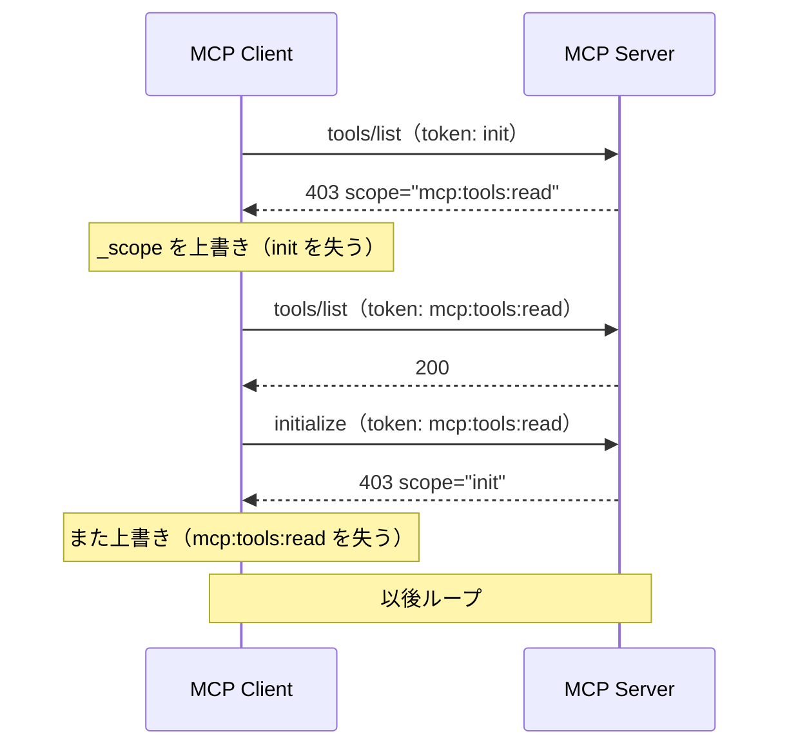
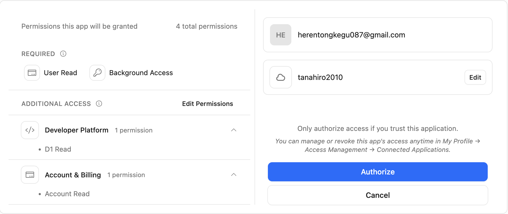

# MCPのStep-up Authorizationは、OAuthのIncremental Authorizationと何が違うのか？

> 「ゾーンはありません」。実際には 3 つありました。

## この記事の結論

Cloudflare API MCP Server が Step-up Authorization に対応したという発表を見て、Google OAuth の Incremental Authorization と何が違うのかを確かめました。仕様を読み、自前の MCP クライアントを書いて実機に 128 回リクエストを投げました。**追加認可そのものは、どちらも同じ OAuth です。違うのは「権限が足りない」をサーバーからクライアントに伝える経路があることでした。**

- **既存 Scope を覚えているのはクライアント。** Cloudflare の認可サーバーは、baseline 以外の付与済み Scope を次の認可に引き継ぎません。Google の `include_granted_scopes` とは逆向きです
- **ところが Cloudflare のサーバーも覚えていました。** 403 チャレンジの `scope` が、そのトークンの付与 Scope に追随します。これは MCP 2026-07-28 が削除した方のやり方です
- **経路は全部の操作につながっていません。** 権限が無いとき、403 を返す操作と、200 と空配列を返す操作が同じサーバーに同居しています

同じ API を、Scope を付与する前と後で叩いた結果です。

| 操作 | Scope 無し | Scope 付与後 |
| --- | ---: | ---: |
| ゾーン一覧 | **0 件** | **3 件** |
| Workers スクリプト一覧 | **0 件** | **12 件** |
| D1 データベース一覧 | 403 チャレンジ | 5 件 |

検証コードはこちらです: https://github.com/tanahiro2010/slides/tree/main/slides/slides/MCP%E3%81%AEStep-up%20Authorization%E3%81%AF%E3%80%81OAuth%E3%81%AEIncremental%20Authorization%E3%81%A8%E4%BD%95%E3%81%8C%E9%81%95%E3%81%86%E3%81%AE%E3%81%8B%EF%BC%9F/sandbox

そして、この記事で一番伝えたいことを先に書いておきます。

**Step-up Authorization で新しくなったのは、認可のやり方ではありません。「権限が足りない」を伝える経路です。** 従来の Web アプリでは、どの機能にどの Scope が要るかを開発者が知っていました。MCP では AI がツールを選ぶので、クライアントには事前に分かりません。だから「気づく」役をサーバーに移すしかなく、そのための経路が要ります。経路が通っていれば最小権限で始められます。通っていない操作では、AI は「ありません」と答えます。

> この記事は LT「MCPのStep-up Authorizationは、OAuthのIncremental Authorizationと何が違うのか？」の内容に、発表で話しきれなかった実測と、判定を一度取り下げた経緯を足したものです。対象は、OAuth 2.0 の基礎を知っていて MCP サーバーを書く側に回ることがある人です。

---

## 1. 発端は、3 段構えの 3 段目だった

2026 年 10 月 19 日、Cloudflare の Changelog に 1 本流れました。

> Grant only the required scopes when you connect, then authorize more on demand as your agent performs a task. When a tool call needs a scope you have not granted, the server returns an `insufficient_scope` challenge naming it, and your MCP client asks you to approve it. Scopes you already granted are kept.

最小で繋いで、足りなくなったら足す。読んだとき、自分が個人開発で使っている `include_granted_scopes=true` と何が違うのか分かりませんでした。それがこの記事の出発点です。

調べると、この発表は単発ではありませんでした。

| 日付 | 出来事 |
| --- | --- |
| 2026-08-22 | Wrangler と API MCP Server が optional scopes 対応。同意画面に「Edit Permissions」 |
| 2026-10-01 | `workers-oauth-provider` が v1。`insufficientScope()` 一行で step-up |
| **2026-10-19** | API MCP Server が step-up 対応 |

8 月の Changelog の締めが効いています。

> If a command or tool call needs a scope that you declined, **reauthorize the client** and grant that scope.

8 月の時点では、断ったら手で繋ぎ直せ、でした。権限を減らせるようになったぶん、減らすほど不便になる。10 月の対応は、その手作業を消した話です。

## 2. 2 対 384

Cloudflare の MCP サーバーは、2 種類の `scopes_supported` を公開しています。名前は同じですが、別の RFC が別の意味で定義したものです。

```sh
curl -s https://mcp.cloudflare.com/.well-known/oauth-protected-resource/mcp
curl -s https://mcp.cloudflare.com/.well-known/oauth-authorization-server
```

| メタデータ | RFC | 個数 | 中身 |
| --- | --- | ---: | --- |
| Protected Resource Metadata | RFC 9728 | **2** | `user:read`, `account:read` |
| Authorization Server Metadata | RFC 8414 | **384** | `dns.write`, `zone.write`, `workers-r2.read` … |

前者は「このリソースにアクセスするのに最低限いるもの」、後者は「この認可サーバーが発行しうるものの全カタログ」です。MCP の仕様は前者について、`the minimal set of scopes necessary for basic functionality` と書いています。

認証なしで叩くと、401 がその 2 個を名指しします。

```http
HTTP/2 401
www-authenticate: Bearer realm="OAuth",
  resource_metadata="https://mcp.cloudflare.com/.well-known/oauth-protected-resource/mcp",
  scope="user:read account:read"
```

**2 と 384 の差が、この機能の存在理由です。** step-up が無ければ、クライアントは 384 個のカタログから初回に渡す分を選ぶしかありません。少なく選べば動かず、多く選べば権限を配りすぎる。2 個で始められるのは、足りなくなったら足せる前提があるときだけです。

## 3. Step-up は RFC 6750 の上に建っている

MCP の仕様を読むと、発火点は `403 insufficient_scope` です。

```http
HTTP/1.1 403 Forbidden
WWW-Authenticate: Bearer error="insufficient_scope",
                         scope="files:write",
                         resource_metadata="https://mcp.example.com/.well-known/oauth-protected-resource",
                         error_description="File write permission required for this operation"
```

このエラーコードは MCP の発明ではありません。RFC 6750 §3.1、2012 年の定義です。

> **insufficient_scope** — The request requires higher privileges than provided by the access token.

MCP が足したのは、そこから再認可へ繋ぐ手順の方です。

1. `WWW-Authenticate` をパースする
2. 必要 Scope を「前回要求した Scope ∪ チャレンジの Scope」として決める
3. 再認可する。**ここは普通の OAuth 認可コードフローです**
4. 元のリクエストを再試行する

Google の Incremental Authorization と並べると、違いは 3 つに絞れます。

| | Google Incremental Authorization | MCP Step-up Authorization |
| --- | --- | --- |
| 追加が必要と**気づく**のは | アプリ（呼ぶ前に自分で判断） | **サーバー** |
| 不足 Scope を**伝える**のは | 伝達不要。アプリが知っている | `WWW-Authenticate: scope="…"` |
| 既存 Scope を**覚えている**のは | **認可サーバー**（`include_granted_scopes=true`） | **クライアント** |
| 再認可の仕組み | OAuth 認可コードフロー | **同じ** |

3 行目は、仕様を読んだだけでは決まりません。Changelog の "Scopes you already granted are kept" には主語がないからです。クライアントが和集合を作った結果そう見えるのか、認可サーバーが覚えているのか、両方読めます。ここを実機で確定させるのが、この検証の中心になりました。

> **用語: baseline**
> この記事では、Protected Resource Metadata が名指しする最小 Scope（`user:read` と `account:read`）に `offline_access` を足したものを baseline と呼びます。Cloudflare の同意画面が、過去の付与に関係なく毎回出してくる 3 つです。

## 4. 「2026-07-28 の新機能」ではなかった

Changelog は MCP 2026-07-28 の step-up にリンクしています。それで新機能だと思い込みましたが、違いました。`Step-Up Authorization Flow` の節は **2025-11-25 の仕様に既にあります**。2025-06-18 以前にはありません。

2026-07-28 で変わったのは、既存 Scope の和集合を**誰が作るか**でした。

| 仕様 | 和集合を作るのは |
| --- | --- |
| 2025-11-25 | **サーバー** |
| 2026-07-28 | **クライアント** |

2025-11-25 はサーバーに 3 択を示していました。Minimum / Recommended / Extended の 3 つで、どれも「既に付与済みの Scope をサーバーが 403 に含める」前提です。2026-07-28 で、この 3 択が丸ごと消えました。

変えた理由は [Issue #2349](https://github.com/modelcontextprotocol/modelcontextprotocol/issues/2349) の本文に書いてあります。

> This **contradicts the RFC**, creates an **impossible requirement for stateless servers**, and leads to **infinite re-authorization loops** in practice.

無限ループの中身は、TypeScript SDK の [Issue #1582](https://github.com/modelcontextprotocol/typescript-sdk/issues/1582) が具体的です。`initialize` は `init`、`tools/list` は `mcp:tools:read` を要求するサーバーを想定します。



403 が RFC 6750 に忠実に「その操作に必要な Scope だけ」を返すと、クライアントが上書きした瞬間に前の権限が落ちます。和集合はお作法ではなく、事故対策でした。

## 5. SDK を使わずにクライアントを書いた

検証に `@modelcontextprotocol/client` を使いませんでした。このライブラリは 403 を見た時点で `computeScopeUnion()` を呼び、自動で和集合を作って再認可します。

```js
function computeScopeUnion(...scopes) {
	const seen = new Set();
	for (const scope of scopes) {
		if (!scope) continue;
		for (const token of scope.split(/\s+/)) if (token) seen.add(token);
	}
	return seen.size > 0 ? [...seen].join(" ") : void 0;
}
```

正しい実装です。ただこれだと、**和集合を作らない再認可**が投げられません。「既存 Scope を保っているのは誰か」を切り分ける対照が作れなくなります。なので OAuth と MCP を手で踏む最小クライアントを書きました。何を要求するかを毎回こちらが決められることが、この検証の前提です。

事前登録は要りませんでした。Cloudflare の認可サーバーは Dynamic Client Registration を開けているので、スクリプトから public client として登録できます。`client_secret` は発行されません。

通信層は例外を投げない作りにしました。400 も 403 も観測結果なので、握りつぶさずに status / headers / body をそのまま返します。全送信は 1 箇所のフックを通り、1 往復 1 行の JSON で残ります。秘密は消さずに指紋に置き換えます。

```json
"access_token": { "_redacted_len": 82, "_sha256_16": "184d68d85f68caab" }
```

`<redacted>` で潰すと「同じトークンを投げた」も「毎回別物が発行された」も示せなくなります。指紋なら両方示せます。後でクロスリソースの検証をしたとき、同じ指紋を 2 つのサーバーに出すことで同一性の証明に使いました。

### 要求は 2 個、付与は 3 個

同意は 2 画面に分かれています。最初に `Minimal` を含むプリセットを選ぶ画面が出て、選ぶと権限の内訳に移ります。Changelog の `choose **Minimal** on the consent page` は、1 枚目の方の話です。

2 枚目は REQUIRED と ADDITIONAL ACCESS の 2 段です。前者は外せません。後者は Edit Permissions から個別にチェックを外せます。8 月の optional scopes が効いている画面です。実物は §7 に貼ります。

要求した Scope は `user:read account:read` の 2 個でしたが、付与されたのは 3 個でした。

```
要求した scope  : user:read account:read
付与された scope: user:read offline_access account:read
```

`offline_access` を要求した覚えがなくて一瞬戸惑いましたが、画面を見れば分かります。Background Access が REQUIRED に入っています。**要求 Scope と付与 Scope は別物として記録する**、という当たり前のことが、初回から効きました。

## 6. チャレンジの `scope` は baseline 込みだった

403 を踏むために、読み取り専用のエンドポイントを総当たりしました。`search` ツールが返す OpenAPI spec には `x-api-token-group` が入っていて、説明文にこうあります。

> API token permissions the endpoint accepts (any one); **OAuth scopes have the same names**

Scope とエンドポイントの対応表は、サーバー自身から引けます。実際に `GET /zones` を引くと `["Zone Zone Read"]` が返ります。

持っていない Scope が要る操作を叩くと、チャレンジが返りました。

```http
HTTP/2 403
WWW-Authenticate: Bearer realm="OAuth", error="insufficient_scope",
  scope="user:read account:read workers-r2.read",
  resource_metadata="https://mcp.cloudflare.com/.well-known/oauth-protected-resource/mcp",
  error_description="This operation needs the workers-r2.read scope"
```

`scope` に baseline が入っています。ここは仕様と Cloudflare 自身のドキュメントが割れていた箇所でした。

| | 403 の `scope` に何を入れるか |
| --- | --- |
| MCP 2026-07-28 仕様 | その操作に必要なものだけでよい。既存 Scope を含める義務はない |
| `workers-oauth-provider` の docs | **baseline 込みで**全部入れろ |
| 実機 | **後者** |

`error_description` が不足している 1 個を名指ししているので、人間が読む側としても親切です。

## 7. 誰が覚えているのか ―― ここで一度間違えた

本題です。`d1.read` **だけ**を要求して、持っていた 3 つをあえて落としました。

```
要求 : d1.read
付与 : d1.read user:read offline_access account:read
```



要求していない 3 つが残りました。これを見て「認可サーバーが過去の付与を保持している」と書きかけました。

**間違いです。** 候補が 3 つあって、この観測では切り分けられません。

1. 前回付与したものを認可サーバーが保持している
2. DCR の登録時に `scope: "user:read account:read"` を渡した。こちらの作り込み
3. リソースの baseline を既定で出しているだけ

2 は自分で混ぜ込んだ交絡でした。対照を作ります。**過去の付与がゼロ**のクライアントを新規に登録し、登録時の `scope` も `d1.read` だけにして、同じ認可画面を出しました。


同意画面は完全に同一でした。4 permissions、REQUIRED に User Read と Background Access、ADDITIONAL ACCESS に D1 Read と Account Read。過去に一度も認可していないクライアントでも Account Read が出ます。

つまり 3 で説明がつきます。**判定を取り下げました。**

測り直しの設計はこうです。baseline でない `d1.read` を持った状態で、`workers-r2.read` だけを要求する。これなら既定値では説明がつきません。

同意画面に `D1 Read` は出ませんでした。直前に付与したばかりなのに、です。


承認後の付与がこれです。

```
要求 : workers-r2.read
付与 : workers-r2.read user:read offline_access account:read
```

`d1.read` が消えています。文字列だけでは足りないので、行動でも確かめました。D1 一覧は再び 403 チャレンジに戻りました。能力ごと失われています。

> Cloudflare の認可サーバーは、baseline 以外の既付与 Scope を引き継ぎません。
> Changelog の "Scopes you already granted are kept" が成立するのは、クライアントが和集合を作っているからです。Google の `include_granted_scopes` が認可サーバー側で合成するのとは、構造が逆になっています。

## 8. サーバーも覚えていた ―― 仕様が捨てたやり方

チャレンジの `scope` を、トークンの中身を変えて何度か観測しました。

| 持っていた Scope | 叩いた操作 | チャレンジの `scope` |
| --- | --- | --- |
| baseline のみ | R2 一覧 | `user:read account:read workers-r2.read` |
| baseline + `workers-r2.read` | D1 一覧 | `user:read account:read workers-r2.read` **`d1.read`** |
| baseline + `workers-r2.read` | KV 一覧 | `user:read account:read workers-r2.read` **`workers-kv-storage.read`** |

baseline 固定ではありません。**トークンの付与 Scope に追随しています。** 式にするとこうです。

```
challenge.scope = トークンに付与済みの Scope ∪ その操作に必要な Scope
```

これは 2025-11-25 の "Recommended approach"、つまり 2026-07-28 が削除した方のやり方です。Issue #2349 が「ステートレスなサーバーには実装不可能」と書いたのは、サーバーがトークンの中身を知らないと和集合が作れないからでした。Cloudflare は認可サーバーとリソースサーバーが状態を共有しているので、その制約を受けません。

効果が大きいのは、**古いクライアントが壊れない**ことです。`@modelcontextprotocol/sdk@1.32.1` は 403 のハンドラで `_scope` を上書きします。

```js
if (error === 'insufficient_scope') {
    if (scope) {
        this._scope = scope;   // 上書き。前の Scope は消える
    }
```

§4 のループ条件そのものです。それでも Cloudflare 相手なら落ちません。サーバーが和集合を肩代わりしているからです。仕様はクライアントに責務を移しましたが、実装側は両方で持っている状態になっています。

## 9. 「ゾーンはありません」

総当たりしていて、403 が返らない操作がありました。

| 操作 | 必要 Scope | 結果 |
| --- | --- | --- |
| R2 / KV / D1 / Queues / Images | 各 `*.read` | 403 + チャレンジ |
| ゾーン一覧 | `zone.read` | **200 + 空配列** |
| Workers スクリプト一覧 | `workers-scripts.read` | **200 + 空配列** |
| `/user/tokens` | カタログに無い | ツール結果の文字列で 403 |

真ん中の 2 つが、権限によるフィルタなのか本当に 0 件なのかは、この時点では区別できません。`zone.read` と `workers-scripts.read` を付与して、同じ操作を叩き直しました。

```
ゾーン一覧            0 件  →  3 件
Workers スクリプト一覧  0 件  →  12 件
```

**アカウントには実在していました。** 同一アカウント、同一クライアント、変えたのは Scope だけです。

これが step-up の経路から外れます。403 が返らないので、クライアントは「権限が足りない」を知りません。ユーザーに追加認可を求める機会も発生しません。AI は「ゾーンはありません」と答えて、そこで会話が終わります。

最後の `/user/tokens` は、また別の切れ方をします。

> Cloudflare API error: GET /user/tokens returned HTTP 403: 9109: Unauthorized to access requested resource. **No OAuth scope covers this endpoint, so OAuth connections cannot use it.** Connect with an API token that has one of these permissions instead: API Tokens Write, API Tokens Read.

対応する OAuth Scope がカタログに存在しないので、step-up のしようがありません。これは正直な実装です。ツール結果の文字列として返るぶん、AI も人間も理由が読めます。

**同じサーバーの中に、権限不足の伝わり方が 3 通りあります。** エージェントに権限を渡す設計をするとき、効いてくるのはこの差です。チャレンジが返る操作だけが、最小権限から始めても自力で回復できます。

## 10. refresh では広げられない

追加認可が必ずブラウザに戻る理由は RFC 6749 §6 にあります。refresh では Scope を広げられません。実際に投げてみました。

| 要求 | HTTP | 付与された scope |
| --- | --- | --- |
| scope 省略（対照） | 200 | 元の 7 個のまま |
| 広げる（`workers-kv-storage.read` 追加） | 200 | **元の 7 個のまま** |
| 狭める（baseline だけ要求） | 200 | **元の 7 個のまま** |

広げる方は RFC どおりです。エラーではなく黙って無視されます。行動でも確かめて、KV 一覧は 403 のままでした。

狭める方は想定外でした。RFC 6749 §6 は narrowing を禁じていませんし、`workers-oauth-provider` の docs には `Token and refresh requests can only narrow the grant` と書いてあります。実機では無視され、`d1.read` はまだ通ります。

ライブラリのソースを読むと、こちらは正しく実装されています。

```ts
let tokenScopes = this.downscope(body.scope, grantData.scope);

private downscope(requestedScope, allowedScopes) {
  if (!requestedScope) return allowedScopes;
  return requestedScopes.filter((scope) => allowedScopes.includes(scope));
}
```

docs はライブラリについて正確です。食い違っているのは hosted の方でした。チャレンジのヘッダー形式は `workers-oauth-provider` の `insufficientScope()` と一致するのに、refresh の scope 処理とトークン検証は別物です。**同じ名前のサーバーでも、OSS 版と hosted 版を同一視しない方がいい**、という教訓になりました。

ついでに 2 つ見つけました。refresh は直列化されていて、重なると `429 temporarily_unavailable` が返ります。そして `refresh_token` は毎回回転します。

### 一度、測っていないのに結論を書いた

この 3 ケースを最初は連続で投げました。2 本目以降が 429 で落ちて、**本題が一度も実行されていません**。なのにスクリプトは「広がらなかった」と出力しました。差分が空なのは、挙動がそうだったからではなく、リクエストが届かなかったからです。

判定を取り下げて、間隔を空けて測り直しました。429 を「まだ測れていない」として扱い、指数バックオフで再試行する作りに変えています。出力された結論を、観測だと思い込まないことです。

## 11. ハマりポイント：2026-07-28 に `initialize` は無い

実装で最初に止まったのはここでした。`initialize` を投げたら 400 が返ります。

```
-32020 the request headers and body disagree: an initialize request
       (legacy handshake) was sent with a modern MCP-Protocol-Version header
-32602 the MCP-Protocol-Version header names protocol revision 2026-07-28,
       but the request is missing the required per-request envelope key(s): _meta
-32020 the body names method tools/list but the required Mcp-Method header is absent
```

2026-07-28 はステートレスになっていて、`initialize` ハンドシェイクがありません。代わりに毎リクエストの `params._meta` に載せます。

```json
{
  "_meta": {
    "io.modelcontextprotocol/protocolVersion": "2026-07-28",
    "io.modelcontextprotocol/clientCapabilities": {},
    "io.modelcontextprotocol/clientInfo": { "name": "…", "version": "…" }
  }
}
```

さらに、本文の内容をヘッダーにも書きます。`Mcp-Method: tools/call` と `Mcp-Name: <ツール名>` です。本文を開かずに中間装置がルーティングやレート制限をかけられる形で、CDN を持つ会社が嬉しい設計です。Claude Code のバイナリにも同じ処理が入っています。

旧版の `initialize` は、`MCP-Protocol-Version` ヘッダーを付けなければ今も通ります。同じトークンで 2025-11-25 と 2026-07-28 の両方が 200 になることを確認しました。

> **脇道：401 と 403 の取り違え**
> 本筋から外れるので短く書きます。ここからこのブロックの終わりまでは、step-up の経路とは関係ありません。
>
> 対照用に投げた「一度も発行されていないランダムな 43 文字」が、`401 invalid_token` ではなく **`403 insufficient_scope`** を返しました。二分探索で境界を詰めると、ちょうど 40 文字でした。`[A-Za-z0-9_-]` が 40 文字以上なら 403、39 文字以下や `.` `:` 空白を含むと 401 です。
>
> 403 insufficient_scope は MCP では step-up の発火点なので、失効したクライアントが「追加の権限をください」と表示されるのでは、と疑いました。**外れました。** 現実的な契機を 3 つ試して、全部 401 です。
>
> | 実クライアントが持ちうる状態 | 結果 |
> | --- | --- |
> | revoke 済みの実トークン | 401 `invalid_token` |
> | 別リソース向けの正規トークン | 401 `invalid_token` |
> | 壊れた文字列 / 39 文字以下 | 401 `invalid_token` |
>
> 403 になるのは、意図的に作った未発行の文字列だけです。実装の瑕疵ではありますが、実害はありません。
>
> なお revoke の粒度も測りました。access_token を revoke しても refresh_token は生きています。refresh_token を revoke して初めて `invalid_grant "Grant not found"` になります。

## 12. 結局、何が違ったのか

違いは 3 つで、それ以外は同じ OAuth でした。

1. **気づくのが誰か** — アプリから**サーバー**へ
2. **伝える手段があるか** — 無し（アプリが知っている）から **`WWW-Authenticate`** へ
3. **覚えているのが誰か** — 認可サーバーから**クライアント**へ

再認可そのものは、どちらも認可コードフローです。Step-up は OAuth の代替ではなく、OAuth への入口でした。

なぜ MCP だけこの形になったのかも、測ってみると腑に落ちます。従来の Web アプリでは、どの機能にどの Scope が要るかを開発者が知っています。MCP では AI がユーザーの指示からツールを選ぶので、クライアントには事前に分かりません。`execute()` のように中で任意の API を叩くツールなら、呼ぶまで決まりません。だから「気づく」役はサーバーにしか務まらず、伝える経路が要ります。

そして実装を見ると、仕様が 1 本に決めた責務を、現実は二重に持っていました。クライアントは和集合を作り、サーバーも和集合を返す。遷移期の実装としては正しい判断です。古いクライアントが壊れません。

残っているのは §9 の方です。403 が返らない操作では、AI は権限不足に気づけません。これは Cloudflare の欠陥というより、**権限でフィルタされたリストと AI エージェントの相性**の話です。リストが空で返る API は昔からあって、人間が使うぶんには「自分の権限では見えないのだろう」と察しがつきました。AI は察しません。「ありません」と報告します。

MCP サーバーを書く側として持ち帰ったのは、この一点です。**権限が足りないときに、黙って空を返さない。** 403 とチャレンジを返せば、クライアントがユーザーに聞きにいけます。経路は仕様が用意してくれています。つながっていない操作を作るかどうかは、サーバーを書く側の判断です。

### 参考

- [Cloudflare API MCP server now supports step-up authorization](https://developers.cloudflare.com/changelog/post/2026-10-19-cloudflare-mcp-step-up/) — 今回の発端。末尾に `/index.md` を付けると Markdown で読める
- [Choose OAuth scopes for Wrangler and the Cloudflare API MCP server](https://developers.cloudflare.com/changelog/post/2026-08-22-wrangler-mcp-optional-oauth-scopes/) — optional scopes。同意画面の Edit Permissions
- [MCP Specification 2026-07-28 — Authorization](https://modelcontextprotocol.io/specification/2026-07-28/basic/authorization) — Step-Up Authorization Flow と Scope Challenge Handling
- [MCP Specification 2025-11-25 — Authorization](https://modelcontextprotocol.io/specification/2025-11-25/basic/authorization) — サーバーが和集合を作っていた頃の 3 択
- [Issue #2349](https://github.com/modelcontextprotocol/modelcontextprotocol/issues/2349) — 責務をクライアントへ移した理由。3 つの論点が本文にある
- [typescript-sdk#1582](https://github.com/modelcontextprotocol/typescript-sdk/issues/1582) — 無限ループの再現手順
- [cloudflare/workers-oauth-provider](https://github.com/cloudflare/workers-oauth-provider) — `insufficientScope()` の実装と、2 つの `scopes_supported` の整理
- [Google — Using OAuth 2.0 for Web Server Applications](https://developers.google.com/identity/protocols/oauth2/web-server) — `include_granted_scopes` と combined authorization
- [RFC 6750 §3.1](https://www.rfc-editor.org/rfc/rfc6750#section-3.1) — `insufficient_scope` の定義
- [RFC 9470](https://www.rfc-editor.org/rfc/rfc9470) — こちらは Step-up **Authentication**。別物
