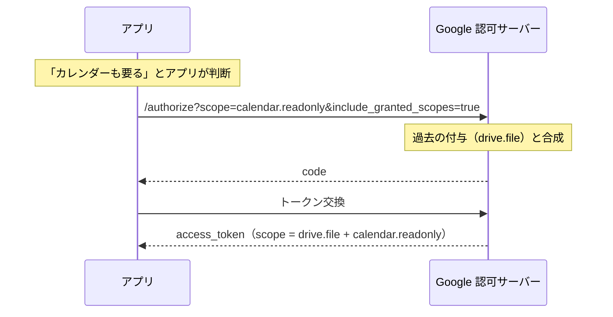
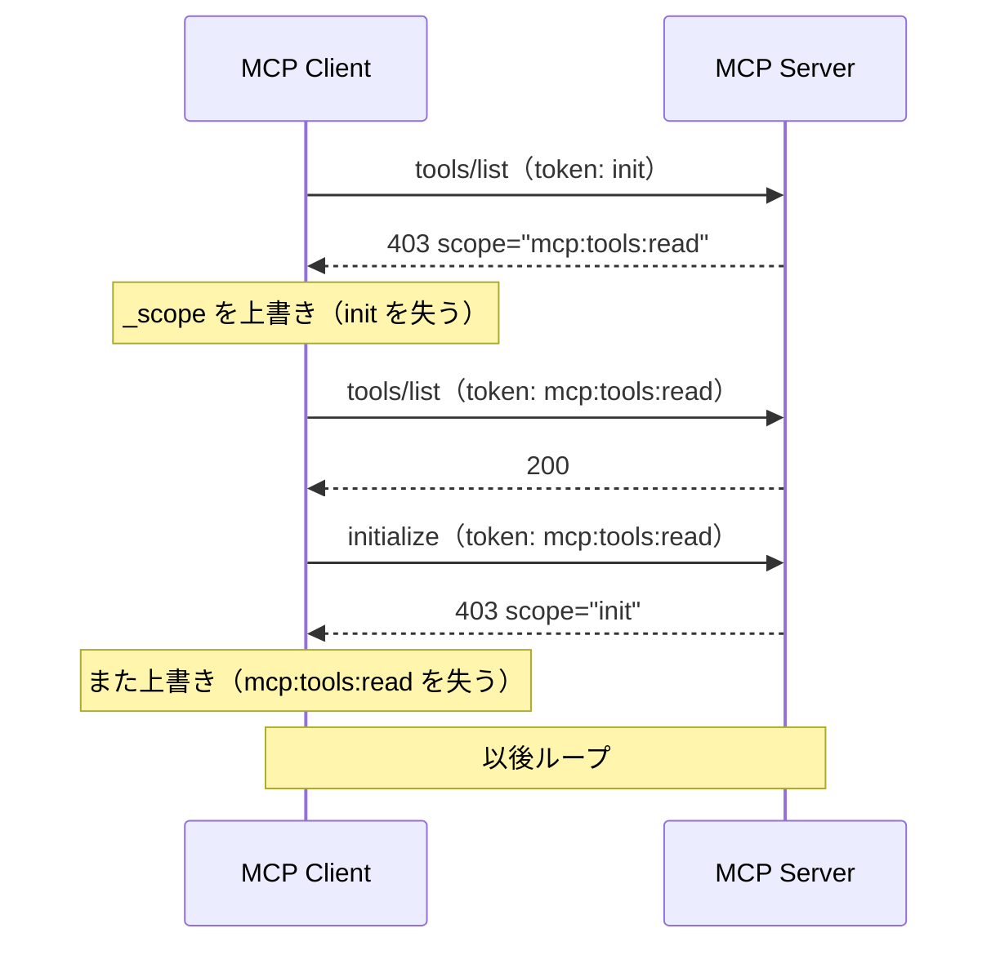

# MCPのStep-up Authorizationは、OAuthのIncremental Authorizationと何が違うのか？

**このドラフトは「調査完了・実機検証前」の状態です。**
仕様・SDK・バイナリの裏取りは済んでいる（`references.md`）。
**Cloudflare実機へのOAuth接続と403の観測はまだ**。⬜ が付いている箇所は実測後に埋める。
**⬜ のまま article.md / slide.md に書かないこと。** 落とすか「確認できていない」と明記する。

- 調査メモ：`references.md`（主張13件の判定・計測コマンド・読めなかったもの）
- 企画書：`PRD.md`（実験シナリオA〜Eの原案。本ドラフトの §検証計画 が最新）

## 記事を書くに当たって

`article-creater`スキルを読んでから書いてください。骨格（エピグラフ → この記事の結論 → 採番した本文）と
frontmatterの決まり、一次ソースの当たり方がそこにまとまっています。
記事はスライドの各セクションごとを増量し、そして技術的側面を追加して書くことを意識してください。
また、記事の中で**AI生成画像は使いません**（意味のない挿絵が入るのを防ぐため）。
実機のスクリーンショットは使ってよい。`images/` に置く。
marmaidなどで図を作ることはできます。
https://zenn.dev/meijin/articles/tech-article-output-recommend
これを参考に記事書いてください。

作成順は **slide → article**。articleはLTの各セクションを増量し、技術要素を足す。

## 一次ソース

- Cloudflare Changelog（2026-10-19）: https://developers.cloudflare.com/changelog/post/2026-10-19-cloudflare-mcp-step-up/
  - **末尾に `/index.md` を付けるとMarkdownが返る。** 引用はそちらから取る
- Cloudflare Changelog（2026-10-01, Workers OAuth Provider v1）: https://developers.cloudflare.com/changelog/post/2026-10-01-workers-oauth-provider-1x/
- Cloudflare Changelog（2026-08-22, optional scopes）: https://developers.cloudflare.com/changelog/post/2026-08-22-wrangler-mcp-optional-oauth-scopes/
- MCP Specification 2026-07-28 — Authorization: https://modelcontextprotocol.io/specification/2026-07-28/basic/authorization
- MCP Specification 2025-11-25 — Authorization（比較用・これが重要）: https://modelcontextprotocol.io/specification/2025-11-25/basic/authorization
- SEP-2350（PR, merged 2026-03-28）: https://github.com/modelcontextprotocol/modelcontextprotocol/pull/2350
- Issue #2349（設計意図はここ）: https://github.com/modelcontextprotocol/modelcontextprotocol/issues/2349
- typescript-sdk#1582（無限ループの実例・open）: https://github.com/modelcontextprotocol/typescript-sdk/issues/1582
- cloudflare/workers-oauth-provider: https://github.com/cloudflare/workers-oauth-provider
- Google OAuth — Incremental Authorization: https://developers.google.com/identity/protocols/oauth2/web-server
- RFC 6750 §3.1: https://www.rfc-editor.org/rfc/rfc6750#section-3.1
- RFC 9470（Step-up **Authentication**）: https://www.rfc-editor.org/rfc/rfc9470
- RFC 9728 / RFC 8414（2つの `scopes_supported`）

## 表現のルール（slide でも守る）

- ❌「MCPが新しい認可方式を作った」→ ⭕「**RFC 6750 §3.1（2012年）の既存機構**に、MCPが手順を定義した」
- ❌「Step-up は 2026-07-28 の新機能」→ ⭕「**2025-11-25から仕様にある**。2026-07-28で変わったのは和集合の責務」
- ❌「Step-up Authorization = RFC 9470」→ ⭕「RFC 9470は Step-up **Authentication**。別物」
- ❌「Incremental か Step-up か」→ ⭕「**置き換えではない**。Step-upは検出の仕組み、再認可はOAuthそのもの」
- 「Scopeを要求した」と「Scopeが付与された」を書き分ける（認可画面で拒否されうる）
- 403（権限不足）と401（未認証・無効トークン）を混同しない。**実測で両方見せる**
- Cloudflare固有の挙動とMCP仕様一般を区別する（`Minimal` はCloudflare固有）
- 未実測を実測として書かない。⬜ は「確認できていません」と書くか落とす
- アクセストークン / 認可コード / Cookie / アカウントID は記事掲載前にマスクする

## タイトルまわり

- 題名：MCPのStep-up Authorizationは、OAuthのIncremental Authorizationと何が違うのか？
- 副題：⬜ 候補 →「違いは"誰が気づいて、誰が覚えているか"だった」
- 発表者：田中博悠 / Hirohisa Tanaka / tanahiro2010
- 自己紹介：三田学園高等学校 / GDG Greater Kwansai
  - 個人開発でGoogle OAuthを使っている（Incremental Authorization 側の当事者）
  - MCPサーバーも書く側 → **両方書く立場から見ると、この差は他人事ではない**

## つかみ

- 2026/10/19、Cloudflare Changelog に「API MCP Server が Step-up Authorization に対応」
  - 最小権限で繋いで、足りなくなったら足せる
- **「それ、Google OAuth の Incremental Authorization と何が違うんだ？」**
  - 自分が個人開発で使っている `include_granted_scopes=true` とやっていることが同じに見える
- 調べ始めたら、思っていたのと違った
  - **新機能じゃなかった**（2025-11-25の仕様に既出）
  - 仕様が**途中で責務をひっくり返していた**（サーバー → クライアント）
  - ひっくり返した理由が**無限ループ**だった
  - 自分が使っているクライアントのバイナリに、その実装が入っていた
- 問いかけ：「**あなたのAIエージェント、今どのScopeを持っていますか？**」
  - 人間が選んだのではなく、AIが選んだツールが要求したScopeです

## この発表のスタンス

- Cloudflareの新機能紹介記事にはしない
- OAuthとMCPの仕様を**並べて差分を見る**
- 「ドキュメントにこう書いてある」ではなく「**実際にこうなった**」を出す
- 検証できなかったものは「できなかった」と書く
- 🔥 このスタンスは §4（新機能ではなかった）と §9（自分のクライアントを読んだ）で正当化される

---

### 1. Cloudflareは何に対応したのか

- 2026-10-19 Changelog（引用は原文）
  > Grant only the required scopes when you connect, then authorize more on demand as your agent performs a task.
  > When a tool call needs a scope you have not granted, the server returns an `insufficient_scope` challenge naming it, and your MCP client asks you to approve it. **Scopes you already granted are kept.**
  > To start with the least access, choose **Minimal** on the consent page.
  > Available now in **all MCP clients that support step-up authorization**.
- 📌 最後の一文が伏線。**サーバーが対応しても、クライアントが対応していないと体験は成立しない**（→ §9）
- 🔥 **これは単発の発表ではなく、3段構えの3段目**（📋 メモ①：3段の時系列表）
  - 2026-08-22 optional scopes（同意画面で権限を減らせる）
  - 2026-10-01 Workers OAuth Provider v1（`insufficientScope()` 一行でStep-up）
  - 2026-10-19 API MCP Server が Step-up 対応
- 8月時点のChangelogの締めが効いている
  > If a command or tool call needs a scope that you declined, **reauthorize the client** and grant that scope.
  - 最小で繋げるようになったが、**足りなくなったら手で繋ぎ直せ**だった
  - → 10月の対応は「最小権限を実用にした」話。**8月だけだと、最小にするほど不便になる**

### 2. OAuthのIncremental Authorization ―― Googleの場合

- 「必要になった時に必要なScopeだけ要求する」は昔からあるプラクティス
  > It is considered a best user-experience practice to request authorization for resources at the time you need them.
- 仕組みは**パラメータ1個**：`include_granted_scopes=true`
  > the new access token will also cover any scopes to which the user previously granted the application access
- 🔥 ポイントは**合成しているのが認可サーバー（Google）側**であること
  - クライアントは「今ほしいScope + フラグ」を送るだけ。過去の付与状況を知らなくていい
  - プロジェクト単位で合成される（別クライアントでの付与も混ざる）
  - 代償：revokeは全Scope一括。未承認アプリだと警告が出ることがある
- 📋 メモ②：Incremental Authorization のシーケンス図（Mermaid）
- **ここで押さえる論点：誰が「過去に何を貰ったか」を覚えているか = 認可サーバー**

### 3. MCPのStep-up Authorization ―― 仕様は何を定義しているか

- 発火点は **`403 insufficient_scope`**
  ```http
  HTTP/1.1 403 Forbidden
  WWW-Authenticate: Bearer error="insufficient_scope",
                           scope="files:write",
                           resource_metadata="https://mcp.example.com/.well-known/oauth-protected-resource",
                           error_description="File write permission required for this operation"
  ```
- 🔥 **これはMCPの発明ではない。RFC 6750 §3.1（2012年）がそのまま土台**
  > **insufficient_scope** — The request requires higher privileges than provided by the access token.
  - MCPが新しく決めたのは「エラーコード」ではなく「**そこからどう再認可に繋ぐか**」の手順
- MCPが足したもの＝Step-Up Authorization Flow（4ステップ）
  1. `WWW-Authenticate` をパースする
  2. **必要Scopeを「前回要求したScope ∪ チャレンジのScope」として決める**
  3. 再認可（OAuth認可コードフロー。**ここは普通のOAuth**）
  4. 元のリクエストを再試行する（`no more than a few times`）
- 仕様が明示している2点（記事で引く）
  - > servers are not required to include the client's previously granted scopes
  - > Challenging incrementally … forces multiple authorization round-trips for a single operation and degrades user experience
    - **必要なScopeは1回のレスポンスで全部名指しする**
  - > Servers **MUST** account for scope hierarchies（広いScopeが狭いScopeを含む場合の考慮）
- 初回401の話（`scopes_supported`）と403の話は**別物**。混ぜない
  > The `scopes_supported` field is intended to represent **the minimal set of scopes necessary for basic functionality**

### 4. 🔥 山場① ―― 「2026-07-28の新機能」ではなかった

- Step-Up Authorization Flow の節は **2025-11-25 の仕様に既にある**（2025-06-18以前には無い）
- 2026-07-28 で変わったのは、**既存Scopeの和集合を誰が作るか**

  | 仕様 | `insufficient_scope` | 和集合を作るのは |
  | --- | --- | --- |
  | 2025-06-18 以前 | 記述なし | — |
  | 2025-11-25 | あり | **サーバー** |
  | 2026-07-28 | あり | **クライアント** |

- 2025-11-25 はサーバーに3択を示していた（Minimum / Recommended / Extended）。
  どれも「既存の付与Scopeをサーバーが403に含める」前提。**2026-07-28でこの3択が丸ごと消えた**
- 変えた理由は Issue #2349 に全部書いてある（📋 メモ③：3つの理由）
  > This **contradicts the RFC**, creates an **impossible requirement for stateless servers**, and leads to **infinite re-authorization loops** in practice.
  1. RFC 6750 §3.1 は「そのリソースに必要なScope」を指す。既存Scopeの合併は意味が違う
  2. 既存Scopeを入れるには、サーバーがトークンの中身を知る必要がある（opaqueなら不可能）
  3. **抽象のレイヤが違う。** サーバーは「この操作に何が要るか」を、クライアントは「自分が何を貯めたか」を知っている
- SEP-2350 として 2026-03-28 マージ。各言語SDKへ展開（Kotlin / Swift は2026-10-20時点で未完）
- 🔥 着地：**「Cloudflareが新機能に対応した」ではなく「仕様が1年かけて固まったものが、実装に降りてきた」**

### 5. 🔥 山場② ―― なぜ和集合が要るのか（無限ループ）

- typescript-sdk#1582 の再現手順がそのまま教材（📋 メモ④：7ステップ）
  - `initialize` は `init`、`tools/list` は `mcp:tools:read` を要求するサーバーを想定
  - 403で `scope="mcp:tools:read"` だけ返る（RFC 6750 §3.1 に忠実）
  - クライアントが `_scope` を**上書き**すると `init` が落ちる → 次は `init` が403 → `mcp:tools:read` が落ちる
  > 7. **Infinite loop between steps 5 and 6**
- 📋 メモ⑤：ループのシーケンス図（Mermaid）
- もう一段深い理由：**refreshではScopeを広げられない（RFC 6749 §6）**
  - だから追加認可は必ずブラウザに戻る。黙ってrefreshして済ませることができない
  - ✅ これは手元のクライアントの実装でも確認できる（→ §9 `omitting refresh_token`）

### 6. 結局、何が違うのか（本題）

- 📋 メモ⑥：比較表（スライドの主役。記事ではこれを1項目ずつ解説する）

  | | Google Incremental Authorization | MCP Step-up Authorization |
  | --- | --- | --- |
  | 追加が必要と**気づく**のは | アプリ（呼ぶ前に自分で判断） | **サーバー**（`403 insufficient_scope`） |
  | 不足Scopeを**伝える**のは | （伝達不要。アプリが知っている） | `WWW-Authenticate: scope="…"` |
  | 既存Scopeを**覚えている**のは | **認可サーバー**（`include_granted_scopes`） | **クライアント**（和集合を自分で計算） |
  | 再認可の仕組み | OAuth認可コードフロー | **同じ** |

- 🔥 **プロトコルの再認可部分は同一。違うのは「誰がトリガを引き、誰が記憶しているか」**
- 記事の中心的な仮説（PRD）はこれで仕様上の裏が取れる
  > MCPのStep-up Authorizationは、OAuthのIncremental Authorizationを置き換える仕組みではなく、
  > **MCPのツール実行時に必要な追加権限を検出し、OAuthの再認可へつなげる仕組み**である
- なぜMCPだけ構造が違うのか（§12へ繋ぐ布石）
  - 従来のWebアプリ：**開発者が**どの機能でどのScopeが要るか知っている
  - MCP：**AIが**ユーザーの指示からツールを選ぶ。クライアントは事前に判断できない
  - → 「気づく」をサーバー側に移すしかない

### 7. Step-up Authorization と Step-up Authentication は別物

- 📋 メモ⑦：RFC 6750 §3.1 vs RFC 9470 の対照表

  | | RFC 6750 §3.1 (2012) | RFC 9470 (2023-09) |
  | --- | --- | --- |
  | エラー | `insufficient_scope` | `insufficient_user_authentication` |
  | ステータス | 403 | 401 |
  | 追加パラメータ | `scope` | `acr_values` / `max_age` |
  | 聞いていること | **権限が足りない** | **認証の強度・新しさが足りない** |

- RFC 9470 自身が併用に言及している（両方足りないなら `scope` も入れてよい）
- 🔥 MCPの認可仕様に `acr_values` / `max_age` / `auth_time` は**一語も出てこない**
  - つまり「**この操作の直前に人間が居たか**」をMCPは表現できない
  - 二次ソース（WorkOS, 2026-09-01）の例が刺さる：
    3時間前に取った `admin:write` で `delete_production_database` を呼ぶ。トークンは有効なので誰も止めない
  - 「Scopeの付与は持続的、人間の存在証明は腐る」
- 記事での扱い：PRDの「同義ではない」で止めず、**MCPに残っている穴**として書く

### 8. 🔥 山場③ ―― 実測：Scopeは「2」と「384」

- ✅ 計測済み（`references.md` 計測B / 📋 メモ⑧にコマンド）

  | メタデータ | RFC | `scopes_supported` | 中身 |
  | --- | --- | ---: | --- |
  | Protected Resource Metadata (`/mcp`) | RFC 9728 | **2** | `user:read`, `account:read` |
  | Authorization Server Metadata | RFC 8414 | **384** | `dns.write`, `workers-scripts.write`, `zone.write` … |

- ✅ 認証なしで叩くと401チャレンジが返る（📋 メモ⑨：生ヘッダー）
  ```http
  HTTP/2 401
  www-authenticate: Bearer realm="OAuth",
    resource_metadata="https://mcp.cloudflare.com/.well-known/oauth-protected-resource/mcp",
    scope="user:read account:read"
  ```
- ✅ 壊れたトークンだと **403ではなく401 + `invalid_token`**
  - → 「403と401を混同しない」をここで実演できる
- 🔥 **2 : 384。** Step-up以前は「384個のカタログからどれを最初に渡すか」しか選べなかった
  - `scopes_supported` を2個にできるのは、**足りなくなったら足せる前提がある時だけ**
  - 「最小権限で始める」が絵空事でないことを、数字1組で示せる
- 補足：`offline_access` はAS側の384には居るが、PRMの2個には入っていない
  - 仕様の `SHOULD NOT include offline_access` に適合（細かいが、読んでいる感が出る）
- サーバー側の実装も読める（Cloudflare公式ライブラリ、📋 メモ⑩）
  - `insufficientScope()` が吐くヘッダーの形が、観測した401と一致する
  - 📌 **仕様とCloudflareのdocsで推奨が微妙にズレている**（記事に書ける対立点）
    - 仕様：「その操作に必要なものだけでよい」
    - workers-oauth-provider docs：「**baseline込みで**全部入れろ」
    - → どちらが実機で返るかは ⬜ 実験B で観測する

### 9. 実測：自分が使っているクライアントは何をしているか

- 🔥 ここが「仕様 → SDK → 手元のバイナリ」を繋ぐセクション
- ✅ npm registry（📋 メモ⑪）

  | パッケージ | 最新 | 403で `_scope` を |
  | --- | --- | --- |
  | `@modelcontextprotocol/sdk` | 1.32.1 | **上書き**（＝2025-11-25流） |
  | `@modelcontextprotocol/client` | 2.3.1 | **和集合**（`computeScopeUnion`） |

  - 📌 パッケージ名ごと変わっているので「**SDK上げたのに直らない**」が起こりうる
- ✅ Claude Code 2.1.304 のバイナリを `strings` で読んだ（📋 メモ⑫）
  ```js
  let s = _n(this._scope, r?.scope, e.scope);   // computeScopeUnion(前回要求, 現トークン, チャレンジ)
  let a = Pd(s, r?.scope);                      // isStrictScopeSuperset(union, 現トークン)
  return axt(this._oauthProvider, { scope: s, forceReauthorization: a, … });
  ```
  - 引数の並びまで `@modelcontextprotocol/client@2.3.1` と一致 → **SEP-2350の実装が入っている**
- ✅ Step-up保留中は **refresh_token を意図的に伏せる**
  ```
  Step-up pending (scope=…), omitting refresh_token
  ```
  - → §5の「refreshでは広げられない」の答え合わせ。**追加認可が必ずブラウザに戻る理由**
- ✅ クライアント側にもループ対策がある：`_maxStepUpRetries` 超過で403を投げる
- 📌 CHANGELOGを追うと、Step-up対応は **2.1.49** から段階的に入っている
  - 2.1.85「refresh tokenがあるとStep-upが失敗する」= RFC 6749 §6 を踏み外した実例
  - 2.1.118「黙ってrefreshしてしまい再同意を求めない」
  - 2.1.288「追加Scope要求時に再認証プロンプトを出す」
  - → **「対応した」は一点ではなく、1年がかりの連続だった**（§4と同じ構図）

### 10. ⬜ 実機で追加認可を観測する（検証計画は後述）

- ⬜ 実験A：`Minimal` で接続した時の同意画面とScope
- ⬜ 実験B：未許可Scopeを要求する操作 → 403の生ヘッダー（`scope` に何が入るか＝§8の対立点の決着）
- ⬜ 実験C：承認して再実行 → 付与されたScope、元の操作が通るか
- ⬜ 実験D：別の操作でもう一段 → **既存Scopeは維持されるか／維持しているのは誰か**
- ⬜ 実験E：拒否した場合 → 失敗の仕方、ループの有無、既存権限への影響
- 🔥 **実験Dが記事の決着点。** Changelogは "Scopes you already granted are kept" と書いている
  - 仕様はクライアントの和集合を要求している
  - **Cloudflare（AS）側も保持しているのか、クライアントの和集合だけが効いているのか**
  - ここが取れると §6 の比較表に「実装のねじれ」を足せる

### 11. 結局、何が違ったのか（まとめ）

- 違いは3つだけ。それ以外は同じ
  1. **気づくのが誰か**：アプリ → **サーバー**
  2. **伝え方があるか**：無し（アプリが知っている）→ **`WWW-Authenticate`**
  3. **覚えているのが誰か**：認可サーバー → **クライアント**
- 再認可そのものはどちらもOAuth。**Step-upはOAuthの代替ではなく、OAuthへの入口**
- 「新しい認可方式ができた」ではなく「**OAuthでできたことを、MCPではどう動的に実現するのか**」

### 12. おわりに ―― なぜMCPだけこの形になったのか

- 従来：開発者が「この機能にはこのScope」を知っている → 事前に要求できる
- MCP：**AIがツールを選ぶ**。何が要るかはクライアントも事前に分からない
  - だから「足りない」はサーバーにしか判定できず、伝える経路が要る
  - だから和集合は「長く生きるセッションを持つクライアント」の仕事になる
- 📌 §7の穴と合わせると、MCPの権限設計はまだ片肺
  - **権限（Scope）は段階的に積める。でも「今、人間が居るか」は積めない**
- 💭 感想：⬜（検証後に書く）

---

## 検証計画

### 前提（済）

- ✅ クライアント：Claude Code **2.1.304**。SEP-2350の和集合実装あり、2026-07-28ネゴシエート既定（2.1.292以降）
- ✅ サーバー：`https://mcp.cloudflare.com/mcp`（Streamable HTTP）。PRMとASメタデータは取得済み
- ✅ 認証なし/不正トークンの挙動は観測済み（どちらも401）
- 必要なもの：個人のCloudflareアカウント（**読み取り専用操作のみ**で完結させる）

### 安全上のルール（実験の前に決めておく）

- **書き込み・削除系のAPIは叩かない。** `*.read` 系だけで実験A〜Eを成立させる
- 403を踏むのが目的なので、**叩く前に「このエンドポイントは落ちても何も壊れない」ことを確認する**
- 記録に残るもののマスク規則
  - アクセストークン / リフレッシュトークン / 認可コード / `code_verifier` → **全文削除**（長さだけ残す）
  - アカウントID / ゾーンID → ハッシュ化、または `acct_xxx` に置換
  - `WWW-Authenticate` ヘッダーは**そのまま載せてよい**（秘密を含まない）。これが記事の主役
- 生ログは `sandbox/private/` に置き、**公開物にはマスク済み抜粋だけ**を貼る

### 実験A ―― `Minimal` で接続する

| | |
| --- | --- |
| 目的 | 初期Scopeが本当に最小（`user:read account:read`）か |
| 手順 | `claude mcp add --transport http cloudflare https://mcp.cloudflare.com/mcp` → `/mcp` で認証 → 同意画面で **Minimal** |
| 観測 | 同意画面の選択肢（Minimal以外に何があるか）、`/authorize` の `scope` パラメータ、発行されたトークンの `scope` |
| 記録 | 同意画面のスクショ（**記事には貼れないので文章化＋Mermaid**）、認可URLのクエリ |
| 判定 | 付与Scope == `user:read account:read` なら §8 の「2」が実機で確定 |

- 📌 **要求Scopeと付与Scopeを別々に記録する。** 同じとは限らない
- ⚠️ 認可URLは `?scope=` を見れば、**クライアントが何を要求したか**が分かる（§9の和集合の入力側）

### 実験B ―― 403を踏む（本丸）

| | |
| --- | --- |
| 目的 | `WWW-Authenticate` の `scope` に**何が入るか**（不足分のみ / baseline込み） |
| 手順 | `search()` でエンドポイントを探す → `execute()` で読み取り専用APIを呼ぶ |
| 観測 | HTTPステータス、`WWW-Authenticate` 全文、レスポンスボディ、クライアントの表示 |
| 判定 | `scope="dns.read"` なら仕様どおり / `scope="user:read account:read dns.read"` ならCloudflare docs流 |

- 候補（要求Scopeが違いそうなもの。**実験前に `search()` で確認する**）
  - アカウント情報の読み取り → `account:read`（既に持っている＝403にならないはず）
  - DNSレコード一覧 → `dns.read`
  - Workers スクリプト一覧 → `workers-scripts.read`
  - ゾーン設定の読み取り → `zone.read` / `zone-settings.read`
- ⚠️ **どのAPIがどのScopeを要求するかは公開情報に無い**（`references.md`「取れなかったもの」）。手で探す
- 📌 `execute()` の中で呼ぶエンドポイントによってScopeが変わるので、**ツール単位ではなくAPI単位で403が起きる**
  - これ自体が記事のネタ（MCPツール1個の裏に384個のScopeがある）

### 実験C ―― 追加認可を承認する

| | |
| --- | --- |
| 目的 | 和集合が本当に要求されるか。元の操作が通るか |
| 観測 | **再認可URLの `scope` パラメータ**（ここに `user:read account:read dns.read` が入っていれば和集合が実機で確認できる）／付与後のトークンの `scope`／再試行の成否 |
| ログ | Claude Code のデバッグ出力に `Marked step-up pending: scope=…` / `Step-up pending (…), omitting refresh_token` が出るはず（§9） |

- 🔥 **再認可URLの `scope` が、この記事で一番見たいもの。** §6の比較表の3行目が実測で埋まる
- 📌 `omitting refresh_token` が実際にログに出たら、§5の理屈が実機で繋がる

### 実験D ―― もう一段積む（既存Scopeの維持は誰の仕事か）

| | |
| --- | --- |
| 目的 | 2回目の追加認可で、1回目のScopeが**残るか／誰が残しているか** |
| 手順 | 実験Cとは別のScopeを要求する操作を実行 → 2回目の403 → 承認 |
| 観測 | 2回目の再認可URLの `scope`／付与後のトークンの `scope`／**1回目の操作が今も通るか** |

- 切り分け方（ここが設計のキモ）

  | 2回目の認可URLの `scope` | 付与後のトークン | 解釈 |
  | --- | --- | --- |
  | 3つ全部入っている | 3つ | **クライアントの和集合が効いている**（仕様どおり） |
  | 新しい1つだけ | 3つ | **Cloudflare（AS）側が過去の付与を保持**（Google流） |
  | 新しい1つだけ | 1つ | 既存Scopeが落ちる＝#1582のループ条件 |

- 🔥 2行目だったら面白い。**仕様はクライアントに寄せたのに、実装はAS側でも保持している**という二重化
  - Changelogの "Scopes you already granted are kept" は、どちらの意味でも読める文

### 実験E ―― 拒否する

| | |
| --- | --- |
| 目的 | 失敗の仕方。ループしないか。既存権限が壊れないか |
| 手順 | 追加認可の画面で拒否、またはプロンプトを断る |
| 観測 | クライアントのエラー表示／再試行回数（`_maxStepUpRetries`）／**拒否後に既存Scopeの操作がまだ通るか** |

- 📌 2.1.274 以前は「sign-inが切れました」と誤表示していた（CHANGELOG）。**今は正しく出るはず**＝そこも観測点
- ⚠️ 拒否で既存トークンが失効したら、それ自体が記事ネタ（**要検証、推測で書かない**）

### 記録フォーマット

- `sandbox/` に置くもの
  - `run.md`：実験A〜Eの実行ログ（時刻・操作・観測を1行ずつ）
  - `private/`：生HTTPログ（コミットしない）
  - マスク済み抜粋 → 記事に貼る
- 各実験で必ず3点セットを残す：**要求Scope / 返ってきたチャレンジ / 付与Scope**

### 検証が空振りしたときの代替

- クライアント側でStep-upが走らない → `_onInsufficientScope: "throw"` 相当の挙動や、自前の最小クライアントで直接HTTPを観測する
- 403を踏めるエンドポイントが見つからない → `search()` の結果と `scopes_supported` 384件を突き合わせて候補を絞る
- どうしても取れない → **「取れなかった」と書く。** 仕様の記述と区別して提示する（§表現のルール）

---

## メモ（データ・サンプルコード）

> 実測値の置き場。slide / article はここから引く。
> ✅ は計測済み（詳細と生データは `references.md`）、⬜ は実験後に埋める。

### メモ① 3段の時系列（✅）

| 日付 | 出来事 | 意味 |
| --- | --- | --- |
| 2025-11-25 | MCP仕様に Step-Up Authorization Flow 登場 | **和集合はサーバーの仕事** |
| 2026-03-28 | SEP-2350 マージ | **和集合がクライアントの仕事に** |
| 2026-07-28 | 仕様リリース | 現行 |
| 2026-08-22 | Cloudflare optional scopes | 同意画面で減らせる |
| 2026-10-01 | Workers OAuth Provider v1 | `insufficientScope()` |
| 2026-10-19 | Cloudflare API MCP Server が Step-up 対応 | 本記事の発端 |

### メモ② Incremental Authorization のシーケンス（Mermaid）



### メモ③ 責務をひっくり返した3つの理由（✅ Issue #2349）

1. RFC 6750 §3.1 と矛盾する（`scope` は「このリソースに必要なもの」）
2. ステートレスなサーバーには実装不可能（トークンの中身を知る必要がある）
3. 抽象のレイヤが違う（サーバー＝操作の要件 / クライアント＝自分の履歴）

### メモ④ 無限ループの再現手順（✅ typescript-sdk#1582）

1. `initialize` は `init`、`tools/list` は `mcp:tools:read` を要求するサーバー
2. 403 が `scope="mcp:tools:read"` だけ返す（RFC 6750 §3.1 に忠実）
3. クライアントが `_scope = "mcp:tools:read"` と**上書き**して再認可
4. 新トークンに `init` が無い → 次は `init` で403
5. `_scope = "init"` に上書き → `mcp:tools:read` が落ちる
6. → **3〜5 を往復し続ける**

### メモ⑤ ループのシーケンス（Mermaid・⬜ 作図）



### メモ⑥ 比較表（記事・スライドの主役）

→ §6 の表をそのまま使う。スライドでは3行に絞る（気づく / 伝える / 覚える）。

### メモ⑦ RFC 6750 §3.1 vs RFC 9470（✅）

→ §7 の表。引用は `references.md` の「5.」から。

### メモ⑧ Scope数の計測コマンド（✅）

```sh
curl -s "https://mcp.cloudflare.com/.well-known/oauth-protected-resource/mcp" | python3 -m json.tool
curl -s "https://mcp.cloudflare.com/.well-known/oauth-authorization-server" | python3 -c \
  "import json,sys; d=json.load(sys.stdin); print(len(d['scopes_supported']))"
# → 2 と 384
```

### メモ⑨ 401チャレンジの生ヘッダー（✅）

```sh
curl -s -i -X POST https://mcp.cloudflare.com/mcp \
  -H 'Content-Type: application/json' \
  -H 'Accept: application/json, text/event-stream' \
  -H 'MCP-Protocol-Version: 2026-07-28' \
  -d '{"jsonrpc":"2.0","id":1,"method":"initialize","params":{"protocolVersion":"2026-07-28","capabilities":{},"clientInfo":{"name":"refcheck","version":"0.0.1"}}}'
```

```http
HTTP/2 401
www-authenticate: Bearer realm="OAuth",
  resource_metadata="https://mcp.cloudflare.com/.well-known/oauth-protected-resource/mcp",
  scope="user:read account:read"
```

壊れたトークン → 401 + `error="invalid_token"`（**403ではない**）。

### メモ⑩ サーバー側が吐くチャレンジ（✅ workers-oauth-provider）

```ts
let challenge = `Bearer realm="OAuth", error="insufficient_scope", scope="${[...new Set(scope)].join(' ')}"`;
challenge += `, resource_metadata="${getResourceMetadataUrl(auth.audience)}"`;
return new Response(JSON.stringify({ error: 'insufficient_scope', … }), { status: 403, headers: { …, 'WWW-Authenticate': challenge } });
```

ヘッダーに加えて**ボディにも** `{"error":"insufficient_scope"}` を入れている（仕様はボディを要求していない）。

### メモ⑪ SDKの分岐（✅）

```sh
curl -s https://registry.npmjs.org/@modelcontextprotocol%2Fsdk    | python3 -c "import json,sys;print(json.load(sys.stdin)['dist-tags'])"
curl -s https://registry.npmjs.org/@modelcontextprotocol%2Fclient | python3 -c "import json,sys;print(json.load(sys.stdin)['dist-tags'])"
```

| | 最新 | 公開日 | 403の扱い |
| --- | --- | --- | --- |
| `@modelcontextprotocol/sdk` | 1.32.1 | 2026-10-05 | `this._scope = scope`（上書き） |
| `@modelcontextprotocol/client` | 2.3.1 | 2026-10-05 | `computeScopeUnion(...)`（和集合） |

### メモ⑫ Claude Code 2.1.304 のStep-up実装（✅）

```sh
strings -a /opt/homebrew/Caskroom/claude-code/2.1.304/claude | grep -o "async _stepUpAuthorize(e,t){.\{0,900\}"
```

```js
let s = _n(this._scope, r?.scope, e.scope);  // computeScopeUnion
this._scope = s;
let a = Pd(s, r?.scope);                     // isStrictScopeSuperset
return axt(this._oauthProvider, { scope: s, forceReauthorization: a, … });
```

```js
// Step-up保留中はrefresh_tokenを伏せる
if (l) se(this.serverName, `Step-up pending (${FC("scope", h)}), omitting refresh_token`);
```

### メモ⑬ ⬜ 実験A：Minimal接続

| | 要求Scope | 付与Scope |
| --- | --- | --- |
| 初回 | ⬜ | ⬜ |

同意画面の選択肢：⬜

### メモ⑭ ⬜ 実験B：403の生レスポンス

```http
⬜
```

| 叩いたAPI | ステータス | `scope` の中身 | 不足分のみ / baseline込み |
| --- | --- | --- | --- |
| ⬜ | ⬜ | ⬜ | ⬜ |

### メモ⑮ ⬜ 実験C/D：Scopeの積み上がり

| 回 | 403の `scope` | 再認可URLの `scope` | 付与後のトークン | 前のScopeは生きているか |
| ---: | --- | --- | --- | --- |
| 1 | ⬜ | ⬜ | ⬜ | — |
| 2 | ⬜ | ⬜ | ⬜ | ⬜ |

→ メモ⑮が埋まると §6 の比較表3行目と §10 の決着が同時に付く。

### メモ⑯ ⬜ 実験E：拒否時

| 観測点 | 結果 |
| --- | --- |
| エラー表示 | ⬜ |
| 再試行回数 | ⬜ |
| 既存Scopeの操作 | ⬜ |

### メモ⑰ 検証環境

- 2026-10-20 / macOS (Darwin 25.5.0, arm64)
- Claude Code **2.1.304**（Step-up対応・2026-07-28ネゴシエート既定）
- MCP Server: `https://mcp.cloudflare.com/mcp`（Streamable HTTP）
- ⬜ 実験実施日：
