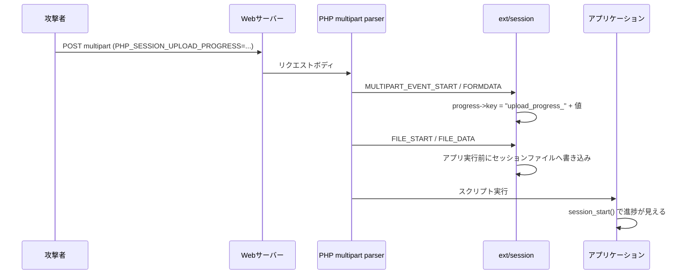
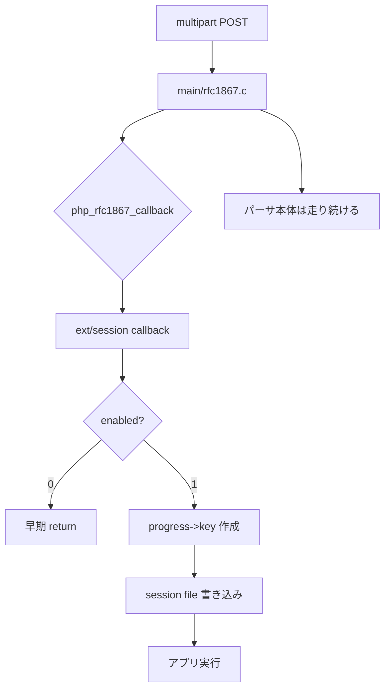
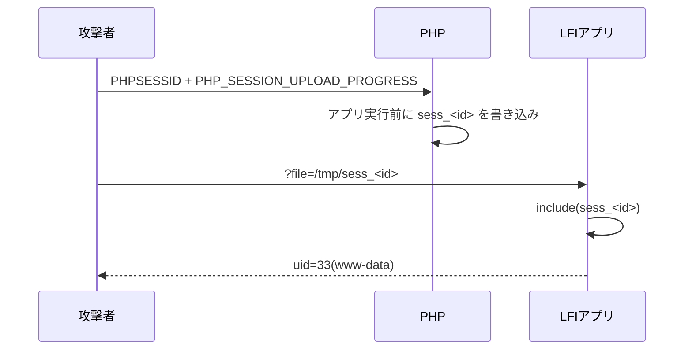

# PHP2SHELLという悪夢の再来を検証してみる

> 「PHP コアの UAF で RCE」――その公開 PoC は、私のラボでは動きませんでした。

## この記事の結論

PHP の重大脆弱性として話題になった「php2shell」について、Docker のローカルラボを組み、公開 PoC と PHP のソースを突き合わせました。結果は、**公開 PoC が主張する「PHP コアの UAF」は再現せず、代わりに `session.upload_progress` の書き込み primitive とアプリ側 LFI を組み合わせた鎖が動いた**、というものです。

- 公式が確定したのは「Critical 2 件、CVSS v4.0 9.2、2026-10-21 23:00 JST にリリース」まで。CVE 番号・原因・影響バージョン・修正版は、執筆時点では公式未公開です。
- 公開 PoC の 618/619 は、PHP 8.4.4 / 8.5.4 の ASAN ビルド、PHP 5.6.40、ASLR 無効、毒 call アドレスでも、UAF も RCE も再現しませんでした。
- 一方、`session.upload_progress` とアプリ側 LFI の鎖は再現しました。`cleanup=0` だけでなく、既定の `cleanup=1` でもレースで 3/3 成立し、`enabled=0` でも multipart の一時ファイル経由で RCE が残ります。
- したがって現時点の理解は「PHP コアだけで万能に RCE」ではなく、**multipart upload 周りの primitive + アプリ側の別脆弱性**という鎖です。コア UAF の真偽は、公式パッチの差分を見るまで確定しません。

| 検証 | 結果 |
| --- | ---: |
| 公開 PoC 618/619（8.4.4 ASAN） | 再現せず |
| 公開 PoC 618/619（8.5.4 ASAN / 5.6.40） | 再現せず |
| `cleanup=0` の LFI | `uid=33(www-data)` |
| `cleanup=1`（既定）のレース | 3/3 で `uid=33(www-data)` |
| `enabled=0` + 一時ファイル include | `uid=33(www-data)` |
| `use_strict_mode=1` + `Set-Cookie` 追従 | `uid=33(www-data)` |
| mod_php (Apache) | `uid=33(www-data)` |

検証コードと生ログはこちらです: https://github.com/tanahiro2010/slides/tree/main/slides/slides/PHP2SHELL%E3%81%A8%E3%81%84%E3%81%86%E6%82%AA%E5%A4%A2%E3%81%AE%E5%86%8D%E6%9D%A5%E3%82%92%E6%A4%9C%E8%A8%BC%E3%81%97%E3%81%A6%E3%81%BF%E3%82%8B/sandbox

そして、この記事で一番伝えたいことを先に書いておきます。

**「公開 PoC が動かないこと」と「脆弱性が存在しないこと」は別です。** 公開 PoC はソース行の説明としては参考になりますが、RCE の再現証明にはなっていません。一方で、`session.upload_progress` の primitive は実在し、アプリ側の LFI と組み合わさると未認証でコード実行まで到達します。公式パッチの差分を見るまでは、コアの原因を断定しない。これが、Embargo 中の情報に振り回されないための最低線だと思います。

> この記事は、PHP2SHELL の検証記録に、登壇では話しきれなかったソースリーディングと実験ログを足したものです。対象は、PHP アプリの運用・開発に携わり、脆弱性情報と実際の挙動を分けて理解したい人です。

---

## 1. 何が起きたのか

2026年10月20日、PHP の公式サイトに「Upcoming Critical PHP Security Release」という短い予告が出ました。内容は、翌日 2026年10月21日 14:00 UTC（23:00 JST）に Critical な脆弱性 2 件の修正を出す、というものです。両方とも CVSS v4.0 で 9.2。詳細、影響バージョン、修正版はリリース時に公開すると書かれていました。

予告自体は 4 行程度です。ところが、その予告より先に情報が漏れました。SNS や Hacker News で CVE 番号らしきもの、`session.upload_progress`、PHP 5.4 以降への影響、CVSS 10.0 といった断片が流通し、研究者やセキュリティ企業が「RCE である」「再現した」と投稿しました。PHP の公式文面には、CVE 番号も "RCE" も "Session Upload Progress" も出てきません。

この順序の異常さが、今回の主題です。**公式が確定した事実より、リークと二次情報の方が先に広がった。** しかも、その二次情報の一部は、後から見ると公開 PoC の再現性に疑問があります。

私は、この状況を批評するだけでは何も分からないので、Docker のローカルラボを組みました。PHP を ASAN 付きでビルドし、公開 PoC を送り、PHP のソースを読み、どの主張がどこまで支えられるのかを確かめました。

## 2. 公式が確定したこと、していないこと

まず、公式が確定した事実を整理します。

- 2026年10月21日 14:00 UTC（23:00 JST）にセキュリティリリースが予定されている。
- Critical な脆弱性が 2 件。
- どちらも CVSS v4.0 で 9.2。
- 詳細・影響バージョン・修正版はリリース時に公開される。
- 詳細が公開された場合、または active exploitation が見られた場合、前倒しする可能性がある。

公式が言っていないことは、次のとおりです。

- CVE-2026-109618 / CVE-2026-109619 という番号。
- 「RCE である」という分類。
- 「`session.upload_progress` が原因」という特定。
- 影響バージョン。「PHP 5.4 以降」はリークの主張です。
- 修正版番号。8.5.12 / 8.4.27 / 8.3.36 / 8.2.35 という数字は、執筆時点では未確認の推測です。

| 項目 | 公式 | 研究者・リーク | 自ラボ |
| --- | --- | --- | --- |
| 2 件 / CVSS 9.2 / 日時 | 確定 | 一致 | — |
| CVE 番号 | 未記載 | 主張 | — |
| RCE | 未記載 | 主張 | コア UAF は再現せず |
| Session Upload Progress | 未記載 | 主張 | primitive は確認 |
| PHP 5.4+ | 未記載 | リークの主張 | 5.6.40 で primitive は確認 |
| 修正版番号 | 未公開 | 推測 | 未検証 |

特に分かりやすいのが CVSS の割れ方です。公式は 9.2。一方で、watchTowr の CEO は報道に対して "Both of them are CVSS10" とコメントしています。どちらが正しいか、という話ではありません。**公式が 9.2 と言っているのに、二次情報では 10.0 が独り歩きしている**という事実が、今回の情報環境をそのまま表しています。

## 3. Session Upload Progress とは何だったのか

`session.upload_progress` は、PHP がファイルアップロードの進捗をセッションに書く機能です。`multipart/form-data` の POST に `PHP_SESSION_UPLOAD_PROGRESS` というフィールドを入れると、PHP が `$_SESSION["upload_progress_<値>"]` に進捗を書きます。進捗には `start_time`、`content_length`、`bytes_processed`、`done`、`files[]` などが入ります。

この機能の重要な点は、**進捗がアプリのスクリプトより前に書かれる**ことです。PHP が POST を解析している最中に書かれるので、アプリの認証や入力検証より手前で動きます。アプリが進捗表示機能を使っていなくても、PHP エンジンが勝手に動きます。



既定値も押さえておきます。`session.upload_progress.enabled` は On、`session.upload_progress.cleanup` は On（リクエスト終了時に進捗を削除）、`session.use_strict_mode` は 0（攻撃者がセッション ID を指定できる）です。ここが、後の「設定だけでは足りない」話につながります。

## 4. php-src を読む：コールバックとパーサの 2 層構造

php-src を読むと、この機能が 2 層になっていることが分かります。

1. `main/rfc1867.c` の multipart パーサ本体。
2. `ext/session/session.c` の進捗コールバック。

`main/rfc1867.c` には `php_rfc1867_callback` というグローバルな関数ポインタがあります。パーサは START / FORMDATA / FILE_START / FILE_DATA / FILE_END / END の各イベントでこれを呼びます。`ext/session` は MINIT で `php_rfc1867_callback = php_session_rfc1867_callback;` と登録し、パーサに相乗りします。

コールバックの先頭には、次の早期 return があります。

```c
if (!PS(rfc1867_enabled)) {
    return retval;
}
```

つまり、`session.upload_progress.enabled=0` で止まるのは**このコールバック側だけ**です。`main/rfc1867.c` のパーサ本体は、設定に関係なく multipart POST で走ります。

進捗のキーは FORMDATA で作られます。

```c
smart_str_appendl(&progress->key, PS(rfc1867_prefix).c, PS(rfc1867_prefix).len);
smart_str_appendl(&progress->key, *data->value, value_len);
```

その後、`php_session_rfc1867_update()` が `php_session_initialize()` → `zend_hash_update()` → `php_session_flush()` を実行し、アプリのスクリプトが動く前に `sess_<PHPSESSID>` を書きます。セッション ID は `php_session_rfc1867_early_find_sid()` が Cookie / GET から先に読みます。`use_strict_mode=0` なら、攻撃者が好きな ID を指定できます。



ここで言えるのは、**設定で止まるのは session コールバック側だけ**、という構造までです。「だから 2 件目の脆弱性はパーサ本体にある」とは、公式パッチ前には確定できません。研究者の主張として扱うべきです。

## 5. 公開 PoC の「コア UAF」を検証する

公開バンドル `Zer061/CVE-2026-109618` は、`php_session_rfc1867_progress` が 2 つの `zval *` をキャッシュし、2 回目の `update()` で session file を再デコードしたときに、そのツリーが `zval_ptr_dtor` で壊れる、と説明しています。149 個の `t[]` で解放済み領域を reclaim し、偽造した `zend_fcall_info` から `zend_call_function` を呼んで `system()` に到達する、という筋書きです。

私は PHP 8.4.4 を ASAN でビルドし、`USE_ZEND_ALLOC=0` を設定して Zend ヒープも ASAN の対象にしました。PHP-FPM + nginx で 618/619 を送り、ASAN レポート、`uid=`、ワーカーの異常終了を確認しました。

結果は、**UAF も RCE も再現しませんでした**。進捗ストア経路には到達しており、`bytes_processed=258` や `files[0].bytes_processed=1` は確認できます。しかし、ASAN レポートは出ず、`uid=` も出ず、ワーカーも落ちません。PHP 8.5.4 の ASAN ビルド（公開 PoC の `DELTA_CALL` が想定するビルド）、PHP 5.6.40、ASLR を無効にした環境、`zend_call_function` の実アドレス、毒アドレス `0x4141414141414141` でも同じでした。毒アドレスでクラッシュしないということは、stale pointer が関数ポインタとして使われている形跡がない、ということです。

ソースを計測すると、理由が見えてきます。

- `post_bytes_processed` が指すのは `progress->data` 内の zval で、`progress` 自身が参照を持つため、更新中は生存しています。
- `track_init` / `zend_hash_update` が解放するのは、セッションからデコードされたコピーです。
- `update()` の `post` 読み取りは `php_session_initialize()` の前にあり、解放はその後です。
- `MULTIPART_EVENT_END` の `force=1` 更新は、読み取り自体をスキップします。
- `current_file_bytes_processed` も `files[]` が配列を保持しており、`FILE_END` の更新は既存キーの更新です。

公開バンドルの `VALIDATION.md` 自身も「ASAN crash はローカルで未観測」と明記しています。ツイートで添付されていた画像は、このレポートの機構説明のスクリーンショットで、`uid=` や ASAN レポートの実行証跡ではありません。配布 tarball は、ページ記載の SHA-256 と実ファイルが一致しませんでした（`a29d…` と `0c254d…`）。コードは GitHub ミラーと同一でしたが、実行するならコミットを固定すべきです。

**これは「CVE が存在しない」という証明ではありません。** 公開 PoC が、少なくともそのままでは RCE の再現証明になっていない、というだけです。公式パッチの差分を見るまで、コアの原因は確定できません。

## 6. 実際に成立した鎖：multipart + LFI

公開 PoC のコア UAF は再現しませんでしたが、`session.upload_progress` の primitive とアプリ側 LFI を組み合わせる鎖は再現しました。

流れは次のとおりです。

1. 攻撃者が `PHPSESSID` を決める（`use_strict_mode=0`）。
2. `PHP_SESSION_UPLOAD_PROGRESS` に PHP コードを入れる。
3. PHP がアプリ実行前に `sess_<PHPSESSID>` へシリアライズして書き込む。
4. アプリの LFI が `sess_<PHPSESSID>` を `include` する。
5. キー文字列内の `<?php ... ?>` が実行される。



検証では、意図的に `include($_GET['file'])` するローカル専用のアプリを使いました。結果は `uid=33(www-data)`。セッションファイルには、進捗のキーとして埋め込んだ PHP コードが残っています。

```text
upload_progress_<?php /* ... */ ?>|a:5:{s:10:"start_time";...}
```

nginx の access log にも、次の流れが残っています。

```text
"POST /index.php HTTP/1.1" 200 5
"GET /index.php?file=%2Ftmp%2Fsess_...&0=id HTTP/1.1" 200 414
```

ここで「後何個かの脆弱性」と言われていたものの正体が見えます。中心は**アプリ側の LFI / セッションファイルを読む sink**です。加えて、`use_strict_mode=0` による SID 固定、`cleanup=1` の場合のレース、`session.save_path` の予測可能性、`enabled=0` でも残る一時ファイルの include が組み合わさります。

**これは PHP コアだけで万能に RCE になる話ではありません。** アプリ側の sink が必要です。ここを混ぜると、公開 PoC のコア UAF と、今回再現した LFI 鎖がごちゃごちゃになります。

## 7. 既定設定でのレース、enabled=0、strict mode、mod_php

「`cleanup=1` が既定だから安全」とは言えません。`cleanup=1` はリクエスト終了時に進捗を消すだけで、アップロード中は残ります。FPM の `FILLUNIT=5120` を満たす最初のチャンク（6000 バイト）を送り、1.5 秒 stall して、その間に LFI を叩くと、3/3 で `uid=33(www-data)` が返りました。

`enabled=0` は、session への進捗書き込みを止めます。ただし multipart のアップロード自体は続き、`$_FILES['f']['tmp_name']` は作られます。アプリがそれを include するなら、別の RCE 経路が残ります。実際、`enabled=0` のサービスでも一時ファイル include で `uid=33(www-data)` が返りました。

`use_strict_mode=1` は、攻撃者が指定した未知の SID を拒否します。指定 SID での LFI は失敗しました。ただし、アップロード応答の `Set-Cookie` には新しい SID が入ります。応答を読める状況では、その SID を使って成立します。`--follow-cookie` を付けた検証では `uid=33(www-data)` が返りました。

mod_php（`php:8.4.4-apache`）でも同じ鎖が成立しました。この鎖は SAPI 非依存です。

| 条件 | 結果 |
| --- | ---: |
| `cleanup=0` | `uid=33(www-data)` |
| `cleanup=1`（既定）+ レース | 3/3 で `uid=33(www-data)` |
| `enabled=0` + 一時ファイル include | `uid=33(www-data)` |
| `use_strict_mode=1` + 指定 SID | 失敗 |
| `use_strict_mode=1` + `Set-Cookie` 追従 | `uid=33(www-data)` |
| mod_php | `uid=33(www-data)` |

## 8. 共有された影響調査レポートをどう読むか

今回、PHP 5.6.40 を使う Web アプリの影響調査レポートも共有してもらいました。固有のアプリ名や認証情報のキー名は出せないので、一般化して書きます。

レポートの良い点は、露出条件の整理です。PHP 5.6.40 が EOL で公式修正の対象外であること、`session` 拡張が入っていること、`upload_progress` が既定 On であること、`file_uploads` が On であること、全リクエストが PHP に到達すること。これらを並べると、攻撃面があることは分かります。影響を「RCE が成立した場合のブラストラディウス」として条件付きで書いている点も実務的です。

ただし、注意すべき点があります。

- 「`enabled=Off` で脆弱なコードパスは不実行」は、**session コールバック側だけ**の話です。multipart パーサ本体と一時ファイルは残ります。本ラボの `enabled=0` + 一時ファイル include が反例です。
- 「RCE である」は研究者・リークの主張で、公式未確認です。レポート自身も確度を「中」としていました。
- 「PHP 5.6 も影響」はリークの主張で、公式の影響バージョンはパッチ公開後に確認する必要があります。
- レポートに LFI の記載がない場合、そのレポートだけでは RCE の成立を証明しません。本ラボの鎖は、アプリ側の LFI が前提です。
- 内部アプリ名・秘密情報のキー名を含むため、公開リポジトリにそのままコミットしないでください。

記事で書くなら、「PHP 5.6.40 の Web アプリで露出条件が揃っていた」という事実に留めるのが正確です。「RCE が確認された」とは書けません。あくまで「RCE が成立した場合の影響評価」です。

## 9. 緩和策の強弱

対策は、何を止められるかで分けて考える必要があります。

| 対策 | 止められるもの | 残るもの |
| --- | --- | --- |
| `session.upload_progress.enabled=Off` | session への進捗書き込み | multipart のアップロード / 一時ファイル |
| `session.upload_progress.cleanup=1` | 終了後の進捗 | アップロード中のレース |
| `session.use_strict_mode=1` | 攻撃者による SID 指定 | 応答の `Set-Cookie` を読める場合の追従 |
| WAF / multipart 制限 | 一部の自動攻撃 | 正常なアップロード、別 SAPI、別 sink |
| パッチ | コアの原因（公式が特定したもの） | アプリ側 LFI / 設定不備 |
| 最小権限・隔離 | 侵害後の被害拡大 | RCE 自体 |

`enabled=Off` は、session への書き込み primitive に対しては最も強い対策です。ただし、multipart のアップロードと一時ファイルは残ります。アプリがアップロードファイルを include する sink を持っているなら、別途それを塞ぐ必要があります。

`cleanup=1` は「終了時に消す」だけなので、アップロード中のレースには耐えません。`use_strict_mode=1` は SID を選ばせないだけで、progress の書き込みは続きます。応答の `Set-Cookie` を読める状況では追従されます。

だから、対策は 3 層に分けます。

1. **パッチ** — コアの原因を直す。
2. **設定** — `enabled=Off` などで primitive を止める。
3. **アプリ側の sink 除去** — LFI、アップロードファイルの include、セッションファイルを読む処理をなくす。

「設定を 1 つ入れて終わり」にしないことが重要です。

## 10. 公式パッチ後に確定すること

執筆時点では、公式パッチはまだ公開されていません。23:00 JST 以降に、次を確認します。

- 公式アドバイザリ本文: CVE 番号、影響バージョン、修正版、原因、攻撃条件。
- 修正コミットの diff: `ext/session/session.c` / `main/rfc1867.c` のどこが変わったか。
- 公開 PoC の主張が正しかったか。本当に `post_bytes_processed` / `current_file_bytes_processed` の UAF だったのか、それとも別の原因か。
- 本ラボの「再現しなかった」が、ビルド・SAPI・設定の違いで説明できるか。
- `compose.patched.yaml` の `PATCHED_VERSION` を公式修正版に変え、同じ trigger / PoC / LFI 鎖を 8082 で再実行する。

もし公開 PoC が誤りだったなら、その誤りを隠さずに書きます。「公開 PoC はソース行の確認までで、RCE の再現証明ではなかった」と。それは記事の価値を下げるどころか、検証記事としての信頼を上げます。

## 11. まとめ

今回の調査で持ち帰れることは、次の 4 つです。

1. **アプリ層の安全性と、ランタイム層の安全性は別物。** 自分のコードが 1 行も悪くなくても、リクエストがアプリに届く前に壊れることがあります。
2. **`session.upload_progress` は、アプリ実行前にセッションへ書く。** この primitive は実在し、アプリ側の LFI と組むと RCE になります。
3. **公開 PoC の「コア UAF」と、実際に成立する「multipart + LFI」を混同しない。** 前者は本ラボでは再現せず、公開バンドル自身も ASAN crash 未観測と書いています。
4. **「設定で回避」「パッチで修正」「アプリ側 sink の除去」を分ける。** `enabled=Off` は強いが万能ではなく、multipart と一時ファイルは残ります。

「PHP2SHELLという悪夢の再来」というタイトルにしたのは、PHP の RCE 騒動の既視感があったからです。ただ、今回の悪夢は、単一の UAF というより、**情報の混線と、アプリ側の見落としが組み合わさって生まれる**もののように見えます。公式パッチの差分を見るまで、コアの原因は分かりません。分からないことを分からないまま、手元のラボで確かめられることを確かめる。それが、Embargo 中の一番堅い動き方だと思います。

### 参考

- [PHP: News Archive 2026 — Upcoming Critical PHP Security Release](https://www.php.net/archive/2026.php) — 公式予告。2 件、CVSS 9.2、日時のみ。
- [PHP Manual — Session Upload Progress](https://www.php.net/manual/en/session.upload-progress.php) — 進捗がアプリ実行前に書かれること、`PHP_SESSION_UPLOAD_PROGRESS` の仕様。
- [php/php-src — ext/session/session.c](https://github.com/php/php-src/blob/master/ext/session/session.c) — `php_session_rfc1867_callback`、`enabled=0` の早期 return、セッション書き込み。
- [php/php-src — main/rfc1867.c](https://github.com/php/php-src/blob/master/main/rfc1867.c) — multipart パーサとグローバルコールバック。
- [GMO Flatt Security Blog — php2shell](https://blog.flatt.tech/entry/php2shell) — 日本語の二次分析。Session Upload Progress との関連を「推測」と明記。
- [Sansec — php2shell](https://sansec.io/research/php2shell) — 公開状況と緩和策の整理。
- [Huntress — php2shell Rapid Response](https://www.huntress.com/blog/php2shell-leaked-critical-php-vulnerabilities) — 公開時点の状況と検知の観点。
- [JackalSyn — PHP-UP-2026](https://jackalsyn.com/posts/php-up-2026.html) — 公開バンドルの解説。`VALIDATION.md` に ASAN crash 未観測と明記。
- [Zer061/CVE-2026-109618](https://github.com/Zer061/CVE-2026-109618) — 公開 PoC のコード。本ラボでは 618/619 を再現せず。
- [検証レポート](https://github.com/tanahiro2010/slides/blob/main/slides/slides/PHP2SHELL%E3%81%A8%E3%81%84%E3%81%86%E6%82%AA%E5%A4%A2%E3%81%AE%E5%86%8D%E6%9D%A5%E3%82%92%E6%A4%9C%E8%A8%BC%E3%81%97%E3%81%A6%E3%81%BF%E3%82%8B/sandbox/report/REPORT.md) — 本記事の実験ログ、nginx/Apache access log、セッションファイル、`uid=` の証跡。
- [攻撃スクリプトのドキュメント](https://github.com/tanahiro2010/slides/blob/main/slides/slides/PHP2SHELL%E3%81%A8%E3%81%84%E3%81%86%E6%82%AA%E5%A4%A2%E3%81%AE%E5%86%8D%E6%9D%A5%E3%82%92%E6%A4%9C%E8%A8%BC%E3%81%97%E3%81%A6%E3%81%BF%E3%82%8B/sandbox/attacker/README.md) — 各スクリプトの使い方と実装。
