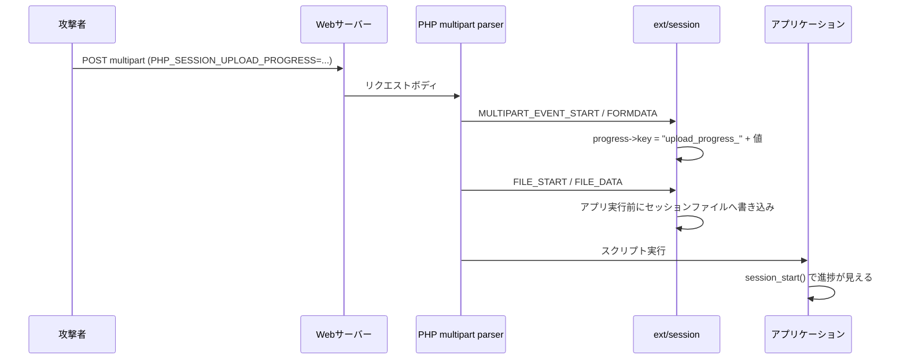
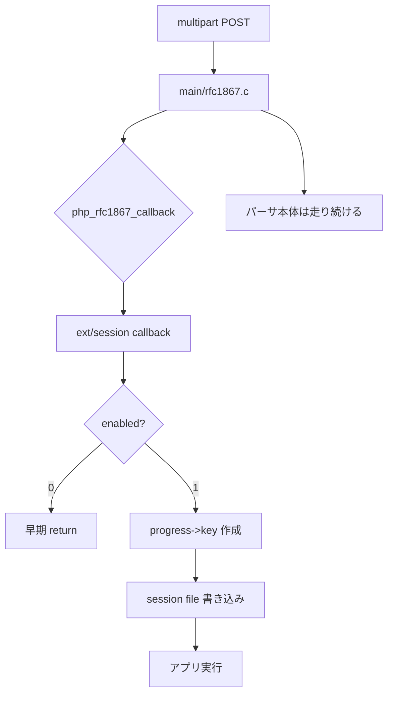
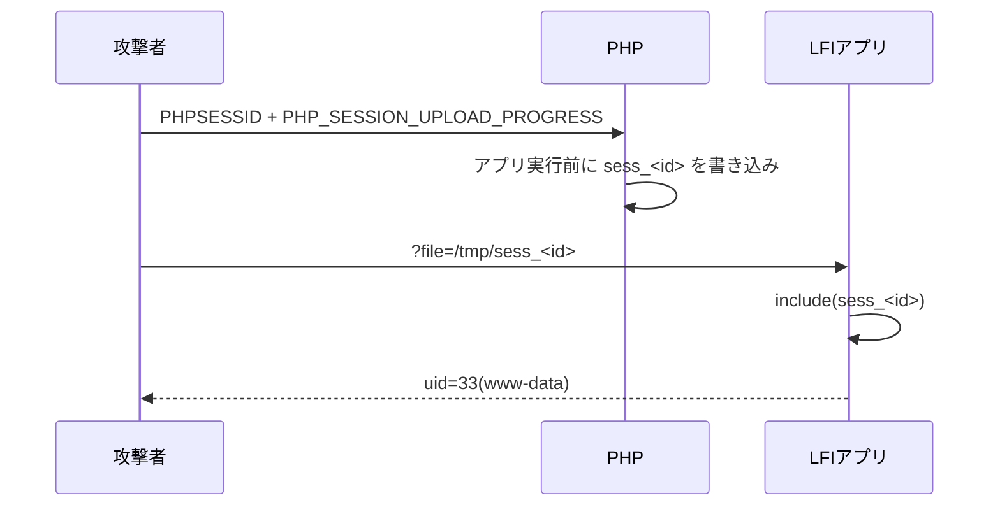

# PHP2Shellという悪夢の再来を検証してみる

> 「PHP コアの UAF で RCE」――その公開 PoC は私のラボでは動きませんでした。公式パッチを読むと、原因は「1 リクエスト内の zval UAF」ではなく、OOM 時の状態破壊と、リクエストを跨ぐ状態の破棄漏れでした。

## この記事の結論

PHP の重大脆弱性として話題になった「php2shell」について、Docker のローカルラボを組み、公開 PoC と PHP のソースを突き合わせました。さらに公式リリース後のパッチ差分まで読んだ結果は、**公開 PoC が主張する「PHP コアの UAF」は再現せず、公式の原因は別にあった。一方で `session.upload_progress` の書き込み primitive とアプリ側 LFI を組み合わせた鎖は動いた**、というものです。

- 公式は 2026-10-21 に 8.5.12 / 8.4.27 / 8.3.36 / 8.2.35 を公開しました。CVE-2026-109618 は「OOM 時の状態破壊」、CVE-2026-109619 は「リクエストを跨ぐ stale global state」です。どちらも CVSS v4.0 9.2 で、公式が「RCE」と明言しました。
- 公開 PoC の 618/619 は、PHP 8.4.4 / 8.5.4 の ASAN ビルド、PHP 5.6.40、ASLR 無効、毒 call アドレスでも、UAF も RCE も再現しませんでした。
- パッチ差分を読むと、修正の中心は `ext/session` の「2 回目の update で zval が壊れる」処理ではありません。OOM 時の脱出経路の作り直しと、RINIT 前に走る session 状態の初期化、別リクエストに残った状態の reset です。公開 PoC は原因の特定を外していました。
- 一方、`session.upload_progress` とアプリ側 LFI の鎖は再現しました。`cleanup=0` だけでなく、既定の `cleanup=1` でもレースで 3/3 成立し、`enabled=0` でも multipart の一時ファイル経由で RCE が残ります。公式も Session Upload Progress を 619 の確認済み consumer として認めています。
- したがって結論は「PHP コアだけで万能に RCE」でも「PHP2Shell はデマ」でもありません。**コアの CVE は実在し、更新だけが完全な対策。ただしアプリ側 LFI の鎖は更新後も残る**、という 2 層で理解するのが正確です。

| 検証 | 結果 |
| --- | ---: |
| 公開 PoC 618/619（8.4.4 ASAN） | 再現せず |
| 公開 PoC 618/619（8.5.4 ASAN / 5.6.40） | 再現せず |
| `cleanup=0` の LFI | `uid=33(www-data)` |
| `cleanup=1`（既定）のレース | 3/3 で `uid=33(www-data)` |
| `enabled=0` + 一時ファイル include | `uid=33(www-data)` |
| `use_strict_mode=1` + `Set-Cookie` 追従 | `uid=33(www-data)` |
| mod_php (Apache) | `uid=33(www-data)` |

検証コードと生ログはこちらです: https://github.com/tanahiro2010/slides/tree/main/slides/slides/PHP2SHELL%E3%81%A8%E3%81%84%E3%81%86%E6%82%AA%E5%A4%A2%E3%81%AE%E5%86%8D%E6%9D%A5%E3%82%92%E6%A4%9C%E8%A8%BC%E3%81%97%E3%81%A6%E3%81%BF%E3%82%8B/sandbox

そして、この記事で一番伝えたいことを先に書いておきます。

**「公開 PoC が動かないこと」と「脆弱性が存在しないこと」は別です。** 公開 PoC はソース行の説明としては参考になりますが、RCE の再現証明にはなっていません。一方で、`session.upload_progress` の primitive は実在し、アプリ側の LFI と組み合わさると未認証でコード実行まで到達します。公式パッチの差分を見るまでは、コアの原因を断定しない。これが、Embargo 中の情報に振り回されないための最低線だと思います。

> この記事は、PHP2SHELL の検証記録に、登壇では話しきれなかったソースリーディングと実験ログを足したものです。対象は、PHP アプリの運用・開発に携わり、脆弱性情報と実際の挙動を分けて理解したい人です。

---

## 1. 何が起きたのか

2026年10月20日、PHP の公式サイトに「Upcoming Critical PHP Security Release」という短い予告が出ました。内容は、翌日 2026年10月21日 14:00 UTC（23:00 JST）に Critical な脆弱性 2 件の修正を出す、というものです。両方とも CVSS v4.0 で 9.2。詳細、影響バージョン、修正版はリリース時に公開すると書かれていました。

予告自体は 4 行程度です。ところが、その予告より先に情報が漏れました。SNS や Hacker News で CVE 番号らしきもの、`session.upload_progress`、PHP 5.4 以降への影響、CVSS 10.0 といった断片が流通し、研究者やセキュリティ企業が「RCE である」「再現した」と投稿しました。PHP の公式文面には、CVE 番号も "RCE" も "Session Upload Progress" も出てきません。

この順序の異常さが、今回の主題です。**公式が確定した事実より、リークと二次情報の方が先に広がった。** しかも、その二次情報の一部は、後から見ると公開 PoC の再現性に疑問があります。

私は、この状況を批評するだけでは何も分からないので、Docker のローカルラボを組みました。PHP を ASAN 付きでビルドし、公開 PoC を送り、PHP のソースを読み、どの主張がどこまで支えられるのかを確かめました。

この記事の初稿は、この予告だけを頼りに書きました。その後 2026-10-21 22:45 JST の時点で公式リリースが公開され、CVE 番号・原因・影響バージョン・修正版がすべて確定しました。予告時点の記述とリリース後の事実が混ざらないよう、この節は「予告時点で何が確定していたか」として残し、結果は §10 にまとめます。

## 2. 予告時点で公式が確定したこと、していないこと

予告の時点で、公式が確定していたのは次の 5 点です。

- 2026年10月21日 14:00 UTC（23:00 JST）にセキュリティリリースが予定されている。
- Critical な脆弱性が 2 件。
- どちらも CVSS v4.0 で 9.2。
- 詳細・影響バージョン・修正版はリリース時に公開される。
- 詳細が公開された場合、または active exploitation が見られた場合、前倒しする可能性がある。

公式が言っていないことは、次のとおりです。

- CVE-2026-109618 / CVE-2026-109619 という番号。
- 「RCE である」という分類。
- 「`session.upload_progress` が原因」という特定。
- 影響バージョン。「PHP 5.4 以降」はリークの主張です。リリース後も公式のサポート対象は 8.2 以降で、7.4 / 8.0 / 8.1 には source backport が用意されただけでした。
- 修正版番号。8.5.12 / 8.4.27 / 8.3.36 / 8.2.35 という数字は、予告時点では未確認の推測です。のちに 4 つとも実在したことが確認されました。

| 項目 | 予告時点の公式 | 研究者・リーク | 自ラボ |
| --- | --- | --- | --- |
| 2 件 / CVSS 9.2 / 日時 | 確定 | 一致 | — |
| CVE 番号 | 未記載 | 主張 | — |
| RCE | 未記載 | 主張 | コア UAF は再現せず |
| Session Upload Progress | 未記載 | 主張 | primitive は確認 |
| PHP 5.4+ | 未記載 | リークの主張 | 5.6.40 で primitive は確認 |
| 修正版番号 | 未公開 | 推測 | 未検証 |

10月21日のリリースで、この表の「未記載」「未公開」はすべて埋まりました。CVE 番号は実在し、公式は「RCE」と明言し、修正版は推測どおりの 4 つでした。予告とリリースの差分は §10 にまとめます。

特に分かりやすいのが CVSS の割れ方です。公式は 9.2。一方で、watchTowr の CEO は報道に対して "Both of them are CVSS10" とコメントしています。どちらが正しいか、という話ではありません。**公式が 9.2 と言っているのに、二次情報では 10.0 が独り歩きしている**という事実が、今回の情報環境をそのまま表しています。

## 3. Session Upload Progress とは何だったのか

`session.upload_progress` は、PHP がファイルアップロードの進捗をセッションに書く機能です。`multipart/form-data` の POST に `PHP_SESSION_UPLOAD_PROGRESS` というフィールドを入れると、PHP が `$_SESSION["upload_progress_<値>"]` に進捗を書きます。進捗には `start_time`、`content_length`、`bytes_processed`、`done`、`files[]` などが入ります。

この機能の重要な点は、**進捗がアプリのスクリプトより前に書かれる**ことです。PHP が POST を解析している最中に書かれるので、アプリの認証や入力検証より手前で動きます。アプリが進捗表示機能を使っていなくても、PHP エンジンが勝手に動きます。



既定値も押さえておきます。`session.upload_progress.enabled` は On、`session.upload_progress.cleanup` は On（リクエスト終了時に進捗を削除）、`session.use_strict_mode` は 0（攻撃者がセッション ID を指定できる）です。ここが、後の「設定だけでは足りない」話につながります。

## 4. php-src を読む：コールバックとパーサの 2 層構造

php-src を読むと、この機能が 2 層になっていることが分かります。

1. `main/rfc1867.c` の multipart パーサ本体。
2. `ext/session/session.c` の進捗コールバック。

`main/rfc1867.c` には `php_rfc1867_callback` というグローバルな関数ポインタがあります。パーサは START / FORMDATA / FILE_START / FILE_DATA / FILE_END / END の各イベントでこれを呼びます。`ext/session` は MINIT で `php_rfc1867_callback = php_session_rfc1867_callback;` と登録し、パーサに相乗りします。

コールバックの先頭には、次の早期 return があります。

```c
if (!PS(rfc1867_enabled)) {
    return retval;
}
```

つまり、`session.upload_progress.enabled=0` で止まるのは**このコールバック側だけ**です。`main/rfc1867.c` のパーサ本体は、設定に関係なく multipart POST で走ります。

進捗のキーは FORMDATA で作られます。

```c
smart_str_appendl(&progress->key, PS(rfc1867_prefix).c, PS(rfc1867_prefix).len);
smart_str_appendl(&progress->key, *data->value, value_len);
```

その後、`php_session_rfc1867_update()` が `php_session_initialize()` → `zend_hash_update()` → `php_session_flush()` を実行し、アプリのスクリプトが動く前に `sess_<PHPSESSID>` を書きます。セッション ID は `php_session_rfc1867_early_find_sid()` が Cookie / GET から先に読みます。`use_strict_mode=0` なら、攻撃者が好きな ID を指定できます。



ここで言えるのは、**設定で止まるのは session コールバック側だけ**、という構造までです。「だから 2 件目の脆弱性はパーサ本体にある」とは、初稿時点では確定できませんでした。答えは §10 に書きますが、公式の説明は「パーサ本体の UAF」ではありませんでした。

## 5. 公開 PoC の「コア UAF」を検証する

公開バンドル `Zer061/CVE-2026-109618` は、`php_session_rfc1867_progress` が 2 つの `zval *` をキャッシュし、2 回目の `update()` で session file を再デコードしたときに、そのツリーが `zval_ptr_dtor` で壊れる、と説明しています。149 個の `t[]` で解放済み領域を reclaim し、偽造した `zend_fcall_info` から `zend_call_function` を呼んで `system()` に到達する、という筋書きです。

私は PHP 8.4.4 を ASAN でビルドし、`USE_ZEND_ALLOC=0` を設定して Zend ヒープも ASAN の対象にしました。PHP-FPM + nginx で 618/619 を送り、ASAN レポート、`uid=`、ワーカーの異常終了を確認しました。

結果は、**UAF も RCE も再現しませんでした**。進捗ストア経路には到達しており、`bytes_processed=258` や `files[0].bytes_processed=1` は確認できます。しかし、ASAN レポートは出ず、`uid=` も出ず、ワーカーも落ちません。PHP 8.5.4 の ASAN ビルド（公開 PoC の `DELTA_CALL` が想定するビルド）、PHP 5.6.40、ASLR を無効にした環境、`zend_call_function` の実アドレス、毒アドレス `0x4141414141414141` でも同じでした。毒アドレスでクラッシュしないということは、stale pointer が関数ポインタとして使われている形跡がない、ということです。

ソースを計測すると、理由が見えてきます。

- `post_bytes_processed` が指すのは `progress->data` 内の zval で、`progress` 自身が参照を持つため、更新中は生存しています。
- `track_init` / `zend_hash_update` が解放するのは、セッションからデコードされたコピーです。
- `update()` の `post` 読み取りは `php_session_initialize()` の前にあり、解放はその後です。
- `MULTIPART_EVENT_END` の `force=1` 更新は、読み取り自体をスキップします。
- `current_file_bytes_processed` も `files[]` が配列を保持しており、`FILE_END` の更新は既存キーの更新です。

公開バンドルの `VALIDATION.md` 自身も「ASAN crash はローカルで未観測」と明記しています。ツイートで添付されていた画像は、このレポートの機構説明のスクリーンショットで、`uid=` や ASAN レポートの実行証跡ではありません。配布 tarball は、ページ記載の SHA-256 と実ファイルが一致しませんでした（`a29d…` と `0c254d…`）。コードは GitHub ミラーと同一でしたが、実行するならコミットを固定すべきです。

**これは「CVE が存在しない」という証明ではありません。** 公開 PoC が、少なくともそのままでは RCE の再現証明になっていない、というだけです。初稿ではここで「公式パッチの差分を見るまで、コアの原因は確定できません」と書きました。パッチは公開され、答え合わせは §10 にあります。先に言うと、公式の原因はこの PoC の筋書きとは別物でした。

## 6. 実際に成立した鎖：multipart + LFI

公開 PoC のコア UAF は再現しませんでしたが、`session.upload_progress` の primitive とアプリ側 LFI を組み合わせる鎖は再現しました。

流れは次のとおりです。

1. 攻撃者が `PHPSESSID` を決める（`use_strict_mode=0`）。
2. `PHP_SESSION_UPLOAD_PROGRESS` に PHP コードを入れる。
3. PHP がアプリ実行前に `sess_<PHPSESSID>` へシリアライズして書き込む。
4. アプリの LFI が `sess_<PHPSESSID>` を `include` する。
5. キー文字列内の `<?php ... ?>` が実行される。



検証では、意図的に `include($_GET['file'])` するローカル専用のアプリを使いました。結果は `uid=33(www-data)`。セッションファイルには、進捗のキーとして埋め込んだ PHP コードが残っています。

```text
upload_progress_<?php /* ... */ ?>|a:5:{s:10:"start_time";...}
```

nginx の access log にも、次の流れが残っています。

```text
"POST /index.php HTTP/1.1" 200 5
"GET /index.php?file=%2Ftmp%2Fsess_...&0=id HTTP/1.1" 200 414
```

ここで「後何個かの脆弱性」と言われていたものの正体が見えます。中心は**アプリ側の LFI / セッションファイルを読む sink**です。加えて、`use_strict_mode=0` による SID 固定、`cleanup=1` の場合のレース、`session.save_path` の予測可能性、`enabled=0` でも残る一時ファイルの include が組み合わさります。

**これは PHP コアだけで万能に RCE になる話ではありません。** アプリ側の sink が必要です。ここを混ぜると、公開 PoC のコア UAF と、今回再現した LFI 鎖がごちゃごちゃになります。

## 7. 既定設定でのレース、enabled=0、strict mode、mod_php

「`cleanup=1` が既定だから安全」とは言えません。`cleanup=1` はリクエスト終了時に進捗を消すだけで、アップロード中は残ります。FPM の `FILLUNIT=5120` を満たす最初のチャンク（6000 バイト）を送り、1.5 秒 stall して、その間に LFI を叩くと、3/3 で `uid=33(www-data)` が返りました。

`enabled=0` は、session への進捗書き込みを止めます。ただし multipart のアップロード自体は続き、`$_FILES['f']['tmp_name']` は作られます。アプリがそれを include するなら、別の RCE 経路が残ります。実際、`enabled=0` のサービスでも一時ファイル include で `uid=33(www-data)` が返りました。

`use_strict_mode=1` は、攻撃者が指定した未知の SID を拒否します。指定 SID での LFI は失敗しました。ただし、アップロード応答の `Set-Cookie` には新しい SID が入ります。応答を読める状況では、その SID を使って成立します。`--follow-cookie` を付けた検証では `uid=33(www-data)` が返りました。

mod_php（`php:8.4.4-apache`）でも同じ鎖が成立しました。この鎖は SAPI 非依存です。

| 条件 | 結果 |
| --- | ---: |
| `cleanup=0` | `uid=33(www-data)` |
| `cleanup=1`（既定）+ レース | 3/3 で `uid=33(www-data)` |
| `enabled=0` + 一時ファイル include | `uid=33(www-data)` |
| `use_strict_mode=1` + 指定 SID | 失敗 |
| `use_strict_mode=1` + `Set-Cookie` 追従 | `uid=33(www-data)` |
| mod_php | `uid=33(www-data)` |

## 8. 共有された影響調査レポートをどう読むか

今回、PHP 5.6.40 を使う Web アプリの影響調査レポートも共有してもらいました。固有のアプリ名や認証情報のキー名は出せないので、一般化して書きます。

レポートの良い点は、露出条件の整理です。PHP 5.6.40 が EOL で公式修正の対象外であること、`session` 拡張が入っていること、`upload_progress` が既定 On であること、`file_uploads` が On であること、全リクエストが PHP に到達すること。これらを並べると、攻撃面があることは分かります。影響を「RCE が成立した場合のブラストラディウス」として条件付きで書いている点も実務的です。

ただし、注意すべき点があります。

- 「`enabled=Off` で脆弱なコードパスは不実行」は、**session コールバック側だけ**の話です。multipart パーサ本体と一時ファイルは残ります。本ラボの `enabled=0` + 一時ファイル include が反例です。
- 「RCE である」は初稿時点では研究者・リークの主張で、公式未確認でした。10月21日のリリースで公式が RCE と明言しています。レポート自身も確度を「中」としていました。
- 「PHP 5.6 も影響」はリークの主張です。公式修正は 8.2 以降で、7.4 / 8.0 / 8.1 には backport があるものの、5.6 は対象外で未確認のままです。
- レポートに LFI の記載がない場合、そのレポートだけでは RCE の成立を証明しません。本ラボの鎖は、アプリ側の LFI が前提です。
- 内部アプリ名・秘密情報のキー名を含むため、公開リポジトリにそのままコミットしないでください。

記事で書くなら、「PHP 5.6.40 の Web アプリで露出条件が揃っていた」という事実に留めるのが正確です。「RCE が確認された」とは書けません。あくまで「RCE が成立した場合の影響評価」です。

## 9. 緩和策の強弱

対策は、何を止められるかで分けて考える必要があります。

| 対策 | 止められるもの | 残るもの |
| --- | --- | --- |
| `session.upload_progress.enabled=Off` | session への進捗書き込み | multipart のアップロード / 一時ファイル |
| `session.upload_progress.cleanup=1` | 終了後の進捗 | アップロード中のレース |
| `session.use_strict_mode=1` | 攻撃者による SID 指定 | 応答の `Set-Cookie` を読める場合の追従 |
| WAF / multipart 制限 | 一部の自動攻撃 | 正常なアップロード、別 SAPI、別 sink |
| パッチ | コアの原因（公式が特定したもの） | アプリ側 LFI / 設定不備 |
| 最小権限・隔離 | 侵害後の被害拡大 | RCE 自体 |

`enabled=Off` は、session への書き込み primitive に対しては最も強い対策です。ただし、multipart のアップロードと一時ファイルは残ります。アプリがアップロードファイルを include する sink を持っているなら、別途それを塞ぐ必要があります。

`cleanup=1` は「終了時に消す」だけなので、アップロード中のレースには耐えません。`use_strict_mode=1` は SID を選ばせないだけで、progress の書き込みは続きます。応答の `Set-Cookie` を読める状況では追従されます。

だから、対策は 3 層に分けます。

1. **パッチ** — コアの原因を直す。
2. **設定** — `enabled=Off` などで primitive を止める。
3. **アプリ側の sink 除去** — LFI、アップロードファイルの include、セッションファイルを読む処理をなくす。

「設定を 1 つ入れて終わり」にしないことです。

公式アドバイザリは、この 3 層に加えてコア側の緩和策を具体的に挙げています。`memory_limit=-1` を管理者設定で強制する（アプリから上書きさせない）、`post_max_size` を小さくする、cgroup / container のメモリ上限を使う、PHP 8.5 なら `fatal_error_backtraces=0`、`pm.max_requests=1` で worker の使い回しを切る、などです。`RLIMIT_AS` / `RLIMIT_DATA` は `mmap()` 失敗を招いて脆弱な経路を踏むため、公式が**使うな**と明記しています。ただし、これらはすべて「攻撃経路を減らす」もので、公式自身が「完全な緩和策は存在しない、更新だけが安全」と書いています。

## 10. 公式発表とパッチ差分を見た結果

公式リリースは、予告の 23:00 JST を待たず、22:45 JST の時点で公開されていました。内容を読んで、初稿の予測を一つずつ照合します。

### 10.1 公式が確定した事実

| 項目 | 内容 |
| --- | --- |
| 修正版 | PHP 8.5.12 / 8.4.27 / 8.3.36 / 8.2.35 |
| CVE-2026-109618 | RCE via OOM corruption（GHSA-w8hw-w9fx-j79w） |
| CVE-2026-109619 | RCE via stale global state（GHSA-6wmf-4rv5-p3rp） |
| 重大度 | 両方 CVSS v4.0 9.2 |
| 影響 | Web リクエストを処理する全 PHP。FPM、mod_php、php-cgi、FrankenPHP、LiteSpeed |
| 最も危険な構成 | mod_php。アプリコードが動く前の未認証リクエストで攻撃が成立する実証例あり |
| 8.1 以下 | 公式サポート外。7.4 / 8.0 / 8.1 には最小の source backport のみ |
| 緩和 | 「完全な緩和策は存在しない。更新だけが安全」 |

公式が「RCE」と明言したことで、初稿の「公式は RCE とすら書いていない」は**予告時点の話**として過去のものになりました。CVE 番号も修正版番号も、リーク側の推測がそのまま当たっています。

### 10.2 原因は公開 PoC の説明と違った

公式 GHSA が説明する原因は、2 つです。

**CVE-2026-109618（OOM corruption）** は、PHP が OOM 時に `longjmp()` で一気に処理を脱出することを悪用します。リクエストメモリがまだ完全に初期化されていないタイミングで確保が失敗すると、PHP は早期脱出を正しく会計できず、リクエストメモリを不正な状態のまま残します。その後の request shutdown が、その不正な状態を読んだり分岐したりします。multipart の解析は、`post_max_size` の範囲内でも `memory_limit` に到達させられる組み合わせがいくつもありました。Content-Length が使えない multipart、part 内のヘッダ数無制限、`max_file_uploads` に数えられない空の file control、ネストしたフィールド名などです。

**CVE-2026-109619（stale global state）** は、リクエスト所有の状態が、そのメモリ解放後も worker のグローバルに残る問題です。fatal error や OOM が、対応する reset を飛ばして処理を中断します。すると、リクエストヒープは解放される一方で、worker のグローバル変数はそのメモリを指したままになります。次のリクエストが、通常の初期化より前にその stale な値を読むと、use-after-free になります。公式は producer（状態を残す操作）と consumer（stale state を読む操作）の**両方**が必要で、実証された経路では**別々の HTTP リクエスト**が同じ worker に割り当たる必要がある、と明記しています。

公式が名指しした consumer は 2 つです。1 つはリクエスト初期化前の INI diagnostics（`.htaccess` や FPM の `PHP_VALUE` が warning / deprecation を出す経路）。もう 1 つが **Session Upload Progress** です。Session Upload Progress は、通常の session 初期化より前に session / decoder の状態に触れます。前のリクエストが fatal で中断して残した状態を、次のアップロードが読む、という筋書きです。`session_start()` は不要で、既定で有効です。

ここが、公開 PoC の説明との決定的な違いでした。公開 PoC は「1 回のリクエストの中で 2 回 `update()` させると、`post_bytes_processed` の zval が壊れる」と説明していました。公式の原因は、**リクエストを跨ぐ状態の破棄漏れ**です。単一リクエストの中で完結する UAF ではありません。

### 10.3 パッチ差分を読む

修正コミットは `31c0ea7d7ff1d1fccb6492e52dab544011628065`（"Avoid state corruption via bailout"）で、両方の GHSA を Fix と明記しています。`php-8.5.11` と `php-8.5.12` のタグを取得して、該当ファイルを diff しました。

`ext/session/session.c` で変わったのは、次の 4 点です。

1. `MULTIPART_EVENT_START` で `php_rinit_session_globals()` を**先に**呼ぶ。RINIT を待たずに session のグローバルを初期化する。
2. upload progress 中の unserialize / serialize を `__PHP_Incomplete_Class` 固定にする。RINIT 前なので、autoload も `__wakeup()` も `__unserialize()` も呼ばせない。
3. `php_session_initialize()` が FAILURE なら、`session_status` を active にせず return する。
4. `request_parse_body()` 経由（`PG(modules_activated)`）では callback を動かさない。

```diff
 	case MULTIPART_EVENT_START: {
+		/* This runs before RINIT, so we need to clear these early */
+		php_rinit_session_globals();
 		progress = ecalloc(1, sizeof(php_session_rfc1867_progress));
```

```diff
+	PS(in_rfc1867_update) = true;
+	if (php_session_initialize() == FAILURE || PS(session_status) != php_session_active) {
+		PS(in_rfc1867_update) = false;
+		return;
+	}
```

`main/rfc1867.c` 側は、`ZEND_HAS_OOM()` のチェックと、失敗可能な確保への置き換えが入っています。ヘッダは `Content-Disposition` と `Content-Type` だけを保持するようになり、part 内ヘッダでメモリを膨らませる経路が狭くなりました。`Zend/zend_alloc.c` では、OOM の `longjmp()` が廃止され、遅延させる soft OOM と、二段目の上限に達したら `_exit()` する hard OOM に変わっています。

つまり、**公開分析が名指しした `php_session_rfc1867_callback()` は、確かに修正対象でした**。ただし直っているのは「2 回目の update で zval が壊れる」ことではなく、「RINIT 前に動く session の状態初期化」と「pre-RINIT でのユーザコード実行」です。関数名が当たっていたことと、原因の説明が当たっていたことは別でした。

### 10.4 なぜラボでは再現しなかったのか

初稿のラボは、公開 PoC の筋書きどおり「1 リクエスト内で 2 回 update させ、zval を壊す」ことだけを試していました。公式が実証した 619 の経路は、producer と consumer が**別リクエスト**で、同じ worker に割り当たる必要があります。単一リクエストでは条件が揃いません。

加えて、619 の producer は「fatal error / OOM で reset が飛ぶ」ことです。ラボの trigger は正常終了していたので、producer になっていません。618 は mod_php で「request startup が失敗しても shutdown が走る」ことが本質で、ラボの主環境である FPM は startup 失敗時に child を終了するため、同じ経路になりません。

だから「ラボで再現しなかった」は、CVE が存在しないことの証明でも、公式原因が間違いであることの証明でもありません。**別の攻撃条件を試していた**、というだけです。公開 PoC についても同じで、「この PoC は RCE の再現証明になっていない」と「この CVE はデマ」は別です。初稿でそう書いた線引きは、結果的に正しかったことになります。

### 10.5 初稿の予測はどこまで当たったか

| 初稿の記述 | 結果 |
| --- | --- |
| 修正版は 8.5.12 / 8.4.27 / 8.3.36 / 8.2.35 | 的中 |
| 公式はまだ RCE と書いていない | 予告時点では正しい。リリースで公式が RCE と明言 |
| 原因は `php_session_rfc1867_callback()` の zval UAF | 外れ。公式は OOM とリクエスト横断の stale state |
| `session.upload_progress` が関与する | 部分的に的中。619 の確認済み consumer |
| PHP 5.4 以降すべて | 未確認のまま。公式修正は 8.2 以降、7.4–8.1 は backport |
| `enabled=Off` は完全な対策ではない | 的中。ただし理由は multipart パーサだけではなく、他の lifecycle path |
| multipart + LFI の鎖は実在する | 的中。パッチ後もアプリ側の sink は残る |

### 10.6 パッチ後のラボ

`PATCHED_VERSION=8.5.12` で ASAN ビルドを作り、同じ trigger と LFI 鎖を再実行しました。ビルドは PHP 8.5.12、Web 側の SAPI は `fpm-fcgi` です。

| 検証 | 8.5.12 の結果 |
| --- | --- |
| `probe`（通常の multipart） | `upload_progress=present`、ファイル解析 OK |
| `trigger`（258 バイト） | `bytes_processed=258`、`done=true` |
| `poc618` / `poc619` | HTTP 200、ASAN レポートなし、`uid=` なし |
| LFI 鎖（8084） | `uid=33(www-data)` |
| FPM ログ | 起動・終了の NOTICE のみ。ASAN / クラッシュなし |

読み取れることは 2 つです。

1. **パッチ後も `session.upload_progress` の書き込み primitive は動きます。** これは脆弱性ではなく機能です。公式パッチが直したのは「リクエストを跨ぐ状態の破棄漏れ」であって、進捗をセッションに書くこと自体ではありません。だから `probe` も `trigger` も前と同じ結果になります。
2. **アプリ側 LFI の鎖は、8.5.12 でも成立します。** 公式パッチはコアの CVE を塞ぎますが、アプリが `sess_<id>` やアップロード一時ファイルを `include` する sink は残ります。ここは別途塞ぐ必要があります。

正直に書くと、`poc618` / `poc619` が 8.5.12 でクラッシュしないことは、パッチの効果の証明にはなりません。修正前の 8.5.11 でも、このラボの PoC はクラッシュしていないからです。パッチの効果は、GHSA の記述と差分を読むことで確認しました。ラボで確認できたのは「パッチ後も機能とアプリ側の鎖は残る」ところまでです。

### 10.7 それでも残る不確実性

- 今回のラボは、公式 CVE の**実際の producer / consumer を再現したわけではありません**。パッチ差分と GHSA の記述を読んだ検証です。公式が「mod_php で実証済み」と書いても、私の手元で RCE を再現したわけではないので、そこは分けて書きます。
- 619 の FPM 経路は「適切なアプリ操作に依存する」と GHSA が書いています。どのアプリ操作が producer になるかは、アプリと拡張の組み合わせ次第です。
- 5.4–7.3 の影響は、公式の対象外なので確定していません。7.4–8.1 は backport が存在しますが、サポートされた更新ではありません。
- リリース後の ITW（in-the-wild）攻撃の有無は、この記事では確認していません。

## 11. まとめ

今回の調査で持ち帰れることは、次の 5 つです。

1. **アプリ層の安全性と、ランタイム層の安全性は別物。** 自分のコードが 1 行も悪くなくても、リクエストがアプリに届く前に壊れることがあります。
2. **CVE は実在し、更新だけが完全な対策。** 8.5.12 / 8.4.27 / 8.3.36 / 8.2.35 へ上げる。設定で完全に代替できるものではありません。
3. **原因は「OOM 時の状態破壊」と「リクエストを跨ぐ状態の破棄漏れ」。** 単一リクエストの zval UAF ではありません。前者は初期化途中のメモリを shutdown が触る話、後者は fatal error / OOM で reset が飛び、次のリクエストが stale state を読む話です。
4. **`session.upload_progress` は、アプリ実行前にセッションへ書く。** この primitive は実在し、アプリ側の LFI と組むと RCE になります。公式も 619 の consumer として認めています。
5. **「設定で回避」「パッチで修正」「アプリ側 sink の除去」を分ける。** `enabled=Off` は 619 の確認済み session 経路を塞ぐが、他の経路とアプリ側 LFI は残ります。

「PHP2SHELLという悪夢の再来」というタイトルにしたのは、PHP の RCE 騒動の既視感があったからです。ただ、今回の悪夢は、単一の UAF というより、**情報の混線と、アプリ側の見落としが組み合わさって生まれる**ものでした。公式パッチを読んで分かったのは、公開 PoC の説明が間違っていたことと、それでも CVE は実在したことの両方です。公開情報が間違っているからといって脆弱性がないとは限らないし、脆弱性があるからといって公開 PoC が正しいとも限らない。手元のラボで確かめられることを確かめ、公式の一次情報で答え合わせをする。それが、Embargo 中もその後も変わらない、一番堅い動き方だと思います。

### 参考

- [PHP: News Archive 2026](https://www.php.net/archive/2026.php) — 10/20 の予告と、10/21 のセキュリティアドバイザリ・各修正版リリース。
- [GHSA-w8hw-w9fx-j79w — RCE via OOM corruption](https://github.com/php/php-src/security/advisories/GHSA-w8hw-w9fx-j79w) — CVE-2026-109618 の一次情報。OOM 経路と緩和策。
- [GHSA-6wmf-4rv5-p3rp — RCE via stale global state](https://github.com/php/php-src/security/advisories/GHSA-6wmf-4rv5-p3rp) — CVE-2026-109619 の一次情報。producer / consumer と Session Upload Progress。
- [php/php-src commit 31c0ea7d7f](https://github.com/php/php-src/commit/31c0ea7d7ff1d1fccb6492e52dab544011628065) — "Avoid state corruption via bailout"。両 CVE の修正コミット。
- [PHP Manual — Session Upload Progress](https://www.php.net/manual/en/session.upload-progress.php) — 進捗がアプリ実行前に書かれること、`PHP_SESSION_UPLOAD_PROGRESS` の仕様。
- [php/php-src — ext/session/session.c](https://github.com/php/php-src/blob/master/ext/session/session.c) — `php_session_rfc1867_callback`、`enabled=0` の早期 return、セッション書き込み。
- [php/php-src — main/rfc1867.c](https://github.com/php/php-src/blob/master/main/rfc1867.c) — multipart パーサとグローバルコールバック。
- [GMO Flatt Security Blog — php2shell](https://blog.flatt.tech/entry/php2shell) — 日本語の二次分析。Session Upload Progress との関連を「推測」と明記。
- [Sansec — php2shell](https://sansec.io/research/php2shell) — 公開状況と緩和策の整理。
- [Huntress — php2shell Rapid Response](https://www.huntress.com/blog/php2shell-leaked-critical-php-vulnerabilities) — 公開時点の状況と検知の観点。
- [JackalSyn — PHP-UP-2026](https://jackalsyn.com/posts/php-up-2026.html) — 公開バンドルの解説。`VALIDATION.md` に ASAN crash 未観測と明記。
- [Zer061/CVE-2026-109618](https://github.com/Zer061/CVE-2026-109618) — 公開 PoC のコード。本ラボでは 618/619 を再現せず。
- [検証レポート](https://github.com/tanahiro2010/slides/blob/main/slides/slides/PHP2SHELL%E3%81%A8%E3%81%84%E3%81%86%E6%82%AA%E5%A4%A2%E3%81%AE%E5%86%8D%E6%9D%A5%E3%82%92%E6%A4%9C%E8%A8%BC%E3%81%97%E3%81%A6%E3%81%BF%E3%82%8B/sandbox/report/REPORT.md) — 本記事の実験ログ、nginx/Apache access log、セッションファイル、`uid=` の証跡。
- [パッチ後（8.5.12）の比較](https://github.com/tanahiro2010/slides/blob/main/slides/slides/PHP2SHELL%E3%81%A8%E3%81%84%E3%81%86%E6%82%AA%E5%A4%A2%E3%81%AE%E5%86%8D%E6%9D%A5%E3%82%92%E6%A4%9C%E8%A8%BC%E3%81%97%E3%81%A6%E3%81%BF%E3%82%8B/sandbox/README.md) — 8.5.12 ASAN ビルドでの trigger / PoC / LFI 鎖の再実行結果。
- [攻撃スクリプトのドキュメント](https://github.com/tanahiro2010/slides/blob/main/slides/slides/PHP2SHELL%E3%81%A8%E3%81%84%E3%81%86%E6%82%AA%E5%A4%A2%E3%81%AE%E5%86%8D%E6%9D%A5%E3%82%92%E6%A4%9C%E8%A8%BC%E3%81%97%E3%81%A6%E3%81%BF%E3%82%8B/sandbox/attacker/README.md) — 各スクリプトの使い方と実装。
