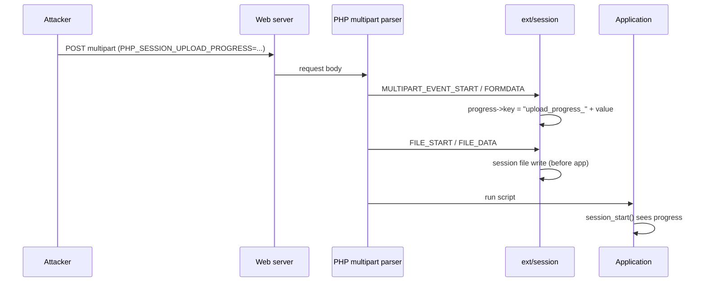

# PHP2SHELLという悪夢の再来を検証してみる

## 記事を書くに当たって

`article-creater` スキルを読んでから書いてください。骨格（エピグラフ → この記事の結論 → 採番した本文）と
frontmatter の決まり、一次ソースの当たり方がそこにまとまっています。
記事はスライドの各セクションごとに増量し、技術的側面を追加して書くことを意識してください。
記事の中では画像を使うことはできません。mermaid などで図を作ることはできます。
https://zenn.dev/meijin/articles/tech-article-output-recommend を参考にしてください。

**今回の追記（重要）**

- このデッキには `sandbox/` に検証環境・攻撃スクリプト・実行レポートがあります。
  記事・スライドはこの結果を引用してください。
- 記事本文には**ターンキーな攻撃手順やコピペ可能なペイロードを貼らない**でください。
  メカニズム、観測結果、防御への含意を書きます。完全版は `sandbox/` を参照する形にします。
- `sandbox/lfi-demo/` は**意図的に脆弱なローカル専用アプリ**です。外部に公開しない前提です。
- 共有された影響調査レポートには内部アプリ名・認証情報のキー名などが含まれるため、
  記事・スライドでは**固有の名前を出さず**、「PHP 5.6.40 の Web アプリ」のような一般化をします。

## 記事・スライド共通ドラフト

> 調査時点: 2026-10-21 17:50 JST（公式パッチ公開 23:00 JST の前）
> 一次ソース: `references.md`、`sandbox/ANALYSIS.md`、`sandbox/report/REPORT.md`、
> `sandbox/attacker/README.md`、`sandbox/report/evidence/`
> 本ドラフトは「公式が確定した事実」「二次・研究者の主張」「公開 PoC の主張」「自ラボの検証」を
> 混ぜないことを最優先にしています。

### 0. この記事の結論（先に）

現時点で言えることを、強さの順に分けます。

| 層 | 言えること |
| --- | --- |
| 公式が確定 | 2026-10-21 23:00 JST に、Critical 2 件（CVSS v4.0 9.2）のセキュリティリリースを予定。CVE 番号・原因・影響バージョン・修正版は**まだ公式未公開**。 |
| 研究者・リークの主張 | `session.upload_progress` の heap UAF、`php_session_rfc1867_callback`、PHP 5.4+ 影響、RCE。CVE-2026-109618 / 109619。 |
| 公開 PoC の主張 | 「618/619 で UAF → `zend_call_function` → RCE」。`status: weaponized (lab)`。 |
| 自ラボの検証 | 公開 PoC 618/619 は **8.4.4 / 8.5.4 ASAN、5.6.40、ASLR 無効、毒 call アドレスでも UAF/RCE を再現せず**。一方、`session.upload_progress` の書き込み primitive + アプリ側 LFI の鎖は **再現した**。 |

この記事の結論:

1. **「PHP コアだけで万能に RCE」という公開 PoC の主張は、少なくともそのままでは再現しない。**
   公開バンドル自身の `VALIDATION.md` も「ASAN crash はローカルで未観測」と明記している。
2. **ただし `session.upload_progress` は、アプリ実行前にセッションファイルへ書き込む強力な primitive。**
   アプリ側に LFI（またはセッションファイルを読む sink）があると、**未認証で RCE** まで到達する。
3. したがって現時点の理解は「**multipart upload 周りの primitive + アプリ側の別脆弱性**」の鎖。
   PHP コアの UAF が本当にあるかは、**公式パッチの差分を見るまで確定しない**。
4. 対策は「`enabled=Off` だけ」「`cleanup=1` だけ」「`use_strict_mode=1` だけ」では不十分。
   **パッチ + 設定 + アプリ側 sink の除去**を分けて考える必要がある。

> 公式パッチ後にこの節を更新する。公開 PoC が正しかった場合は「再現しなかった」を撤回し、
> 逆に公開 PoC が誤りだった場合は、その誤りを隠さず書く。

---

### 1. つかみ：何が起きたのか

**スライドの枚数: 2〜3 枚**

- 10/20、PHP 公式が「重大 2 件、10/21 23:00 JST に出す」と**予告だけ**した。
- 予告より先に、SNS / HN / 研究者の間で情報が漏れた。CVE 番号、`session.upload_progress`、
  「PHP 5.4 以降」「CVSS 10.0」などが混在した。
- 公式が言ったのは「2 件」「critical」「CVSS v4.0 9.2」「日時」だけ。
  **CVE 番号も "RCE" も "Session Upload Progress" も公式の文面にはない。**
- タイトルの「悪夢の再来」は、PHP の RCE 騒動の既視感。ただし今回は**中身が分からないまま
  先にリークが走った**という順序の異常さが主題。

**記事の視点**

- 速報ではなく「**誰が何を確定させたのか**」を分離する。
- そのうえで「公開 PoC は本当に動くのか」「設定でどこまで止まるのか」を自分のラボで確かめる。

---

### 2. 公式は何を確定させ、何を言っていないのか

**スライドの枚数: 2 枚**

公式予告の事実:

- 2026-10-21 14:00 UTC（23:00 JST）にセキュリティリリース。
- Critical 2 件、いずれも CVSS v4.0 9.2。
- 詳細・影響バージョン・修正版はリリース時に公開。
- 詳細が公開された場合、または active exploitation が見られた場合、前倒しする可能性がある。

公式が**言っていない**こと:

- CVE-2026-109618 / 109619 という番号。
- 「RCE である」という分類。
- 「`session.upload_progress` が原因」という特定。
- 影響バージョン（PHP 5.4+ はリークの主張）。
- 修正版番号（8.5.12 / 8.4.27 / 8.3.36 / 8.2.35 は未確認の推測）。
- 攻撃条件（認証要否、SAPI、設定）。

**表: 3 分類 + 自ラボ**

| 項目 | 公式 | 研究者・リーク | 自ラボ |
| --- | --- | --- | --- |
| 2 件 / CVSS 9.2 / 日時 | ✅ | ✅ | — |
| CVE 番号 | ❌ 未記載 | ⚠️ 主張 | — |
| RCE | ❌ 未記載 | ⚠️ 主張 | コア UAF は再現せず |
| Session Upload Progress | ❌ 未記載 | ⚠️ 主張 | primitive は確認 |
| PHP 5.4+ | ❌ 未記載 | ⚠️ リーク | 5.6.40 で primitive は確認 |
| 修正版番号 | ❌ 未公開 | ⬜ 推測 | 未検証 |
| 公開 PoC の RCE | — | ⚠️ 主張 | **再現せず** |

**スライドの見せ方**

- 公式文面の 4 行をそのまま引用し、**書かれていない単語**を赤で並べる。
- 「CVSS 10.0」はリーク側の数字、公式は 9.2。ここだけでも情報の混線が分かる。

---

### 3. Session Upload Progress とは何だったのか

**スライドの枚数: 2〜3 枚**

本来の仕様:

- `multipart/form-data` の POST に `PHP_SESSION_UPLOAD_PROGRESS` フィールドを入れると、
  PHP がアップロード進捗を `$_SESSION["upload_progress_<値>"]` に書く。
- 進捗には `start_time`、`content_length`、`bytes_processed`、`done`、`files[]` が入る。
- **アプリのスクリプトが動く前**、PHP が POST を解析している最中に書かれる。
  → アプリの認証より手前で動く。ここが最大のポイント。
- `session.upload_progress.enabled` の既定は **On**（ソースで `"1"` を確認）。
- `session.upload_progress.cleanup` の既定は **On**（リクエスト終了時に進捗を削除）。
- `session.use_strict_mode` の既定は **0**（攻撃者が SID を指定できる）。

**mermaid の流れ図**



**記事のポイント**

- 「アプリが進捗機能を使っているか」とは無関係。PHP エンジンが POST 解析中に勝手に動く。
- だから「アプリ側のコードが安全なら関係ない」とは言えない。

---

### 4. php-src を読む：コールバックとパーサの 2 層構造

**スライドの枚数: 3〜4 枚（ここが技術の山）**

読むファイル:

- `main/rfc1867.c` — multipart パーサ本体。
- `ext/session/session.c` — 進捗コールバックとセッション書き込み。

押さえる点:

1. `php_rfc1867_callback` はグローバルな関数ポインタ。
   `rfc1867.c` の各イベント（START / FORMDATA / FILE_START / FILE_DATA / FILE_END / END）で呼ばれる。
2. `ext/session` は MINIT で `php_rfc1867_callback = php_session_rfc1867_callback;` と登録し、
   パーサに相乗りする。
3. コールバックの先頭に `if (!PS(rfc1867_enabled)) return retval;` がある。
   → `session.upload_progress.enabled=0` で止まるのは**このコールバック側だけ**。
4. `main/rfc1867.c` のパーサ本体は、設定に関係なく multipart POST で走る。
5. `FORMDATA` で `progress->key = prefix + value` を作り、
   `php_session_rfc1867_update()` が `php_session_initialize()` → `zend_hash_update()` →
   `php_session_flush()` で **アプリ実行前に** `sess_<PHPSESSID>` を書く。
6. `php_session_rfc1867_early_find_sid()` は Cookie / GET の `PHPSESSID` を先に読む。
   `use_strict_mode=0` なら攻撃者が SID を選べる。

**ここで止めること**

- 「だから 2 件目の脆弱性はパーサ本体にある」とは**書かない**。それは研究者の主張で、
  公式パッチ前には確定していない。
- 言えるのは「**設定で止まるのは session コールバック側だけ**」という構造まで。

---

### 5. 公開 PoC の「コア UAF」を検証する（再現しなかった）

**スライドの枚数: 3 枚**

公開バンドル `Zer061/CVE-2026-109618` の主張:

- `php_session_rfc1867_progress` が 2 つの `zval *`（`post_bytes_processed` /
  `current_file_bytes_processed`）をキャッシュする。
- 2 回目の `update()` で session file を再デコードし、`track_init` / `zend_hash_update` が
  前のツリーを `zval_ptr_dtor` で壊す。stale pointer が解放済みバケットを指す。
- 149 個の `t[]` で reclaim し、偽造 `zend_fcall_info` から `zend_call_function` → `system()`。

自ラボの結果:

- PHP 8.4.4 ASAN + `USE_ZEND_ALLOC=0` で 618/619 を送信。
- `bytes_processed=258` の進捗ストア経路には到達する。
- しかし **ASAN レポートなし、`uid=` なし、ワーカー異常終了なし**。
- PHP 8.5.4 ASAN（公開 PoC の `DELTA_CALL` が想定するビルド）でも同じ。
- PHP 5.6.40 でも同じ（非 ASAN）。
- ASLR を無効化し、`zend_call_function` の実アドレスを渡しても同じ。
- 偽造レコードの call 先を毒アドレス `0x4141414141414141` にしてもクラッシュしない。
  → stale pointer が関数ポインタとして使われている形跡がない。

**ソース計測で分かったこと**

- `post_bytes_processed` が指すのは `progress->data` 内の zval。
  `progress` 自身が参照を持つため、更新中は生存している。
- `track_init` / `zend_hash_update` が解放するのは、**セッションからデコードされたコピー**。
- `update()` の `post` 読み取りは `php_session_initialize()` の**前**にあり、解放はその後。
- `MULTIPART_EVENT_END` の `force=1` 更新は読み取り自体をスキップする。
- `current_file_bytes_processed` も `files[]` が配列を保持し、`FILE_END` の更新は既存キーの更新。

→ 公開バンドルの「解放済みバケットを stale pointer が読む」順序になっていない。
   これは同バンドルの `VALIDATION.md` が「ASAN crash はローカルで未観測」と書いていることと一致する。

**公開情報の注意点**

- ツイートの画像は、公開バンドルの `REPORT_VALIDATION.md` の**機構説明のスクリーンショット**。
  `uid=` や ASAN レポートの実行証跡ではない。
- ページの `status: weaponized (lab)` と "verified" は自己申告。同梱の `VALIDATION.md` は
  「ASAN crash 未観測」と明記している。
- 配布 tarball は、ページ記載の SHA-256 と実ファイルが一致しなかった（`a29d…` vs `0c254d…`）。
  コードは GitHub ミラーと同一だったが、実行するならコミットを固定する。

**スライドの見せ方**

- 「公開 PoC の主張」と「自ラボの観測」を左右に並べる。
- 観測の証拠は `sandbox/report/evidence/01_public_poc.txt` の 1 画面で足りる。
- 「再現しなかった」＝「CVE が存在しない」ではない、と明記する。

---

### 6. 実際に成立する鎖：multipart + LFI

**スライドの枚数: 4 枚（ここが今回の成果）**

公開 PoC のコア UAF は再現しなかったが、**`session.upload_progress` の primitive と
アプリ側 LFI を組み合わせる鎖**は再現した。

**攻撃の流れ**

1. 攻撃者が `PHPSESSID` を決める（`use_strict_mode=0`）。
2. `PHP_SESSION_UPLOAD_PROGRESS` に PHP コードを入れる。
3. PHP がアプリ実行前に `sess_<PHPSESSID>` へシリアライズして書き込む。
4. アプリの LFI が `sess_<PHPSESSID>` を `include` する。
5. キー文字列内の `<?php ... ?>` が実行される。

**実測結果**

| 実験 | 結果 |
| --- | --- |
| `cleanup=0` の LFI（8087） | `uid=33(www-data)` |
| `cleanup=1`（既定）のレース（8088） | 3/3 で `uid=33(www-data)` |
| `enabled=0` + `$_FILES['f']['tmp_name']` include（8089） | `uid=33(www-data)` |
| `use_strict_mode=1` + 攻撃者指定 SID（8090） | 失敗 |
| `use_strict_mode=1` + `Set-Cookie` 追従（8090） | `uid=33(www-data)` |
| mod_php（php:8.4.4-apache、8091） | `uid=33(www-data)` |

**証跡**

- `sandbox/report/REPORT.md` / `index.html`
- `sandbox/report/evidence/02_lfi_cleanup0.txt`
- `sandbox/report/evidence/03_race_cleanup1.txt`
- `sandbox/report/evidence/04_enabled0_temp_include.txt`
- `sandbox/report/evidence/06_strict_follow_cookie.txt`
- `sandbox/report/evidence/07_modphp.txt`
- `sandbox/report/evidence/08_nginx_access.log`
- `sandbox/report/evidence/09_session_files_vuln.txt`

**「後何個かの脆弱性」の正体**

- アプリ側の **LFI / セッションファイルを読む sink**（必須）。
- `session.use_strict_mode=0` による **SID 固定**。
- `cleanup=1` の場合は**アップロード中のレース**。
- `session.save_path` の**予測可能な場所**。
- `enabled=0` でも残る **multipart の一時ファイル**と、それを include する sink。

**記事の注意**

- これは「PHP コアだけで万能 RCE」ではない。**アプリ側の sink が必要**。
- 完全なペイロードは記事に貼らず、`sandbox/` を参照する。
- 「公開 PoC の UAF」と「今回再現した LFI 鎖」を混ぜない。

---

### 7. 既定設定でのレース、enabled=0、strict mode の意味

**スライドの枚数: 3 枚**

- **`cleanup=1` は十分ではない**。終了時に消すだけなので、アップロードを遅くして
  その間に LFI を叩けばよい。FPM の `FILLUNIT=5120` を満たす初回チャンク（6000B）を送り、
  1.5 秒 stall すると 3/3 で成立した。
- **`enabled=0` は session 書き込みを止めるが、multipart のアップロードと一時ファイルは残る**。
  アプリが `$_FILES['f']['tmp_name']` を include するなら、別の RCE 経路になる。
- **`use_strict_mode=1` は SID を選ばせないだけ**。progress の書き込みは続き、
  新しい SID はアップロード応答の `Set-Cookie` に出る。応答を読める状況では追従される。
- **mod_php でも成立**。SAPI 非依存の鎖。

**スライドの見せ方**

- 「対策の強さ」を 3 段で並べる:
  1. `enabled=Off`（session primitive を止める）
  2. パッチ（コアの原因を直す）
  3. アプリ側 sink の除去 / 一時ファイル include の禁止 / WAF
- 「これで安全」と言い切らない。何を止められて、何が残るかを表にする。

---

### 8. 共有された影響調査レポートをどう読むか

**スライドの枚数: 1〜2 枚**

> 固有のアプリ名・会社名・認証情報のキー名は出さない。一般化して扱う。

レポートの良い点:

- 対象が **PHP 5.6.40（EOL）** で、公式修正の対象外であることを明確にしている。
- `session` 拡張が入っている、`upload_progress` が既定 On、`file_uploads` が On、
  全リクエストが PHP に到達する、という**露出条件の整理**ができている。
- 影響を「RCE が成立した場合のブラストラディウス」として条件付きで書いている。
- 対策の優先順位（機能無効化 → WAF → 公式照合 → PHP 移行）が実務的。

レポートで注意すべき点:

- 「`enabled=Off` で脆弱なコードパスは不実行」は **session コールバック側だけ**。
  multipart パーサ本体と一時ファイルは残る。本ラボの `enabled=0` + temp include が反例。
- 「RCE である」は研究者・リークの主張で、公式未確認。レポート自身も確度「中」としている。
- 「PHP 5.6 も影響」はリークの主張。公式の影響バージョンはパッチ公開後に確認。
- レポートに LFI の記載がない場合、**そのレポートだけでは RCE の成立を証明しない**。
  本ラボの鎖は「アプリ側 LFI」が前提。
- 内部アプリ名・秘密情報のキー名を含むため、**公開リポジトリにそのままコミットしない**。

**記事での扱い**

- 「共有された影響調査レポートでは、PHP 5.6.40 の Web アプリで露出条件が揃っていた」
  という事実に留める。
- 「RCE が確認された」とは書かない。あくまで「RCE が成立した場合の影響評価」。
- 固有の情報は一般化し、必要なら「決済系の秘密情報を扱う構成」程度にする。

---

### 9. 緩和策の強弱

**スライドの枚数: 2 枚**

| 対策 | 止められるもの | 残るもの |
| --- | --- | --- |
| `session.upload_progress.enabled=Off` | session への進捗書き込み | multipart のアップロード / 一時ファイル |
| `session.upload_progress.cleanup=1` | 終了後の進捗 | アップロード中のレース |
| `session.use_strict_mode=1` | 攻撃者による SID 指定 | 応答の `Set-Cookie` を読める場合の追従 |
| WAF / multipart 制限 | 一部の自動攻撃 | 正常なアップロード、別 SAPI、別 sink |
| パッチ | コアの原因（公式が特定したもの） | アプリ側 LFI / 設定不備 |
| 最小権限・隔離 | 侵害後の被害拡大 | RCE 自体 |

**記事の結論**

- 「設定を 1 つ入れて終わり」にしない。
- **パッチ / 設定 / アプリ側 sink の除去 / 被害局限**を分けて運用する。
- 特に「`enabled=Off` は session primitive には効くが、multipart と一時ファイルは残る」
  という点を、本ラボの `enabled=0` 実験で示す。

---

### 10. パッチ後に確定すること

**スライドの枚数: 1〜2 枚（23:00 JST 以降に更新）**

- 公式アドバイザリ本文: CVE 番号、影響バージョン、修正版、原因、攻撃条件。
- 修正コミットの diff: `ext/session/session.c` / `main/rfc1867.c` のどこが変わったか。
- 公開 PoC の主張が正しかったか:
  - 本当に `post_bytes_processed` / `current_file_bytes_processed` の UAF だったか。
  - それとも別の原因か。
  - 本ラボの「再現しなかった」は、ビルド・SAPI・設定の違いで説明できるか。
- `compose.patched.yaml` の `PATCHED_VERSION` を公式修正版に変え、
  同じ trigger / PoC / LFI 鎖を 8082 で再実行する。
- `references.md` の ⚠️/⬜ を ✅/❌ に更新する。

**もし公開 PoC が誤りだった場合**

- その誤りを隠さない。「公開 PoC はソース行の確認までで、RCE の再現証明ではなかった」
  と書く。これは記事の価値を下げるどころか、**検証記事としての信頼**を上げる。

---

### 11. まとめ：PHP 開発者が持ち帰れること

**スライドの枚数: 2 枚**

- アプリ層の安全性（SQLi / XSS / 認証）と、**ランタイム層**の安全性は別物。
- 自分のコードが 1 行も悪くなくても、**リクエストがアプリに届く前**に壊れることがある。
- `session.upload_progress` のように「デフォルトで有効な便利機能」が、
  アプリ側の LFI と組み合わさると RCE になる。
- 「設定で回避」と「パッチで修正」と「アプリ側 sink の除去」を混同しない。
- 公式が何を確定し、何を言っていないかを分けて運用判断する。
   Embargo 中の情報に振り回されない。

---

### 付録 A. 検証環境と証跡

| 項目 | 内容 |
| --- | --- |
| ラボ | `sandbox/compose.yaml` |
| PHP | 8.4.4 ASAN（`USE_ZEND_ALLOC=0`）、8.5.4 ASAN、5.6.40 |
| Web | nginx 1.31.7、php-fpm、mod_php（`php:8.4.4-apache`） |
| レポート | `sandbox/report/REPORT.md` / `index.html` |
| 生ログ | `sandbox/report/evidence/` |
| 解析 | `sandbox/ANALYSIS.md` |
| 攻撃スクリプト | `sandbox/attacker/`（`README.md` に詳細） |

再実行:

```sh
cd sandbox
./report/run_repro.sh
```

主な証跡:

- `evidence/01_public_poc.txt` — 公開 PoC は UAF/RCE なし
- `evidence/02_lfi_cleanup0.txt` — `cleanup=0` の LFI 成功
- `evidence/03_race_cleanup1.txt` — `cleanup=1` のレース 3/3
- `evidence/04_enabled0_temp_include.txt` — `enabled=0` の一時ファイル include
- `evidence/05_strict_chosen_sid.txt` / `06_strict_follow_cookie.txt`
- `evidence/07_modphp.txt`
- `evidence/08_nginx_access.log` — `POST /index.php` → `GET ...file=/tmp/sess_...&0=id`
- `evidence/09_session_files_vuln.txt` — `upload_progress_<?php ...?>` の実体

---

### 付録 B. スライドと記事の対応

| 節 | スライド | 記事 |
| --- | --- | --- |
| 1. つかみ | 2〜3 枚 | 冒頭・問題提起 |
| 2. 公式/リーク/検証の分離 | 2 枚 | 一次情報の整理 |
| 3. Session Upload Progress の正常動作 | 2〜3 枚 | 前提技術 |
| 4. php-src の 2 層構造 | 3〜4 枚 | ソースリーディング |
| 5. 公開 PoC の検証（再現せず） | 3 枚 | 独自検証 1 |
| 6. multipart + LFI の鎖 | 4 枚 | 独自検証 2 |
| 7. cleanup / enabled=0 / strict / mod_php | 3 枚 | 検証の深掘り |
| 8. 共有影響調査レポート | 1〜2 枚 | 実務への含意 |
| 9. 緩和策の強弱 | 2 枚 | 防御の整理 |
| 10. パッチ後に確定 | 1〜2 枚 | 更新節 |
| 11. まとめ | 2 枚 | 結論 |

---

### 付録 C. 書くときの注意（再掲）

- **公式 / 二次 / リーク / 自ラボ**を混ぜない。`references.md` の判定記号を確認する。
- 公開 PoC のコア UAF は**再現していない**。「再現成功」と書かない。
- 実際に再現したのは **multipart + LFI** の鎖。アプリ側 sink が必要。
- 記事にターンキーな攻撃手順・ペイロードを貼らない。`sandbox/` を参照する。
- 共有レポートの固有アプリ名・秘密情報のキー名を出さない。
- 画像は使わず、mermaid で処理フローと 2 層構造を描く。
- 23:00 JST 以降に公式情報で更新する。予想が外れたら外れたと書く。
