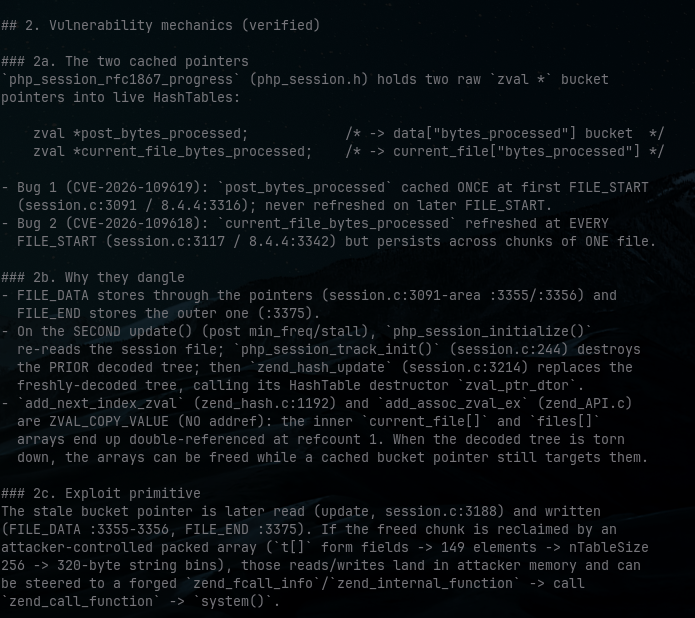

::title::

# PHP2SHELLという悪夢の再来を検証してみる

tanahiro2010

2026-10-21 ・ 公式パッチ公開の前に

---

::center size=1.5 bg=white::

予告

---

::center::

2026年10月20日

---

## 公式の予告

- 10月21日 14:00 UTC にセキュリティリリース
- Critical **2件**、いずれも CVSS v4.0 **9.2**
- 詳細・影響バージョン・修正版はリリース時に公開

-# php.net/archive/2026

---

::center::

書いてあったのは、たった4行

---

## 公式が言っていないこと

- CVE番号
- 「RCEである」という分類
- 「session.upload_progress が原因」という特定
- 影響バージョンも修正版番号も、まだ何も無い

---

::center::

中身は分からない

---

::center::

なのにリークが先に走った

---

::center::

PHP2SHELL

---

::center size=1.5 bg=white::

混線

---

## 流れている情報

- CVE-2026-109618 / 109619 という番号
- 原因は Session Upload Progress のメモリ破壊
- 影響は PHP 5.4 以降すべて

-# SNS / HN / 研究者

---

::center::

どれも公式ではない

---

## 重大度すら割れている

- 公式 → CVSS v4.0 **9.2**
- watchTowr CEO → "Both of them are **CVSS 10**"
- 同じ脆弱性の数字が、違う値で流通している

-# BleepingComputer

---

::center::

誰が、何を確定させた？？

---

## 4つの層に分ける

- 公式が確定させたこと
- 研究者・リークの主張
- 公開PoCの主張
- 自分のラボの検証

---

::center size=1.5 bg=white::

機構

---

## Session Upload Progress

- multipartのPOSTに特定フィールドを入れると
- PHPがアップロード進捗をセッションに書く
- enabled の既定は **On**

---

::center::

いつ動く？？

---

::center::

アプリが走る前

---

## アプリの手前で動く

- PHPがPOSTを解析している最中に書かれる
- アプリの認証より手前で動く
- だから「自分のコードが安全」では済まない

---

## php-src を読む

- main/rfc1867.c → multipartパーサ本体
- ext/session/session.c → 進捗コールバック
- sessionがパーサにフックして相乗りしている

---

## 設定で止まるのはどこか

```c
// ext/session/session.c
static int php_session_rfc1867_callback(...) {
    if (!PS(rfc1867_enabled)) {
        return retval;  // enabled=0 で止まるのはここだけ
    }
    // ... セッションへ進捗を書き込む
}
```

---

## 止まらないところ

- パーサ本体は設定に関係なく走る
- multipartの一時ファイルは残る
- 止まるのは session コールバック側だけ

---

::center::

enabled を切っても、全部は止まらない

---

::center size=1.5 bg=white::

検証

---

::center::

公開PoCは、本当に動くのか？？

---

## 公開PoCの主張

- 2つの zval キャッシュが2回目の update で壊れる
- stale pointer が解放済みバケットを指す
- そこから zend_call_function → system() で RCE

---

::center::



---

## 自分のラボで送ってみた

- PHP 8.4.4 / 8.5.4 を ASAN ビルドで用意
- PHP **5.6.40** も用意
- 公開PoC 618/619 をそのまま送信

---

::center::

再現しなかった

---

## 何も起きない

- ASANレポートなし
- ワーカーの異常終了なし
- call先を毒アドレスにしてもクラッシュしない

---

## なぜ再現しないか

- post側の読み取りは初期化の前
- 解放されるのはセッションからデコードしたコピー
- 「解放済みバケットをstale pointerが読む」順序になっていない

---

::center::

PoC自身も認めている

---

## VALIDATION.md

- 同梱のファイルに「ASAN crash はローカルで未観測」
- ツイート画像は機構説明のスクショ、実行証跡ではない
- status: weaponized は自己申告

---

::center::

再現せず ≠ CVEが無い

---

::center size=1.5 bg=white::

鎖

---

::center::

でも、別の道があった

---

## multipart + LFI

- session.upload_progress の書き込みは強力な primitive
- アプリ側にLFIがあると組み合わさる
- 未認証でRCEまで届いた

---

## 鎖の流れ

- 攻撃者が PHPSESSID を決める
- 進捗フィールドにPHPコードを入れる
- PHPがアプリ実行前に sess_ ファイルへ書く
- アプリのLFIがそのファイルを include して実行

---

## 実測結果

- cleanup=0 のLFI → **uid=33(www-data)**
- enabled=0 + 一時ファイル include → **uid=33(www-data)**
- mod_php でも → **uid=33(www-data)**

---

::center::

設定では止まらない

---

## cleanup=1 でも

- 終了時に消すだけ
- アップロードを遅くして 1.5 秒 stall させる
- その間にLFIを叩くと **3/3** で成立

---

## enabled=0 でも

- session書き込みは止まる
- multipartのアップロードと一時ファイルは残る
- tmp_name を include する sink があれば別経路

---

## use_strict_mode=1 でも

- SIDを選ばせないだけ
- 進捗の書き込み自体は続く
- 新しいSIDは応答の Set-Cookie に出る → 読めれば追従

---

::center size=1.5 bg=white::

対策

---

## 緩和策の強弱

- enabled=Off → primitiveは止まる / 一時ファイルは残る
- use_strict_mode=1 → SID固定は防ぐ / Set-Cookie追従は残る
- パッチ → コアの原因 / アプリ側LFIは残る

---

## パッチ後に確定すること

- 公式のCVE番号・影響バージョン・原因・攻撃条件
- 修正コミットのdiffがどこを直したか
- 公開PoCの主張が正しかったか

---

## 持ち帰れること

- アプリ層の安全性とランタイム層の安全性は別物
- 自分のコードが1行も悪くなくても、届く前に壊れる
- 「設定で回避」「パッチで修正」「sinkの除去」を混同しない

---

## まとめ

- 予告 → 中身が分からないまま先にリークが走った
- 混線 → 公式9.2とwatchTowr10.0で数字が割れた
- 機構 → アプリ実行前に動く書き込みprimitive
- 検証 → コアのUAFはそのままでは再現せず
- 鎖 → multipart primitive + アプリ側LFI は成立した
- 対策 → 設定ひとつでは止まらない

---

::center size=1.5::

ありがとうございました

---

::center bg=white::

One more thing

---

::center::

23:00 JST、公式パッチが出る

---

::center::

そのとき、この結論を更新する

---

::center::

もし間違っていたら、隠さず撤回する

