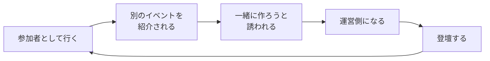

# コミュニティ活動のすゝめ――学校の外に、もうひとつの世界を

> 学校の外に、世界があるのを知っていますか？

## この記事の結論

高校生の生活圏は、教室と部活と家で、だいたい半径数キロに収まります。その外に出る入口がコミュニティです。参加してみた結果、気づいたら運営側にいて、登壇もしていました。

- コミュニティの一番の価値は、**学校・学年・年齢・職業という枠組みが関係なくなる**こと
- 「運営する人」だけがコミュニティ活動ではない。参加する、聞く、交流する、発表する、全部そう
- 進路に効くこともある。ただし**効くのは肩書きではなく経験の中身**

やったことと、そこから生まれたものを並べるとこうなります。

| 時期 | やったこと | そこから生まれたもの |
| --- | --- | --- |
| 最初 | イベントに参加しただけ | 別のイベントを紹介される |
| 次 | 紹介された場に顔を出す | 一緒に作ろうと誘われる |
| 気づいたら | GDG Greater Kwansai で運営 | Hono Conference で登壇・運営 |
| 今回 | 文化祭 LT 会を企画 | 登壇者も協力者も、学校の外で出会った人 |

そして、この記事で一番伝えたいことを先に書いておきます。

**何者かになってから参加する必要はありません。何者でもない自分のまま参加していいです。** コミュニティは実績のある人が行く場所だと思われがちですが、初心者向けのイベントはありますし、「興味がある」だけで参加できる場所もあります。自分から話しかける必要も、知識を披露する必要もありません。まずは聞くだけでいい。その一歩を踏み出すかどうかだけが、他の全部より先にあります。

> この記事は文化祭 LT 会「知らない世界の話をしよう」の登壇内容に、発表では触れなかった総合型選抜まわりの一次資料と、LT 会の準備で実際に詰まったところを足したものです。対象は、学校の外の活動に興味はあるけどまだ踏み出せていない高校生です。

---

## 1. 最初に、謝ることがあります

今日の LT 会「知らない世界の話をしよう」は、僕が企画しました。

そして、自分で自分を登壇者にしました。

温かい目で読んでください。

……という自己紹介から入るくらいには、この話は「自分でやってしまった」側の話です。参加者として外に出た人間が、どうやって企画する側に回ったのか。その流れを順番に書いていきます。

## 2. 高校生の世界は、だいたい半径数キロ

高校生の生活は、教室に行って、部活に出て、家に帰る。この繰り返しです。

行動範囲で言えば、だいたい半径数キロに収まります。

でも、その外には、自分と同じものを好きな人がいます。自分にはない知識を持っている人がいます。自分の考え方を変えてくれる人がいます。

その入口がコミュニティです。

## 3. コミュニティとは何か

共通の趣味・興味・目標を持つ人の集まりのことです。

技術系だけではありません。音楽、ゲーム、小説、イラスト、スポーツ、研究、地域活動。分野の数だけ存在しています。

### 一番すごいのは、枠組みを超えられること

コミュニティでは、次のものが関係なくなります。

- 学校
- 学年
- 年齢
- 職業

高校生も、大学生も、社会人も、研究者も、共通の興味があれば対等な仲間として話せます。学校生活では、同年代の生徒と先生以外に接点を持つ機会がほとんどありません。そこが決定的に違います。

### よくある誤解：「運営する人」だけがコミュニティ活動ではない

これも全部、コミュニティ活動です。

- イベントに**参加する**
- 誰かの話を**聞く**
- **交流する**
- 自分の作品を**発表する**
- 一緒に何かを**作る**

参加する側でも、作る側でもいい。入口の広さは、ここで思っているより広いです。

## 4. なぜやるのか——楽しいから

進学のため、就職のためではありません。

楽しいからです。

学校だと、そもそも同じ趣味の人がいないことがあります。「Hono の話ができる人、クラスにいますか？」と聞いて、手が挙がる高校はたぶん多くありません。

でも外に出ると、その話を何時間でもできる人がいます。自分よりはるかに熱中している人がいます。

### 作る側は、もっと楽しい

企画を考えて、協力してくれる人を集めて、一つのイベントが完成する。

準備は、正直しんどいです。

でも当日、自分たちが作った場で参加者が楽しんでいる光景を見るのは、他で代えがきかない経験でした。

成果を出すためにやるものではありません。楽しいから参加する。それだけで十分な理由になります。

## 5. 人——学校の外に人間関係ができる

コミュニティで出会うのは、こういう人たちです。

- 自分が知らない技術を使いこなしている人
- 面白いサービスを作っている人
- 大きなイベントを運営している人
- 研究に取り組んでいる人

ただ、これは「すごい人と知り合える」という話ではありません。

大事なのは、その人たちが**気軽に話せる相手**になることです。

- 困ったときに相談できる
- 挑戦したときにアドバイスをもらえる
- お互いの活動を応援し合える

自分にはない視点が身近にあると、自分の考え方と行動が変わっていきます。自分の知らない世界を当たり前に生きている人と仲良くなれること。これが一番大きい見返りでした。

## 6. 機会——気づいたら運営側にいた

人とつながると、機会が降ってきます。

全部の機会を、自分で探してくる必要はありません。ひとりでは存在すら知らなかった選択肢が、人づてに見えてきます。

そして、挑戦を応援してくれる人がいます。ひとりでは無理でも、経験や知識を持つ人に協力してもらえば実現できることがあります。

今回の文化祭 LT 会がまさにそれです。登壇者も協力者も、**学校の外で出会った人たち**でした。

一つの出会いが次の挑戦につながり、その挑戦がまた新しい出会いを生む。この循環が、今の自分の活動の土台になっています。

## 7. 進路——要項を読んで確かめた話

ここからは、少し現実的な話です。

「コミュニティ活動は総合型選抜に効く」という話はよく聞きます。ただ、又聞きで断定するのは気持ち悪かったので、文部科学省が出している**大学入学者選抜実施要項**の原文を読みました。

### 「主体性」は、評価する三要素の一つとして明記されている

要項は第 1 の基本方針で、大学が把握すべき「学力の三要素」を次のように定めています。

> ① 基礎的・基本的な知識・技能
> ② 知識・技能を活用して、自ら課題を発見し、その解決に向けて探究し、成果等を表現するために必要な思考力・判断力・表現力等の能力
> ③ **主体性を持ち、多様な人々と協働しつつ学習する態度**

③ がそのまま入っています。これは総合型選抜だけの話ではなく、選抜全般の方針です。

### 総合型選抜では、本人が書いた活動報告書を「必ず」使う

総合型選抜の定義はこうです。

> 一般選抜とは異なる観点や方法により評価を行うという前提のもと、詳細な書類審査と時間をかけた丁寧な面接等を組み合わせることによって、入学志願者の能力・適性や学習に対する意欲、目的意識等を総合的に評価・判定する入試方法。

そのうえで、留意点として次の 2 つが挙がっています。

> 入学志願者自らの意志で出願できる公募制という性格に鑑み、志願者本人の記載する資料（志願者本人が記載する活動報告書、大学入学希望理由書及び学修計画書等）を**必ず**評価に活用する。

> 志望する学問分野に対する意欲や適性等に係る面接（ディベート、集団討論、プレゼンテーション、口頭試問等を含む）による評価を**必ず**行う。

つまり、**活動報告書を書く欄があり、それについて面接で聞かれる**のが制度の前提になっています。書くことが何もないより、あったほうがいいのは確かです。

### ただし、参加しただけでは有利になりません

ここは強調しておきます。

要項が求めているのは「能力・適性や学習に対する意欲、目的意識等の総合的な評価」であって、イベントの参加回数ではありません。大事なのはこちらです。

- どんな課題に向き合ったか
- 何を考えて行動したか
- そこから何を学んだか

肩書きや活動実績の数ではなく、経験の中身です。活動報告書も面接も、そこを書かせ、そこを聞く設計になっています。

なお、**どの大学・学部がどう配点するかまでは要項には書かれていません。** 実際の重み付けは各大学のアドミッション・ポリシーと募集要項によります。志望校のものを読んでください。ここは一次資料で確認できていない部分です。

### 進路の情報そのものも手に入る

制度の話とは別に、実際にその仕事をしている社会人や、大学で研究している学生・研究者から直接話を聞けるのも大きいです。自分の将来を具体的に考える材料が増えます。

好きなことを続けていたら、いつの間にか将来の武器になっていた。そういうこともある、くらいの話です。

## 8. ハードル——何者でもない自分のまま、参加していい

「でも、自分なんて」と思うところだと思います。

コミュニティ＝実績がある人が行く場所、という誤解があります。違います。

- **初心者向け**のイベントがあります
- 「興味がある」だけで参加できる場所があります

やらなくていいことも挙げておきます。

- 自分から話しかける
- 自分の知識を披露する

まずは聞くだけでいいです。慣れてきたら、話しかけてみる、発表してみる、企画を考えてみる。参加者のままでもいいし、運営になってもいい。活動の仕方は人それぞれです。

### 安全の話

ここだけは現実的に確認してください。

- 参加条件
- 年齢制限
- 運営者が信頼できるか

高校生なら、公開イベントや、信頼できる運営者がいる場から始めると安心できます。

## 9. 正直な話——楽なことばかりではありません

ここまでいい話ばかり書いてきましたが、うまくいかないことは普通にあります。

- 人が集まらない
- 予算が足りない
- 計画が思いどおりに進まない
- 人間関係で悩む
- 活動の負担が大きくなる

今回の LT 会の準備でも、詰まったところがありました。

| 詰まったところ | 中身 |
| --- | --- |
| 学校との調整 | 文化祭の企画として通すまでの手続き |
| 予算の確保 | 使える額の範囲で何ができるかを決める |
| 登壇者への連絡 | 日程と内容のすり合わせ |

正直、大変でした。

それでも、問題に向き合う中で学べることがありますし、協力してくれる人のありがたさが実感としてわかります。

そして一番大事なこととして、**無理して続けなくていい**です。学校生活や自分の時間とのバランスを取って、楽しく続けられる範囲で関わればいい。コミュニティ活動は頑張り続ける義務ではなく、自分の世界を広げるための選択肢です。

## 10. なぜ「高校生のうちに」なのか

まだ進路が決まっていない人が多いからです。

だからこそ、いろんな世界を見る意味があります。

- 興味のなかった分野に出会って、やりたいことが変わる
- 社会人の話を聞いて、知らなかった職業を知る
- 好きなことを続けるうちに、新しい目標が生まれる

大人にならないとできないことは確かにあります。でも、高校生だからこそできることもあります。学生の視点で企画を考える、学校の中に新しい活動を生み出す。

たとえば、文化祭で LT 会を開く、とか。

## 11. この LT 会も、コミュニティ活動の一つ

「知らない世界の話をしよう」でやっているのは、こういうことです。

- 普段は話を聞く機会がない人を招く
- それぞれの専門分野や活動を話してもらう
- 参加者は、知らなかった世界を知る
- 登壇者同士・参加者同士にも交流が生まれるかもしれない

こういうイベントは、特別な団体や企業だけのものではありません。学生が企画して、周りに協力してもらえば作れます。

コミュニティは、どこか遠くにある特別なものではありません。今日のこの会場も、その一つです。

## 12. まとめ

コミュニティ活動でできることを並べると、こうなります。

- 進学や就職に役立つ経験が得られることもある
- 刺激をくれる人に出会えることもある
- 新しい挑戦や、思いもよらない機会が生まれることもある

でも、何より大切なのは**楽しいと思えること**です。

進学や就職のためだけに活動する必要はありませんし、大きな実績を残さなければならないわけでもありません。ただ好きだから、面白そうだから、もっと知りたいから。理由はこれで十分です。

わかったことを 3 つにまとめます。

1. コミュニティは**枠組みを超えて**人と出会える場所
2. **何者でもない自分のまま**、参加していい
3. 知らない世界を知ることは、**選択肢を増やすこと**

学校の外には、もうひとつの世界があります。行ってみると、選択肢が増えます。

### おまけ：今日できる、一番簡単なコミュニティ活動

帰る前に、登壇者か、隣の席の人に話しかける。

それだけで、もう始まっています。

### 参考

- [令和９年度大学入学者選抜実施要項](https://www.mext.go.jp/content/20260529-mxt_daigakuc02-000005144_1.pdf)（令和８年５月27日付け ８文科高第318号 文部科学省高等教育局長通知）— 学力の三要素と、総合型選抜で活動報告書・面接を必ず用いる旨
- [令和8年度入学者選抜について](https://www.mext.go.jp/a_menu/koutou/senbatsu/1412102_00011.htm) — 文部科学省の選抜関連ページ
